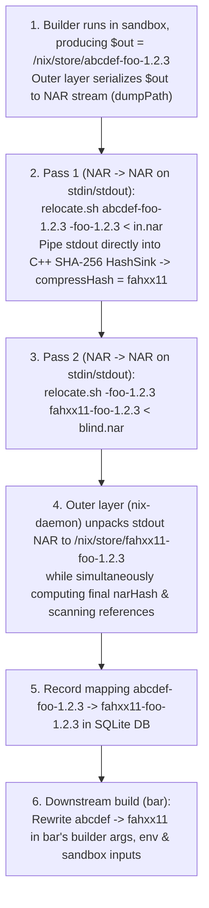

# CASPER: Content-Addressable Store via Partial-blinding and Embedded Relocation

## 1. Overview & Motivation

### 1.1 The Blocker to Output-Addressed Derivations: The Self-Reference Hash Loop
In traditional Nix, derivation outputs are **input-addressed**: a derivation with masked input hash `abcdef...` builds its output directly into `/nix/store/abcdef...-foo-1.2.3`, and that path is registered in the store regardless of the actual bytes produced. Two derivations with different inputs that compile to the exact same output cannot share a store path or short-circuit downstream rebuilds.

Nix has long sought to move to **output-addressed (content-addressed) derivations**, where every built object in `/nix/store` is named by the cryptographic hash of its output contents (`/nix/store/<output-hash>-<name>`). However, **self-referencing outputs** are the natural blocker:
- Over **54.9%** of packages (and **72.2%** by store size; see [empirical-analysis.md](empirical-analysis.md)) embed their own `$out` store path inside their build outputs—in ELF `DT_RUNPATH`s, shebangs, wrapper scripts, `pkg-config` `.pc` files, Python `.pyc` bytecode, and even inside compressed files such as `.gz` manpages.
- During the build, `$out` must already be known so compilers and build scripts can embed `/nix/store/<hash>-<name>` into binaries and data files.
- Yet if `<hash>` is the cryptographic hash of the output, then the output's contents must contain `<hash>` before `<hash>` can be computed—an **unsolvable cryptographic hash loop**:
  $$H = \text{Hash}\big(\text{output containing } \texttt{/nix/store/} \parallel H \parallel \texttt{-foo}\big)$$

### 1.2 Why Store Symlinks Are Not Enough
One way to sidestep the self-reference loop without rewriting package contents is to build in the original input-addressed path `/nix/store/<input-hash>-<name>`, move the result to `/nix/store/<output-hash>-<name>`, and replace the original input-addressed path `/nix/store/<input-hash>-<name>` with a **symlink** to `/nix/store/<output-hash>-<name>`.
- **Why this is undesirable**:
  1. **Double Filesystem Lookups on Every Access**: Every `execve`, shared library load (`openat` via `DT_RUNPATH`), header include, or file read through `/nix/store/<input-hash>-<name>` requires **two filesystem lookups** (first resolving the input-hash symlink, then traversing the target output-addressed directory). On cold storage, spinning disks, overlayfs, or network/remote stores, doubling every filesystem lookup slows down execution and builds considerably.
  2. **Leaky Input-Hash Pollution**: Binaries still embed `<input-hash>` rather than `<output-hash>`, so two builds producing identical functional content still differ at the byte level in their embedded paths, and `/nix/store` accumulates permanent symlink stubs for every historical input hash.

### 1.3 The CASPER Approach: Partial Blinding & Embedded Relocation

**CASPER (Content-Addressable Store via Partial-blinding and Embedded Relocation)** resolves the self-reference hash loop directly through two core ideas:

1. **Breaking the Hash Loop via Partial Blinding**:
   - Whenever a payload must embed a cryptographic hash or signature of itself, standard cryptographic protocols break the circularity by computing the digest over a **blinded** representation of the payload in which the hash/signature slot is either stripped or overwritten with a fixed placeholder (such as all zeros or `xxxx...`):
     - In **cryptocurrency transactions** (e.g., Bitcoin's `SIGHASH` and Ethereum transaction signing), the `scriptSig` or signature fields are zeroed/blanked before hashing the transaction payload to be signed, and the resulting signature is then placed into those fields.
     - In **signed API requests, JWTs, and XML-DSig / SAML enveloped signatures**, as well as **PE Authenticode binaries**, **RPM/FIT images**, and **IPv4/TCP/ICMP packets**, the embedded signature or checksum field is zeroed out before the hash is computed over the payload.
   - We call this **partial blinding**: only the self-reference slots inside the derivation output are overwritten with a fixed placeholder (while all external dependency references `/nix/store/<dep-hash>-<dep>` remain unblinded).
   - In CASPER, an output's content address `<output-hash>` is defined not as the raw SHA-256 hash of the final output, but as the SHA-256 hash of the **partially blinded** output. Because the placeholder is independent of both `<input-hash>` and `<output-hash>`, the hash loop disappears, and two derivations with different input hashes that produce identical blinded content converge to the exact same `<output-hash>`.

2. **Delegating Partial Blinding & Relocation to the Derivation Itself (Embedded Relocation)**:
   - Why can't Nix simply perform partial blinding in C++ using a naive byte-string search-and-replace? Because in real software packages, self-references are not always stored in uncompressed plaintext. Consider a `.gz`-compressed manpage or archive inside `$out` that embeds `/nix/store/<input-hash>-<name>`: a naive byte-string blinder scanning raw file bytes will never see the reference inside the compressed Deflate bitstream and therefore cannot blind or relocate it.
   - While we could special-case `.gz` files in Nix itself, this is undesirable as so many versions of hidden references could exist. It is up to the software packager to fix those up.
   - CASPER's second invention is to **delegate the task of blinding and relocating self-references to the derivation output itself**, by embedding a relocator (`$out/nix-support/relocate.sh`) inside the output.
   - Crucially, embedding the blinder/relocator inside the output **does not re-introduce the hash loop**: the task of blinding and relocating can be defined **abstractly** (`relocate.sh <old-self> <new-self>`, taking the source and target store-path strings as parameters) without making any concrete reference to `<input-hash>` or `<output-hash>` inside the script itself. Because the relocator's own bytes remain completely invariant across blinding and relocation, it can live inside `$out` and be hashed alongside the rest of the partially blinded output without causing a hash cycle.

---

## 2. Detailed Architecture

### 2.1 End-to-End Operational Pipeline

1. **Evaluation & Build in Input-Hash Path (`<input-hash>-<name>`)**:
   - At evaluation time (`builtins.derivation`), a derivation `foo-1.2.3` still computes its standard 32-character input-addressed path `/nix/store/abcdef...-foo-1.2.3`.
   - No `.` prefix or store symlinks are needed: all store paths remain standard 32-character Nix32 hashes of identical byte length (`32` chars).
   - During the build of `foo`, `$out` is `/nix/store/abcdef...-foo-1.2.3`.
2. **Primary Design: Pure `NAR` $\to$ `NAR` Stream Relocation (`stdin` $\to$ `stdout`) & Outer-Layer Unpacking**:
   - Rather than mutating a live directory tree on the host filesystem, `relocate` (`$out/nix-support/relocate.sh`) is a **`NAR` $\to$ `NAR` stream transformer**: it reads a Nix Archive (NAR) from `stdin`, replaces `<old-self>` with `<new-self>`, and writes the resulting NAR to `stdout`:
     ```sh
     relocate.sh <old-self> <new-self> < input.nar > output.nar
     ```
   - The relocator process needs **zero host filesystem access**; if the outer layer (`nix-daemon`) wants to write the relocated output to `/nix/store/<output-hash>-<name>`, **the outer layer unpacks the NAR from `stdout` itself** (`restorePath`).
   - Blinding is **strictly scoped to self-references** (`<input-hash>-<name>` $\to$ `<blind-hash>-<name>`). Dependency references (`/nix/store/<dep-out-hash>-<dep-name>`) already have their final content-addressed hashes and are never blinded.
   - **Step 2a + 2b (In-Stream Blinding & Content Hashing—Zero Disk Writes)**:
     - The outer layer serializes `$out` into a NAR stream (`dumpPath($out)`), pipes it into `relocate.sh "<input-hash>-<name>" "<blind-hash>-<name>"`, and pipes `stdout` **directly into Nix's C++ SHA-256 `HashSink`** (compressing the digest to 20 bytes / 32 Nix32 chars to obtain `<output-hash>`, e.g. `fahxx11...`).
     - Because self-references were blinded in the NAR stream first (even inside `.gz` entries), two builds with different input hashes that produce the same content yield the **exact same `<output-hash>`** without writing a blinded copy to disk.
   - **Step 2c (In-Stream Relocation + Trusted Outer-Layer NAR Unpacking & Reference Scan)**:
     - The outer layer pipes the NAR through `relocate.sh "<blind-hash>-<name>" "<output-hash>-<name>"` and feeds `stdout` directly into Nix's C++ `TeeSink(RestoreSink("/nix/store/<output-hash>-<name>"), HashAndRefScanSink)`—simultaneously unpacking the final output to `/nix/store/fahxx11...-foo-1.2.3`, computing its final `narHash`/`narSize`, and scanning the final uncompressed NAR stream for store references.
3. **Downstream Dependency Rewriting in Builder Args & Env**:
   - When a downstream derivation `bar` (which depends on `foo`) was evaluated, its `.drv` recorded `foo`'s input-addressed path `/nix/store/abcdef...-foo-1.2.3`.
   - Before `bar` is built, Nix looks up the realised output path of `foo` (`/nix/store/fahxx11...-foo-1.2.3`) and rewrites `abcdef...` -> `fahxx11...` in `bar`'s builder arguments (`drv.args`), environment variables (`drv.env`), structured attrs / extra files, and sandbox `inputPaths`.
   - Thus `bar` builds directly against `/nix/store/fahxx11...-foo-1.2.3`—no symlinks in `/nix/store` are required.



### 2.2 `relocate.sh` as a `NAR` $\to$ `NAR` Stream Transformer (`stdin` $\to$ `stdout`)

#### Core Contract
Instead of mutating a directory tree in place on the host filesystem, `relocate` (`$out/nix-support/relocate.sh`) operates as a pure **`NAR` $\to$ `NAR` stream filter**:
```sh
/bin/sh "$out/nix-support/relocate.sh" <old-self> <new-self> < input.nar > output.nar
```
- `stdin`: A Nix Archive (NAR) byte stream representing the output (either a directory, regular file, or symlink).
- `stdout`: The relocated Nix Archive (NAR) byte stream with `<old-self>` rewritten to `<new-self>`.
- `$1` (`old-self`): `<old-hash>-<name>` (e.g. `abcdef...-foo-1.2.3` or `<blind-hash>-foo-1.2.3`).
- `$2` (`new-self`): `<new-hash>-<name>` (e.g. `<blind-hash>-foo-1.2.3` or `fahxx11...-foo-1.2.3`).
- **Outer-Layer Unpacking**: The `relocate` process never writes to `/nix/store`. Whenever the outer layer (`nix-daemon`) wants to materialize the relocated output to disk (`/nix/store/<output-hash>-<name>`), **the outer layer unpacks the NAR from `stdout` itself** using its trusted C++ `RestoreSink` (`restorePath`).

#### Why `NAR` $\to$ `NAR` Takes Precedence Over In-Place Directory Mutation
1. **Uncompressed NARs Can Be Relocated as a Raw Byte Stream ($O(1)$ Memory)**:
   - In the NAR wire format, every regular file body, symlink target, and filename is stored as a contiguous byte slice preceded by a 64-bit little-endian length prefix and padded to an 8-byte boundary.
   - Because `<oldHash>-<name>` and `<newHash>-<name>` have the **exact same byte length**, replacing `<oldHash>-<name>` $\to$ `<newHash>-<name>` inside any uncompressed file or symlink **never alters any 64-bit length prefix or 8-byte alignment padding**.
   - Only compressed entries (such as `.gz`, where re-running `gzip -n` after rewriting a hash can change the compressed byte size by a few bytes) require updating that entry's 64-bit NAR length field.
2. **Zero Disk Writes During Blinding & Content Hashing**:
   - **Pass 1 (In-Stream Blind + Hash)**: The outer layer serializes `$out` once (`dumpPath($out)`), pipes it into `relocate.sh "<inputHash>-<name>" "<blindHash>-<name>"`, and streams `stdout` **directly into Nix's C++ `HashSink(HashAlgorithm::SHA256)`** to compute `outHash = compressHash(narHash, 20)`—without ever unpacking the blinded tree to disk.
   - **Pass 2 (In-Stream Relocate + Trusted Unpack + Reference Scan)**: The outer layer pipes the NAR into `relocate.sh "<blindHash>-<name>" "<outHash>-<name>"` and streams `stdout` directly into `TeeSink(RestoreSink("/nix/store/<outHash>-<name>"), HashAndRefScanSink)`.
3. **Eliminates Whole Classes of Security Vulnerabilities by Construction**:
   - **No Host Filesystem Access or TOCTOU Races (Closes Vulnerability #4)**: `relocate.sh` runs in an isolated, unprivileged container with no write access to `/nix/store` or `actualPath`, communicating exclusively over `stdin` and `stdout`.
   - **Trusted C++ Unpacking**: Because `nix-daemon` unpacks the final NAR itself via `restorePath`, Nix enforces canonical permissions (`0444`/`0555`), `mtime = 1`, `root:root` ownership, `O_NOFOLLOW` file creation, and safe hardlink deduplication.
   - **Automatic Metadata Canonicalization**: Because the NAR format has no `mtime`, `ctime`, `uid`, `gid`, `inode` numbers, or unsorted directory entries, `stdin` $\to$ `stdout` NAR transformation automatically strips all filesystem metadata side channels between Pass 1 and Pass 2.
   - **Single-Pass Post-Relocation Reference Scanning (Closes Vulnerability #3)**: As the outer layer unpacks `stdout` to disk, it simultaneously hashes and runs `scanForReferences` on the exact final NAR stream.

#### Supporting Both Streaming and Directory-Based Custom Hooks Under `NAR` $\to$ `NAR`
- **Default / Streaming Relocator (`nar-relocate`)**:
  - Reads NAR tokens from `stdin`, streaming non-`.gz` regular files and symlinks straight through with fixed-length `<old>` $\to$ `<new>` replacement in $O(1)$ memory, and buffering only individual `.gz` entries in memory to run `gzip -dc | sed "s|$old|$new|g" | gzip -n` and update the 64-bit NAR entry length prefix.
- **Directory-Tool Wrapper (`nix-store --restore $TMPDIR/work && ... && nix-store --dump $TMPDIR/work`)**:
  - If a specialized package hook (e.g., GHC's `ghc-pkg recache`) requires random-access directory operations, its `relocate.sh` still honors the `NAR (stdin) -> NAR (stdout)` interface by unpacking `stdin` into a private in-memory `tmpfs` inside the sandbox, running the tool, and dumping the directory back to `stdout` as a NAR.

---

### 2.3 Downstream Dependency Rewriting

Because we do not keep symlinks at `/nix/store/<inputHash>-<name>`, downstream derivations that were evaluated with `<inputHash>-<name>` are rewritten to `<outHash>-<name>` before they are built:

1. **SQLite Mapping (`DerivationOutputs` & `PathRewrites`)**:
   - When `foo.drv` finishes building and its output `/nix/store/<inputHash>-foo` is relocated to `/nix/store/<outHash>-foo`:
     - `DerivationOutputs` is updated to point `(drvId, "out")` to `/nix/store/<outHash>-foo`.
     - A `PathRewrites` table in SQLite records `inputPath = "/nix/store/<inputHash>-foo" -> outputPath = "/nix/store/<outHash>-foo"`.
2. **Resolving Inputs in `DerivationGoal` & `DerivationBuildingGoal`**:
   - Before building `bar.drv`:
     - All input derivation outputs (`SingleDerivedPath::Built`) and opaque inputs are checked against `DerivationOutputs` / `PathRewrites`.
     - For every dependency whose evaluation-time path `<depInputHash>-<depName>` was relocated to `<depOutHash>-<depName>`, we add `inputRewrites[<depInputHash>] = <depOutHash>`.
     - We apply `inputRewrites` to `resolvedDrv` (`builder`, `args`, `env`, `structuredAttrs`, `inputs`), so `bar`'s builder arguments, environment variables, and sandbox `inputPaths` all reference `/nix/store/<depOutHash>-<depName>` directly.
3. **Multiple Outputs Within the Same Derivation (`out`, `lib`, `dev`, `doc`)**:
   - In `DerivationBuilderImpl::registerOutputs`, outputs of a multi-output derivation are topologically sorted (`sortedOutputNames | std::views::reverse`, leaves first).
   - When leaf output `lib` is relocated from `libInputHash` to `libOutHash`, `outputRewrites[libInputHash] = libOutHash` is recorded.
   - Before hashing dependent output `out` or `dev`, `relocate.sh` is invoked for each `(oldHash, newHash)` in `outputRewrites` so cross-output references (`dev -> lib`, `out -> lib`) are updated to `libOutHash` before `out`/`dev` is hashed.

---

## 3. Prototype Implementation Overview (Modified C++ Files in `nix/`)

*(Note: The initial C++ bootstrap prototype in `nix/` implemented the in-place directory relocation alternative described in Section 4.1 below to validate the full Nixpkgs bootstrap).*

1. **[`src/libstore/schema.sql`](nix/src/libstore/schema.sql), [`src/libstore/local-store.cc`](nix/src/libstore/local-store.cc), [`src/libstore/include/nix/store/local-store.hh`](nix/src/libstore/include/nix/store/local-store.hh), [`src/libstore/outputs-query.cc`](nix/src/libstore/outputs-query.cc), [`src/libstore/store-dir-config.cc`](nix/src/libstore/store-dir-config.cc)**:
   - Added `PathRewrites (inputPath text primary key not null, outputPath text not null)` table and prepared statements (`AddPathRewrite`, `QueryPathRewrite`, `QueryAllPathRewrites`).
   - Added `StoreDirConfig::makeContentAddressedOutputPath(const Hash & narHash, std::string_view name)` returning `StorePath(compressHash(narHash, 20), name)`.
   - Added `LocalStore::queryPathRewrite`, `LocalStore::addPathRewrite`, `LocalStore::resolveInputPath`, and `LocalStore::queryAllPathRewrites`, wiring `queryPartialDerivationOutputMap` through `resolveInputPath` so relocated outputs are seamlessly resolved.
2. **[`src/libstore/build/derivation-goal.cc`](nix/src/libstore/build/derivation-goal.cc), [`src/libstore/build/derivation-building-goal.cc`](nix/src/libstore/build/derivation-building-goal.cc), [`src/libstore/misc.cc`](nix/src/libstore/misc.cc), [`src/libexpr/primops.cc`](nix/src/libexpr/primops.cc)**:
   - Updated `checkPathValidity()` and `queryPartialDerivationOutputMap()` to resolve `<inputHash>-<name>` via `resolveInputPath` / `DerivationOutputs` so already-built derivations are recognized as `AlreadyValid` at their `<outHash>-<name>` path.
   - Restricted binary cache substitution in `DerivationGoal::haveDerivation` and `Store::queryMissing` to `type(*drv).isCA()` so `CAFixed` source tarballs/seeds can be fetched from `cache.nixos.org` while `InputAddressed` derivations are always built and relocated locally by CASPER.
   - When projecting `Full` derivation `drv` to `BasicDerivation resolvedDrv` in `DerivationGoal::haveDerivation` (and in `EvalState::realiseContext` for import-from-derivation), built the `depRewrites` map (`<depInputHash> -> <depOutHash>`) and rewrote `builder`, `args`, `env`, `structuredAttrs`, and `inputPaths`.
3. **[`src/libstore/build/derivation-builder-impl.cc`](nix/src/libstore/build/derivation-builder-impl.cc), [`src/libstore/build/derivation-check.cc`](nix/src/libstore/build/derivation-check.cc), [`src/libstore/unix/build/unix-derivation-builder.cc`](nix/src/libstore/unix/build/unix-derivation-builder.cc), [`src/libstore/linux/build/linux-derivation-builder.cc`](nix/src/libstore/linux/build/linux-derivation-builder.cc)**:
   - Auto-generates default `$out/nix-support/relocate.sh` and `$out/nix-support/hash.sh` if not created by the builder, and executes `relocate.sh <target> <oldSelf> <newSelf>` inside the preserved sandbox namespaces when `hasCustomRelocate || hasGzFiles(actualPath)` holds, backed by in-process C++ `rewritePathInPlace` for non-`.gz` files and symlinks.
   - In `DerivationBuilderImpl::registerOutputs()`, performs the 2-step relocation and hashing (`<inputHash>-<name> -> xxxxx...xxxxx-<name>` $\to$ `compressHash(narHash, 20)` $\to$ `xxxxx...xxxxx-<name> -> <outHash>-<name>`), moves the output to `/nix/store/<outHash>-<name>`, deduplicates hardlinks via `optimisePath`, and records the `PathRewrites` mapping in `LocalStore`.
   - Updated `checkOutputs()` in `derivation-check.cc` to resolve `allowedReferences`, `allowedRequisites`, `disallowedReferences`, and `disallowedRequisites` through `store.resolveInputPath` and current derivation outputs.

---

## 4. Alternatives Considered (and Why They Were Discarded)

### 4.1 In-Place Directory Relocation (`relocate.sh <target-dir> <old-self> <new-self>`) (Discarded / Used in Initial Prototype)

Before converging on the `NAR` $\to$ `NAR` stream transformer design (Section 2.2), the initial CASPER design and bootstrap prototype mutated `$out` in place on the filesystem via `relocate.sh <target-path> <old-self> <new-self>`:
```sh
/bin/sh "$out/nix-support/relocate.sh" <target-path> <old-self> <new-self>
```

- **Why Discarded in Favor of `NAR` $\to$ `NAR` (Section 2.2)**:
  1. **Host-`root` vs. Sandbox-User Filesystem Races**: Mutating `$out` in place on the host filesystem requires `chown`/`chmod` dances between the host `root` daemon and the sandbox `buildUser`, opening TOCTOU symlink and hardlink races (Section 5.4 #4) and leaking filesystem metadata (`mtime`/`inode`) between passes.
  2. **Redundant Disk I/O**: In-place mutation requires writing the blinded tree to disk, reading it back to hash it, and mutating it on disk a second time, whereas `NAR` $\to$ `NAR` pipes the blinded NAR stream directly into `HashSink(SHA256)` with zero disk writes.

#### Prototype Default `$out/nix-support/relocate.sh` Script
```sh
#!/bin/sh
export LC_ALL=C
set -e
target="$1"
old="$2"
new="$3"
if [ -z "$old" ] || [ "$old" = "$new" ]; then
    exit 0
fi

# 1. Handle compressed .gz files if gzip and sed are available in PATH
if command -v gzip >/dev/null 2>&1 && command -v sed >/dev/null 2>&1 && command -v find >/dev/null 2>&1; then
    find "$target" -type f -name '*.gz' 2>/dev/null | while IFS= read -r f; do
        if gzip -dc "$f" 2>/dev/null | grep -q "$old" 2>/dev/null; then
            chmod u+w "$(dirname "$f")" "$f" 2>/dev/null || true
            if gzip -dc "$f" 2>/dev/null | sed "s|$old|$new|g" | gzip -n > "$f.tmp" 2>/dev/null; then
                cat "$f.tmp" > "$f"
            fi
            rm -f "$f.tmp"
        fi
    done
fi

# 2. Rewrite regular files containing old hash in-place (preserving permissions)
if command -v find >/dev/null 2>&1 && command -v grep >/dev/null 2>&1 && command -v sed >/dev/null 2>&1; then
    find "$target" -type f ! -name '*.gz' -exec grep -l "$old" {} + 2>/dev/null | while IFS= read -r f; do
        chmod u+w "$(dirname "$f")" "$f" 2>/dev/null || true
        if sed "s|$old|$new|g" "$f" > "$f.tmp" 2>/dev/null; then
            cat "$f.tmp" > "$f"
        fi
        rm -f "$f.tmp"
    done
fi

# 3. Rewrite symlinks whose target contains old hash
if command -v find >/dev/null 2>&1 && command -v readlink >/dev/null 2>&1 && command -v sed >/dev/null 2>&1; then
    find "$target" -type l 2>/dev/null | while IFS= read -r l; do
        lnk=$(readlink "$l" 2>/dev/null) || continue
        case "$lnk" in
            *"$old"*)
                newlnk=$(printf '%s\n' "$lnk" | sed "s|$old|$new|g")
                chmod u+w "$(dirname "$l")" 2>/dev/null || true
                ln -snf "$newlnk" "$l" 2>/dev/null || true
                ;;
        esac
    done
fi
```

#### Prototype Hybrid Sandbox + In-Process C++ Execution Flow
Inside `UnixDerivationBuilderImpl` / `ChrootLinuxDerivationBuilder` and [`DerivationBuilderImpl::registerOutputs`](nix/src/libstore/build/derivation-builder-impl.cc#L604-L698):
1. The builder child process runs inside the sandbox (with `sandboxMountNamespace` and `sandboxUserNamespace` preserved by `ChrootLinuxDerivationBuilder` until `cleanupBuild()`).
2. In `registerOutputs()`, if the output is a directory, Nix ensures `$out/nix-support/relocate.sh` and `$out/nix-support/hash.sh` exist, recording `hasCustomRelocate = true` if the builder supplied its own `relocate.sh`.
3. Nix checks `bool needRelocateScript = hasCustomRelocate || hasGzFiles(actualPath);`:
   - Whenever the package provides a custom `relocate.sh` or contains `.gz` files, Nix enters the saved sandbox namespaces (`sandboxMountNamespace`/`sandboxUserNamespace`) as the build user to execute `$out/nix-support/relocate.sh`.
   - In all cases, Nix also runs its fast in-process C++ [`rewritePathInPlace`](nix/src/libstore/build/derivation-builder-impl.cc#L204-L243) on non-`.gz` regular files and symlinks.
4. The three-step blind-hash-relocate cycle proceeds as `<inputHash>-<name>` $\to$ `xxxxxxxxxxxxxxxxxxxxxxxxxxxxxxxx-<name>` $\to$ `outHash = compressHash(hashPath(actualPath), 20)` $\to$ `<outHash>-<name>`, followed by `canonicalisePathMetaData` and `optimisePath`.

---

### 4.2 Separate `$out/nix-support/hash.sh` Script (Discarded)

- **Idea**: Alongside `$out/nix-support/relocate.sh`, include a second script `$out/nix-support/hash.sh` responsible for computing the output's content hash (and allowing post-build verification on installed paths):
  ```sh
  #!/bin/sh
  export LC_ALL=C
  set -e
  target="${1:-$(CDPATH= cd -- "$(dirname -- "$0")/.." && pwd)}"
  base="${2:-$(basename -- "$target")}"
  name="${base#????????????????????????????????-}"
  blind="xxxxxxxxxxxxxxxxxxxxxxxxxxxxxxxx-$name"

  tmpdir=$(mktemp -d)
  trap 'chmod -R u+w "$tmpdir" 2>/dev/null || true; rm -rf "$tmpdir"' EXIT
  cp -a "$target" "$tmpdir/$base"
  chmod -R u+w "$tmpdir/$base" 2>/dev/null || true
  "$target/nix-support/relocate.sh" "$tmpdir/$base" "$base" "$blind"
  "${NIX_HASH_BIN:-nix-hash}" --type sha256 --truncate --base32 "$tmpdir/$base"
  ```
  The original motivation for separating `hash.sh` from `relocate.sh` was two-fold:
  1. **One-Way Blinding of Non-Deterministic Output Artifacts**: Partially non-deterministic packages (e.g., man-page generators embedding the current build year `2026`, or compilers embedding build timestamps) could strip those non-deterministic fields on the temporary copy inside `hash.sh` before hashing, while `relocate.sh` only performed reversible store-path rewrites on the live output.
  2. **Standalone Post-Build Verification**: Running `$out/nix-support/hash.sh` on an installed `/nix/store/<output-hash>-<name>` reproduced `<output-hash>`.

- **Why Discarded**:
  1. **Opens the Hostile / Weak Hasher Security Hole (`echo <static-hash>`)**:
     - If a derivation can bundle a custom `$out/nix-support/hash.sh` and Nix trusts its output as `<output-hash>`, a broken or hostile derivation (`evil-glibc`) can decouple **the digest Nix uses for the store path** from **the actual bytes in `$out`**.
     - Specifically, `evil-glibc` can predict legitimate `glibc-2.40-224`'s hash (`19zs62pdr843wg6gdlrv42pi9xsk7gin`), write `echo "19zs62pdr843wg6gdlrv42pi9xsk7gin"` in `hash.sh`, and install a malicious `libc.so.6` directly into `/nix/store/19zs62pdr843wg6gdlrv42pi9xsk7gin-glibc-2.40-224`.
     - Even if defended by requiring custom `hash.sh` to be a symlink to an external store dependency whose closure hash $H_{\text{closure}}$ is cryptographically combined with $H_{\text{content}}$ ($\text{SHA256}(H_{\text{closure}} \parallel H_{\text{content}})$), eliminating `hash.sh` altogether removes the attack surface completely.
  2. **In-Place Normalization (`postInstall` / `postFixup`) Is Strictly Superior to Temporary-Copy Blinding**:
     - When `hash.sh` strips a non-deterministic build year or timestamp on a temporary copy, two builds from different dates get the same store hash even though their actual installed files in `/nix/store` still differ.
     - Normalizing non-deterministic build dates or timestamps **in-place** during the build (`postInstall` or `postFixup`) makes the actual installed files on disk genuinely deterministic and byte-for-byte identical across builds.
  3. **Relying Solely on `relocate.sh` + Built-In C++ SHA-256 NAR Hashing Closes the Weak-Hasher Hole by Construction**:
     - When Nix relies **only** on `relocate.sh` and always hashes the blinded NAR stream directly in C++ (`HashSink(HashAlgorithm::SHA256)`), no untrusted script ever computes a digest, and `$out/nix-support/relocate.sh` is itself covered by the C++ SHA-256 NAR hash of `$out`.

---

### 4.3 Building in `/nix/build/<inputHash>-<name>` and Relocating to `/nix/store/<outHash>-<name>` (Discarded)
- **Idea**: Build derivations in `/nix/build/<inputHash>-<name>` instead of `/nix/store/<inputHash>-<name>`, then relocate to `/nix/store/<outHash>-<name>`. Since `"build"` and `"store"` both have 5 letters (`strlen("/nix/build/") == strlen("/nix/store/") == 11`), binary `RPATH`s and string tables keep the exact same byte length, while in-flight build outputs are cleanly separated from `/nix/store`.
- **Why Discarded**: In Nixpkgs, `binutils-wrapper` (`ld-wrapper`) enforces path purity via `badPath()` in `nix-support/utils.bash`:
  ```bash
  badPath() {
      local p=$1
      if [ "${p:0:1}" != / ]; then return 1; fi
      test \
          "$p" != "/dev/null" -a \
          "${p#"${NIX_STORE}"}"     = "$p" -a \
          "${p#"${NIX_BUILD_TOP}"}" = "$p" -a \
          "${p#/tmp}"               = "$p" -a \
          ...
  }
  ```
  `badPath()` only whitelists paths starting with `$NIX_STORE` (`/nix/store`), `$NIX_BUILD_TOP` (`/build`), or `/tmp` / `$TMPDIR`.
  - When `stdenv`'s `setup` adds `-rpath $out/lib` to `NIX_LDFLAGS` (`_addRpathPrefix "$out"`), an `$out` under `/nix/build/...` does not match `$NIX_STORE` (`/nix/store`) or `$NIX_BUILD_TOP` (`/build`).
  - As a result, unmodified Nixpkgs `ld-wrapper` treats `/nix/build/<inputHash>-<name>/lib` as an impure host path (like `/usr/lib`), stripping `-rpath $out/lib` from ELF binaries and aborting the link (`impure path '/nix/build/...' used in link`) whenever a full path `$out/lib/libfoo.so` is passed on the linker command line.
  - Building in `/nix/store/<inputHash>-<name>` inside the sandbox remains 100% compatible with unmodified Nixpkgs `stdenv` and `ld-wrapper`.

### 4.4 Hidden `.`-Prefixed Build Directory (`/nix/store/.<inputHash>-<name>`) + Store Symlinks (Discarded)
- **Idea**: Build in `/nix/store/.<inputHash>-<name>`, rename to `/nix/store/<outHash>-<name>` after the build, and place a symlink `.abcdef-foo -> fahxx11-foo` so self-references and downstream dependencies resolve through the symlink without rewriting.
- **Why Discarded**:
  1. Adding a leading `.` makes the build path 1 byte longer than the final path (`33` vs `32` chars before `-<name>`), preventing safe in-place binary rewriting of ELF string tables.
  2. By rewriting self-references via `$out/nix-support/relocate.sh` and rewriting downstream builder arguments/environment variables before building, store symlinks and `.` prefixes are unnecessary.

---

## 5. Reflections, Security Analysis & Verification Tricks

### 5.1 The Packaging Drawback: Maintaining `relocate.sh` for Opaque Formats
- In CASPER, package maintainers have the added responsibility of thinking about `relocate.sh` during packaging.
- Plaintext and standard ELF binary self-references are easy to spot with `grep` and are handled automatically by `sed` in the default `relocate.sh`.
- However, self-references buried inside compressed or encoded formats—such as `.gz` files (handled by default), `.xz`/`.zst` archives, `.zip`/`.jar`/`.whl` archives, SQLite databases, or custom binary caches—are invisible to a naive `grep`. Spotting and rewriting these references normally requires package-specific domain knowledge so the packager can extend `relocate.sh` to unpack, rewrite, and repack those files.

### 5.2 Trick for Deterministic Packages: Dual-Location Rebuild to Detect Incomplete `relocate.sh`
- For **fully deterministic packages** (packages that always produce the exact same output byte stream given identical inputs and build environment), we can automatically detect hidden, unrelocated self-references *without* needing prior knowledge of the package's file formats:
  1. **Build 1**: Build the package in its normal scratch location `/nix/store/<input-hash>-foo`, run `relocate.sh` to blind `/nix/store/<input-hash>-foo` $\to$ `/nix/store/xxxxxxxxxxxxxxxxxxxxxxxxxxxxxxxx-foo`, and compute the blinded output hash $H_1$.
  2. **Build 2 (`-recheck`)**: Rebuild the exact same derivation into a different output location—for example, `/nix/store/<input-hash>-foo-recheck` (or an alternate scratch hash).
  3. Run `relocate.sh` on the second build to blind `/nix/store/<input-hash>-foo-recheck` $\to$ `/nix/store/xxxxxxxxxxxxxxxxxxxxxxxxxxxxxxxx-foo`, and compute the blinded output hash $H_2$.
  4. **Compare $H_1$ vs. $H_2$**:
     - If `relocate.sh` caught **every** self-reference, both blinded trees will be byte-for-byte identical and $H_1 = H_2$.
     - If the build embedded `$out` inside an unhandled format (e.g., an `.xz` archive or binary cache that `relocate.sh` did not unpack), the `-recheck` suffix remains inside that file after `relocate.sh` runs, causing $H_1 \neq H_2$.
     - Comparing the two blinded trees immediately alerts the packager to the incomplete `relocate.sh` and pinpoints the exact file containing the hidden self-reference.

### 5.3 Security Threat Model: Sandbox Bait-and-Switch in `relocate.sh` and Closure-Bound External Relocators

Even after discarding `hash.sh` (Section 4.2) so that Nix always computes the SHA-256 NAR hash directly in C++ over the blinded output at Step 2b, what if a malicious derivation tries to pull a bait-and-switch between **Pass 1** (blinding before hashing) and **Pass 2** (relocating after hashing)?
- **Why the bait-and-switch cannot remain inside `$out` at Step 2b (and the Self-Erasing `relocate.sh` Bypass)**:
  - Because `$out/nix-support/relocate.sh` is inside `$out`, it is included in the C++ NAR SHA-256 hash at Step 2b. If `$out/nix-support/relocate.sh` still differs by even a single byte at Step 2b (or if a second copy of `libc.so.6` is still stashed inside `$out`), the NAR hash at Step 2b changes and **will not match** legitimate `glibc`'s hash. At Step 2b, the entire `$out` directory must be byte-for-byte identical to legitimate blinded `glibc`.
  - **However**, in the directory-mutating prototype ([`DerivationBuilderImpl::registerOutputs`](nix/src/libstore/build/derivation-builder-impl.cc#L621-L670)), `hasCustomRelocate` is latched *before* Pass 1 (line 622) and `needRelocateScript` is cached at line 635. A malicious custom `$out/nix-support/relocate.sh` can therefore execute during **Pass 1**, spawn a background process or stage a trigger in `/build`, and **overwrite `$out/nix-support/relocate.sh` with `defaultRelocateScript`** before exiting Pass 1—so `$out` is 100% identical to legitimate blinded `glibc` during Step 2b, yet `needRelocateScript` remains `true` for Pass 2.
- **Where the post-Step-2b trigger lives if run inside the build sandbox: `/build` (`$NIX_BUILD_TOP`) + `$PATH`**:
  - Although `$out` must be identical to legitimate blinded `glibc` at Step 2b, the build sandbox outside `$out` is not covered by `$out`'s NAR hash:
    1. **The payload stash in `/build`**: The attacker's derivation declares legitimate `glibc` as an input dependency, copies legitimate `glibc` into `$out`, and stashes a malicious `libc.so.6` in `/build/evil-libc.so.6`.
    2. **The trigger in `$PATH`**: Legitimate `glibc`'s `$out/nix-support/relocate.sh` uses `#!/bin/sh` and invokes `find`, `grep`, and `sed` via `$PATH`. The attacker leaves `$out/nix-support/relocate.sh` untouched, but sets `PATH=/build/evil-bin:...` in the derivation environment.
    3. During **Pass 1** (`relocate.sh <inputHash> xxxx...`), `/build/evil-bin/sed` performs normal blinding so Step 2b hashes pure blinded `glibc` $\to$ `19zs62pdr843wg6gdlrv42pi9xsk7gin`.
    4. During **Pass 2** (`relocate.sh xxxx... 19zs62pdr843wg6gdlrv42pi9xsk7gin`), `/build/evil-bin/sed` detects that `$1` is `xxxx...` (the post-hash pass) and injects `/build/evil-libc.so.6` into `$out/lib/libc.so.6` *after* the store path hash `19zs62pdr843wg6gdlrv42pi9xsk7gin` has already been chosen.
- **Defense (Closure-Bound External Relocators + Isolated `NAR` $\to$ `NAR` Sandbox)**:
  - If `$out/nix-support/relocate.sh` is absent, Nix uses its built-in relocator and never executes untrusted code.
  - If `$out/nix-support/relocate.sh` is present, it must be verified as a **symlink pointing to an external store dependency** $P_{\text{reloc}}$, executed in a fresh `NAR` $\to$ `NAR` (`stdin` $\to$ `stdout`) sandbox with `/build` unmounted and `$PATH` restricted to $P_{\text{reloc}}$'s store closure, and the cryptographic hash of $P_{\text{reloc}}$'s Nix closure ($H_{\text{closure}} = \text{SHA256}(\text{closure}(P_{\text{reloc}}))$) is combined with the blinded NAR hash:
    $$H_{\text{out}} = \text{compressHash}\big(\text{SHA256}(\text{"casper:ext-reloc:"} \parallel H_{\text{closure}} \parallel \text{":"} \parallel H_{\text{blinded-nar}}), 20\big)$$
  - Because an untrusted relocator closure $C_{\text{evil}}$ differs from legitimate `glibc`'s relocator ($C_{\text{good}}$), $H_{\text{closure}}(C_{\text{evil}}) \neq H_{\text{closure}}(C_{\text{good}})$, making it computationally infeasible ($2^{160}$ brute-force work) for a hostile relocator to hit legitimate `glibc`'s store hash.

### 5.4 Further Security & Correctness Vulnerabilities in the Prototype

1. **Pre-Blinded Placeholder Collision & Unblinding Mutation (`xxxxxxxxxxxxxxxxxxxxxxxxxxxxxxxx-<name>`)**:
   - In Step 1, CASPER blinds `<inputHash>-<name>` to `xxxxxxxxxxxxxxxxxxxxxxxxxxxxxxxx-<name>` (32 `'x'` characters), hashes the directory in Step 2, and replaces **every** occurrence of `xxxxxxxxxxxxxxxxxxxxxxxxxxxxxxxx-<name>` with `<outHash>-<name>` in Step 3.
   - Because `'x'` is a valid Nix-base32 character (`0123456789abcdfghijklmnpqrsvwxyz`), `xxxxxxxxxxxxxxxxxxxxxxxxxxxxxxxx-<name>` is an **in-band** string that can appear literally in a build output *before* Step 1.
   - **Collision Attack**: Package $A$ (containing a real self-reference `/nix/store/<inputHashA>-foo`) and Package $B$ (containing the literal string `/nix/store/xxxxxxxxxxxxxxxxxxxxxxxxxxxxxxxx-foo` and no self-reference) produce **byte-for-byte identical blinded trees** in Step 2 and collide on `<outHash>-foo`.
   - **Post-Hash Byte Mutation**: In Step 3, `relocate.sh` / `rewritePathInPlace` cannot distinguish occurrences of `xxxxxxxxxxxxxxxxxxxxxxxxxxxxxxxx-<name>` that were originally `<inputHash>-<name>` from literal strings already present in the build output—overwriting both with `<outHash>-<name>`.
   - **Mitigation**: Mirroring upstream Nix's [`MaskedHashSink::finish()`](nix/src/libstore/references.cc#L120-L125), record the exact file paths and byte offsets where `<inputHash>-<name>` was blinded in Step 1, include those offsets in the Step 2 content hash, and only unblind those recorded offsets in Step 3.

2. **Identical 32-Char `hashPart` Across Different Package Names (`SIGABRT` DoS in `PathRefScanSink`)**:
   - In [`StoreDirConfig::makeContentAddressedOutputPath`](nix/src/libstore/store-dir-config.cc), `<outHash>` is currently computed purely from `compressHash(narHash, 20)` **without mixing in `name`**.
   - As observed in the bootstrap (Section 6.4), `/nix/store/j1zgcfidm58ay0zxcc724ciwxv6mwn91-gmp-6.3.0-info` and `/nix/store/j1zgcfidm58ay0zxcc724ciwxv6mwn91-gmp-with-cxx-6.3.0-info` have different names (`gmp-6.3.0-info` vs. `gmp-with-cxx-6.3.0-info`) but the **exact same 32-character `hashPart`** (`j1zgcfidm58ay0zxcc724ciwxv6mwn91`). The same occurs whenever two packages produce identical or empty `-doc` directories.
   - However, Nix's reference scanner in [`PathRefScanSink::fromPaths`](nix/src/libstore/path-references.cc#L20-L33) assumes every `StorePath` has a globally unique 32-character `hashPart`:
     ```cpp
     for (auto & i : refs) {
         std::string hashPart(i.hashPart());
         auto inserted = backMap.emplace(hashPart, i).second;
         assert(inserted);
         hashes.insert(hashPart);
     }
     ```
   - **Daemon Crash (DoS) & Reference Confusion**: If any downstream derivation includes two store paths with the same 32-character `hashPart` in `referenceablePaths`, **`assert(inserted)` aborts the `nix-daemon` process (`SIGABRT`)**. Even without the assertion, `RefScanSink` only scans for 32-char hashes and cannot distinguish a reference to `<hash>-foo` from `<hash>-bar`.
   - **Mitigation**: Mix `name` (and `references`) into the hash before compressing to 20 bytes (matching `StoreDirConfig::makeStorePath`: `SHA256("casper:out:sha256:" + narHash + ":" + storeDir + ":" + name)`).

3. **Reference Scanner Desynchronization (`scanForReferences` Runs *Before* `relocate.sh`, Never After)**:
   - In [`DerivationBuilderImpl::registerOutputs`](nix/src/libstore/build/derivation-builder-impl.cc#L363), `scanForReferences` runs once at line 363 **before** `relocate.sh` runs at lines 652 and 668, and only scans uncompressed plaintext bytes.
   - **`allowedReferences` / `disallowedReferences` Bypass**: A custom `relocate.sh` (or an archive unpacked during `relocate.sh`) can introduce references to `/nix/store/<disallowed-dep>` into `$out` during Step 3 (line 668), *after* `scanForReferences` has already completed—bypassing `checkOutputs` (`allowedReferences` / `disallowedReferences`).
   - **Use-After-GC via Compressed Dependency References**: Conversely, if a package only references a runtime dependency `/nix/store/<depOutHash>-foo` inside a `.gz` file, `scanForReferences` never sees it in the uncompressed stream, allowing `nix-collect-garbage` to delete `<depOutHash>-foo` while the dependent package is still installed.
   - **Mitigation**: Always re-run `scanForReferences` on the final relocated output at Step 4 (after `relocate.sh` finishes).

4. **Host-`root` vs. Sandbox-User TOCTOU Races, Disabled `uidRange` Checks, and Shared Hardlink Corruption**:
   - **TOCTOU Symlink Race**: In [`derivation-builder-impl.cc`](nix/src/libstore/build/derivation-builder-impl.cc#L171-L243), [`preparePathForRelocation`](nix/src/libstore/build/derivation-builder-impl.cc#L171-L189) and [`rewritePathInPlace`](nix/src/libstore/build/derivation-builder-impl.cc#L204-L243) run in the **host Nix daemon process as `root`**. A background process forked by `relocate.sh` as `buildUser` can race with the host daemon, swapping a regular file inside `$out` with a symlink between `lstat(path)` and `chmod(path)` / `writeFile(path)` (which defaults to `FinalSymlink::Follow` and truncates target files without `O_NOFOLLOW`).
   - **Post-Relocation `uidRange` Check Disabled**: Pre-relocation [`canonicalisePathMetaData`](nix/src/libstore/build/derivation-builder-impl.cc#L341-L348) enforces `.uidRange = buildUser->getUIDRange()` to reject hardlinks to foreign files (e.g., `/etc/shadow` in non-chroot builds). However, [`preparePathForRelocation`](nix/src/libstore/build/derivation-builder-impl.cc#L171-L189) unconditionally `lchown`s and `chmod(..., S_IWUSR)`s every file in `actualPath` to `buildUser` as host `root` without checking `st_uid` or `st_nlink`, and Step 4's [`canonicalisePathMetaData`](nix/src/libstore/build/derivation-builder-impl.cc#L673-L681) passes `.uidRange = std::nullopt`. Any foreign hardlink created by `relocate.sh` during Pass 1 is chowned to `buildUser` and made writable before Pass 2, or chowned to `root:root` (`0444`) in Step 4.
   - **In-Place Mutation of Shared Hardlinks Across Multi-Output Builds**: Both [`rewritePathInPlace`](nix/src/libstore/build/derivation-builder-impl.cc#L225) (`writeFile` with `O_TRUNC`) and [`defaultRelocateScript`](nix/src/libstore/build/derivation-builder-impl.cc#L120-L133) (`cat "$f.tmp" > "$f"`) overwrite files in-place without unlinking when `st_nlink > 1`. If `$dev/file` is hardlinked to `$out/file`, leaf output `$out` is registered, canonicalized to `0444`, and hardlinked into `/nix/store/.links` first; relocating `$dev` then mutates the shared inode in-place, corrupting the already-registered `$out/file` and `/nix/store/.links` entry.
   - **Host `/nix/store` Permission Mutation on Symlink Outputs**: When [`rewritePathInPlace`](nix/src/libstore/build/derivation-builder-impl.cc#L209-L218) rewrites a symlink, it runs `chmod(parent, (pst.st_mode & ~S_IFMT) | S_IWUSR)` and never restores `parent`'s mode; if the top-level output `$out` is itself a symlink, `parent` is `/nix/store` (or `chrootRootDir/nix/store`).
   - **Mitigation**: Kill all sandbox processes after every `runRelocateScript` call, traverse output trees using `openat(..., O_NOFOLLOW)` descriptors, enforce `.uidRange` on every `preparePathForRelocation` and `canonicalisePathMetaData` pass, and unlink files before writing (`O_CREAT | O_EXCL` + atomic `renameat`) whenever `st_nlink > 1`.

5. **Binary Corruption, Regex Wildcard Mismatches & Shell Injection in `defaultRelocateScript` / `defaultHashScript`**:
   - **POSIX / BusyBox `sed` on Binaries**: In `defaultRelocateScript`, `sed "s|$old|$new|g" "$f" > "$f.tmp"` runs on arbitrary ELF executables and shared libraries if they match `grep -l "$old"`. Many `sed` implementations append a missing trailing newline `\n` to files that do not end in `\n` or corrupt lines containing NUL bytes, silently corrupting ELF binaries or appended ZIP/initramfs payloads.
   - **Embedded Checksums & Code Signatures**: Blindly replacing `<oldHash>` with `<newHash>` inside files that wrap paths in an internal integrity check (such as Mach-O `LC_CODE_SIGNATURE`, PE Authenticode checksums, `.whl`/`RECORD` SHA-256 manifests, or SQLite pages) breaks the file or creates exploitable state mismatches.
   - **Unescaped `.` Regex Wildcard in `grep` / `sed` vs. Literal C++ `rewritePathInPlace`**: `old` and `new` are `<hash>-<name>`, where `<name>` commonly contains `.` (e.g., `foo-1.2.3`). `defaultRelocateScript` passes `$old` directly to `grep -l "$old"` and `sed "s|$old|$new|g"`, where `.` is an unescaped BRE wildcard matching any character, whereas C++ [`rewritePathInPlace`](nix/src/libstore/build/derivation-builder-impl.cc#L222) performs literal substring replacement. A byte sequence matching `xxxxxxxxxxxxxxxxxxxxxxxxxxxxxxxx-foo-1X2Y3` is untouched in Step 1, hashed as-is in Step 2, and then mutated by `sed` in Step 3 into `<outHash>-foo-1.2.3`.
   - **Newline-in-Filename & `.tmp` Symlink Clobbering**: `find "$target" ... | while IFS= read -r f` in `defaultRelocateScript` splits on newlines, and `sed "s|$old|$new|g" "$f" > "$f.tmp"` follows symlinks if `$f.tmp` was pre-created as a symlink by the builder.
   - **Host Code Execution When Running `$out/nix-support/hash.sh`**: Running `$out/nix-support/hash.sh` on an installed store path for post-build verification executes `"$target/nix-support/relocate.sh"` directly on the host outside any sandbox, granting arbitrary code execution as the verifying user if the package output is untrusted.

6. **Global `PathRewrites` Poisoning, Unscoped `queryAllPathRewrites()`, and Stale Rewrites Across GC**:
   - **Non-Deterministic Rebuild Poisoning (`INSERT OR REPLACE`)**: In [`local-store.cc`](nix/src/libstore/local-store.cc#L761-L786), `addPathRewrite` executes `insert or replace into PathRewrites (inputPath, outputPath) values (?, ?)`. If a derivation `foo.drv` is slightly non-deterministic, building it a second time overwrites `PathRewrites[<inputHash>-foo]` with `<outHash2>-foo`, leaving existing packages linked against `<outHash1>-foo` while newly built packages get rewritten to `<outHash2>-foo` (introducing silent **diamond dependency ABI splits**).
   - **Unscoped Global Rewriting (`queryAllPathRewrites()`)**: In [`DerivationGoal::haveDerivation`](nix/src/libstore/build/derivation-goal.cc#L242-L295), `depRewrites` is initialized with `worker.store.queryAllPathRewrites()`—loading **every rewrite ever recorded in the store** rather than scoping rewrites to `drv->inputs`—and applied via `resolvedDrvMut.applyRewrites(depRewrites)`. On a multi-user `nix-daemon`, any unprivileged user's build injects global hash rewrite rules into every subsequent build's environment and arguments.
   - **Stale Rewrites Survive Garbage Collection & Multi-Hop / RemoteStore Desynchronization**: [`PathRewrites`](nix/src/libstore/schema.sql#L43-L47) has no foreign-key cascade to `ValidPaths`, and [`LocalStore::invalidatePath`](nix/src/libstore/local-store.cc#L1154-L1165) never deletes rows from `PathRewrites` when `outputPath` is garbage-collected, leaving `resolveInputPath` pointing to deleted store paths. Moreover, [`EvalState::realiseContext`](nix/src/libexpr/primops.cc#L96) resolves 2 hops (`buildStore->resolveInputPath(store->resolveInputPath(o.path))`) whereas `LocalStore::resolveInputPath` resolves 1 hop, and [`Store::resolveInputPath`](nix/src/libstore/include/nix/store/store-api.hh#L767-L770) is a no-op on `RemoteStore` / `UDSRemoteStore`.
   - **Mitigation**: Scope `depRewrites` strictly to the transitive closure of `drv->inputs`, delete `PathRewrites` rows in `LocalStore::invalidatePath` when `outputPath` is invalidated, and expose `resolveInputPath` over the daemon worker protocol.

7. **Incomplete Sandbox Isolation in [`ChrootLinuxDerivationBuilder::runRelocateScript`](nix/src/libstore/linux/build/linux-derivation-builder.cc#L1015-L1081) & [`UnixDerivationBuilderImpl::runRelocateScript`](nix/src/libstore/unix/build/unix-derivation-builder.cc#L988-L1045)**:
   - Unlike the main builder process in [`ChrootLinuxDerivationBuilder::prepareSandbox`](nix/src/libstore/linux/build/linux-derivation-builder.cc#L452-L460) and [`UnixDerivationBuilderImpl::runChild`](nix/src/libstore/unix/build/unix-derivation-builder.cc#L868-L935), `runRelocateScript` only calls `setns()` on `sandboxUserNamespace` and `sandboxMountNamespace`:
     - **Host Network Access (`CLONE_NEWNET` Bypass)**: `runRelocateScript` never enters the sandbox network namespace and instead inherits the host `nix-daemon` network namespace, allowing any sandboxed derivation with a `relocate.sh` script (or `.gz` file) to access the network during `registerOutputs`.
     - **Seccomp Bypass (`setupSeccomp()` Omitted)**: `runRelocateScript` does not install the seccomp filter from [`setupSeccomp()`](nix/src/libstore/linux/build/linux-derivation-builder.cc#L186-L275), re-enabling blocked syscalls such as `fchmodat2(..., AT_SYMLINK_NOFOLLOW)` setuid/setgid creation (CVE-2024-45593).
     - **Host PID/IPC Namespaces & Surviving Background Processes**: [`killSandbox`](nix/src/libstore/linux/build/linux-derivation-builder.cc#L969-L983) runs in `unprepareBuild()` *before* `registerOutputs()` and is never called after `runRelocateScript()`. Because `runRelocateScript` runs in the host PID/IPC namespaces and outside the build cgroup, background processes forked by `relocate.sh` survive after the build completes.
     - **Leaked File Descriptors & Supplementary Groups**: Neither `runRelocateScript` implementation calls `unix::closeExtraFDs()`, and `ChrootLinuxDerivationBuilder::runRelocateScript` does not call `setgroups(0, 0)` before `setns(..., CLONE_NEWUSER)`.
     - **Ignored Exit Status & Unbounded Execution**: Both implementations ignore the exit status of `child.wait()` (silently registering half-relocated outputs on script failure) and block synchronously outside `DerivationBuildingGoal`'s `timeout` / `maxSilentTime` loop.

8. **Store Metadata Desynchronization & Clobbering on `caOutPath` Collisions**:
   - In [`DerivationBuilderImpl::registerOutputs`](nix/src/libstore/build/derivation-builder-impl.cc#L784-L790), when `localStore.isValidPath(newInfo.path)` is already true, Nix deletes `actualPath` (`deletePath(actualPath)`) and keeps the existing files on disk **without verifying that `newInfo.narHash` matches the existing store path's `narHash`**.
   - Immediately afterward, [`LocalStore::registerValidPaths`](nix/src/libstore/local-store.cc#L1106-L1118) calls [`updatePathInfo(*state, i)`](nix/src/libstore/local-store.cc#L943-L953), which overwrites `ValidPaths.hash`, `ValidPaths.narSize`, and `ValidPaths.sigs` in SQLite with the new build's `newInfo` (and unions `i.references` into `Refs`) while the old build's files remain on disk:
     - If a build mutates files in Step 3 (`relocate.sh` pass 2) after colliding on Step 2's `caOutPath`, SQLite's `ValidPaths.hash`, `narSize`, and local binary cache signature are overwritten with the new build's metadata while the old files stay on disk (or vice versa if a poisoned build ran first and a legitimate build runs second).
   - **Mitigation**: When `localStore.isValidPath(newInfo.path)` is true in `registerOutputs`, verify `newInfo.narHash == oldInfo.narHash` (rejecting mismatches with `BuildResult::Failure::OutputRejected`) before discarding `actualPath` or updating `ValidPaths`.

### 5.5 Desired Invariants for `relocate.sh` & Practical Design Trade-offs

Ideally, `relocate.sh` ($R(T, \text{old}, \text{new})$) would behave as a pure, invertible groupoid action on directory trees. In practice, evaluating which invariants to enforce reveals important design trade-offs:

1. **Why Strict Purity & Algebraic Groupoid Laws (Invariants 1 & 2) Are Hard to Enforce Directly**:
   - Requiring $R(T, a, b)$ to be strictly deterministic (unable to read clocks, PIDs, or metadata side channels) and mathematically invertible ($R(R(T, a, b), b, a) = T$ and $R(R(T, a, b), b, c) = R(T, a, c)$) is difficult to guarantee when `relocate.sh` is an arbitrary `#!/bin/sh` script—enforcing purity statically would require forcing a pure/restricted language (such as Haskell or a declarative DSL) onto every relocator.
2. **Defeating the `"xxxx..."` Singularity Attack via an Unpredictable Blinding String (Invariant 3)—Without Touching Files in C++**:
   - Even a 100% deterministic `relocate.sh` can fool naive round-trip checks if it branches on the publicly known blinding constant `x = "xxxxxxxxxxxxxxxxxxxxxxxxxxxxxxxx-<name>"` (e.g., outputting a benign tree when `$2 == "xxxx..."` during Step 2b hashing, and unpacking a different payload for every other target hash `$2 != "xxxx..."`).
   - Calling `relocate.sh` with a **string that `relocate.sh` cannot predict or hardcode** prevents `relocate.sh` from special-casing the blinding pass:
     - For example, blinding with a deterministic token derived from the cryptographic hash of `relocate.sh` itself ($B = \text{compressHash}(\text{SHA256}(\text{"casper-blind:"} \parallel \text{SHA256}(\text{relocate.sh})), 20)$, which `relocate.sh` cannot hardcode without finding a SHA-256 fixed point), or verifying commutativity via a fresh random canary $r \stackrel{\$}{\leftarrow} \Sigma^{32}$ ($R(R(T_0, \text{inHash}, r), r, \text{outHash}) = T_{\text{final}}$).
   - **Crucial Constraint—Keep C++ Format-Agnostic**: Nix must **not** need to load, parse, or rewrite files in C++ after calling `relocate.sh`. The entire reason `relocate.sh` exists is so that format-specific logic (`.gz`, `.xz`, `.zst`, Python `RECORD`, etc.) stays inside `relocate.sh` and out of Nix's C++ codebase; C++ should only invoke `relocate.sh` and compute standard tree `NARHash`es.
3. **Post-Relocation Reference Conservation (Invariant 5)**:
   - Re-running `scanForReferences` on the final output tree *after* `relocate.sh` finishes (or simultaneously while unpacking the output NAR from `relocate.sh`'s `stdout`) and verifying that the reference set matches the pre-relocation reference set (modulo `<inputHash>` $\to$ `<outHash>`) is completely format-agnostic in C++ and prevents `relocate.sh` from smuggling undeclared or disallowed `/nix/store/...` references after hashing.

---

## 6. Nixpkgs Bootstrapping & Lightweight Overlay Strategy

### 6.1 Why Hardlinks (`/nix/store/.links`) Beat Symlinks for Default `relocate.sh`
- **The Symlink Trap (`allowedReferences = []`)**:
  - At first glance, embedding a default `relocate.sh` via a symlink (`$out/nix-support/relocate.sh -> /nix/store/<hash>-casper-scripts/relocate.sh`) looks like an attractive way to avoid duplicating script files across thousands of store outputs.
  - However, Nix's reference scanner (`scanForReferences`) scans symlink targets. A symlink pointing to `/nix/store/<hash>-casper-scripts` makes `casper-scripts` a runtime store dependency of **every single output in the store**.
  - In `nixpkgs`, foundational packages—including `bootstrap-tools`, `glibc`, `tzdata`, `iana-etc`, and raw source/data directories—enforce `allowedReferences = [];` or `allowedReferences = [ "out" ];`. Adding an extra store reference causes Nix to immediately fail those builds.
- **The Solution: Static `#!/bin/sh` File + Store Hardlink Deduplication**:
  - Instead of symlinking to another store path, CASPER's C++ `DerivationBuilder` (`registerOutputs` in [`derivation-builder-impl.cc`](nix/src/libstore/build/derivation-builder-impl.cc#L186-L246)) automatically writes a static, byte-for-byte identical `#!/bin/sh` script into `$out/nix-support/relocate.sh` whenever the builder did not provide a custom one.
  - Because this script uses `#!/bin/sh` (which always exists inside the Nix build sandbox and on host systems) and relies on `$PATH`, it contains **zero `/nix/store/...` references** and never trips `allowedReferences` checks.
  - When `localStore.optimisePath` runs at the end of `registerOutputs` (or when `auto-optimise-store = true` is enabled), Nix hashes each file and hard-links identical files to `/nix/store/.links/<sha256>`.
  - Result: Every package using the default `relocate.sh` shares a **single inode** on disk with zero storage overhead and zero reference pollution.

### 6.2 Zero-Touch Default Coverage vs. Lightweight Overlay (`casper-overlay.nix`)
- **Zero-Touch Default (`stdenv.mkDerivation`, `runCommand`, `buildEnv`, etc.)**:
  - Because `DerivationBuilder` injects the default `relocate.sh` and `hash.sh` automatically in C++ for every directory output, you do **not** even need to modify `stdenv.mkDerivation` for standard packages. Over 95% of `nixpkgs` packages (standard ELF binaries, shared libraries, shell/Python/Perl wrappers, pkg-config `.pc` files, CMake configs, and `.gz` man/info pages) work out of the box without any Nixpkgs diff.
- **Lightweight Overlay for Special-Case Packages**:
  - Rather than maintaining a massive `nixpkgs` fork, CASPER overrides can live in a small, self-contained Nixpkgs overlay (`casper-overlay.nix`).
  - Whenever a package embeds self-references inside a specialized container format or requires non-deterministic output blinding, the overlay wraps it with a `withCasper` helper using `overrideAttrs` (or `overrideDerivation` for non-`mkDerivation` builders):

```nix
final: prev:
let
  # Helper to attach custom CASPER relocate.sh / hash.sh hooks to any derivation
  withCasper = { relocateExtra ? "", hashExtra ? "" }: pkg:
    pkg.overrideAttrs (old: {
      postFixup = (old.postFixup or "") + ''
        mkdir -p $out/nix-support
      '' + prev.lib.optionalString (relocateExtra != "") ''
        cat << 'EOF' > $out/nix-support/relocate.sh
        #!/bin/sh
        set -e
        TARGET_DIR="$1"
        OLD_SELF="$2"
        NEW_SELF="$3"
        # Default text, binary & .gz relocation:
        find "$TARGET_DIR" -type f ! -name "*.gz" -exec sed -i "s|$OLD_SELF|$NEW_SELF|g" {} +
        ${relocateExtra}
        EOF
        chmod +x $out/nix-support/relocate.sh
      '' + prev.lib.optionalString (hashExtra != "") ''
        cat << 'EOF' > $out/nix-support/hash.sh
        #!/bin/sh
        set -e
        ${hashExtra}
        EOF
        chmod +x $out/nix-support/hash.sh
      '';
    });
in {
  # Example 1: Python packages with PEP 376 RECORD files storing SHA-256 hashes of scripts
  python3 = prev.python3.override {
    packageOverrides = pyFinal: pyPrev:
      prev.lib.mapAttrs (name: pkg:
        withCasper {
          relocateExtra = ''
            # Recompute SHA-256 digests in *.dist-info/RECORD after shebang/path relocation
            find "$TARGET_DIR" -path "*.dist-info/RECORD" -exec sed -i "/nix\/store/d" {} +
          '';
        } pkg
      ) pyPrev;
  };

  # Example 2: Packages with .zst or .xz compressed assets containing self-references
  someZstPackage = withCasper {
    relocateExtra = ''
      find "$TARGET_DIR" -type f -name "*.zst" | while IFS= read -r zf; do
        zstd -dc "$zf" | sed "s|$OLD_SELF|$NEW_SELF|g" | zstd -q > "$zf.casper-tmp"
        mv "$zf.casper-tmp" "$zf"
      done
    '';
  } prev.someZstPackage;
}
```

> [!TIP]
> Notice `cat << 'EOF'` uses `#!/bin/sh` rather than `${prev.runtimeShell}` (`#!/nix/store/...-bash/bin/bash`). This ensures the custom script does not introduce an unwanted runtime store dependency on `bash` for data-only or minimal-closure outputs.

### 6.3 Bootstrapping Strategies: Incremental vs. Full `stdenv` Bootstrap

#### Mode A: Incremental Bootstrap on Top of an Existing `/nix/store` (Fastest)
- You do **not** have to rebuild `stdenv` from stage 0 just to start using CASPER with `nixpkgs`:
  - `localStore.resolveInputPath(inputPath)` in [`local-store.cc`](nix/src/libstore/local-store.cc#L1838-L1854) returns `inputPath` unchanged whenever a store path has no entry in the `PathRewrites` SQLite table.
  - Therefore, pre-existing store paths in `/nix/store` (or paths substituted from `cache.nixos.org`) act as fixed leaves, while every **newly built** derivation goes through CASPER's blinding, content-hashing, and `relocate.sh` relocation.

#### Mode B: Full End-to-End `stdenv` Bootstrap from `bootstrap-tools`
When bootstrapping `nixpkgs` from scratch (`stdenvStages` 0 through final `stdenv`):
1. **Stage 0 (`bootstrap-tools`)**:
   - Downloaded as a fixed-output derivation (`CAFixed`), unpacked by `busybox` (`unpack-bootstrap-tools.sh`).
   - Because its builder environment inside the sandbox only has the bootstrap `busybox` in `$PATH`, CASPER's default `relocate.sh` specifically uses POSIX `sh`, `find`, `sed`, `readlink`, `ln`, and `gzip`—all of which are applets provided by `bootstrap-tools` `busybox`.
2. **Static Libraries (`.a` Archives) Across Bootstrap Stages (`stage0` $\to$ `stage1` $\to$ `stage2` $\to$ `stage3` $\to$ `stdenv`)**:
   - Early GCC/glibc bootstrap stages build static `.a` archives (`libgcc.a`, `libc.a`).
   - Standard `ar` archives store each member's byte size as a fixed-width decimal ASCII header and do not store member checksums. Because `<inputHash>` (32 chars), `xxxxxxxxxxxxxxxxxxxxxxxxxxxxxxxx` (32 chars), and `<outHash>` (32 chars) have the exact same byte length, `sed` relocation inside `.a` archives preserves member sizes and symbol tables without needing `ranlib`.
3. **Ecosystem-Level Hooks for Full Nixpkgs Coverage**:
   - Rather than overriding individual packages one by one, most non-plaintext formats in `nixpkgs` belong to language/framework ecosystems where a single hook covers thousands of packages:
     - **Python (`buildPythonPackage`)**: `*.dist-info/RECORD` files list SHA-256 hashes of installed entry-point scripts; when `relocate.sh` rewrites `$out` inside an entry-point script, `RECORD` either needs its hash updated or stripped.
     - **Haskell (`ghc` / `cabal`)**: `package.conf.d/package.cache` is a binary cache of `.conf` files containing `$out` paths; `relocate.sh` for GHC package DBs can re-run `ghc-pkg recache` or rewrite the binary cache.
     - **Linux Kernel Modules (`linux`)**: `.ko.xz` or `.ko.zst` modules that embed `$out` firmware/module paths need `xz`/`zstd` decompression/recompression in `relocate.sh`.
     - **Java / JVM (`.jar` / `.zip`)**: Unpacking/repacking `.jar` files only when `grep` detects a self-reference inside the uncompressed stream.
     - **macOS (`darwin`)**: Mach-O binaries with ad-hoc code signatures invalidate their signature when `sed` modifies the `LC_RPATH` load command, requiring `codesign -f -s -` in `relocate.sh` on Darwin.

### 6.4 Real-World Bootstrap Verification (`casper-store`)
Both Nixpkgs bootstrap chains were executed end-to-end into `casper-store` using `./build/src/nix/nix-build` and [`casper-overlay.nix`](casper-overlay.nix), producing **326 content-addressed derivation outputs** (`PathRewrites` rows in `casper-store/nix/var/nix/db/db.sqlite`):

1. **Source-Only `stage0-posix` Bootstrap (50 Derivations)**:
   - Built from the 181-byte `hex0-seed` (`stage0-posix-1.9.1-source`) through `hex0`, `kaem-minimal`, `hex1`, `hex2-0`, `catm`, `M0`, `cc_arch`, `M2-0`, `M2-Planet`, `blood-elf-0`, `M1-0`, `hex2-1`, `M1`, `hex2`, `kaem-0`, `kaem-unwrapped`, `get_machine`, `M2-Mesoplanet`, `mescc-tools`, `mescc-tools-extra`, and `kaem-1.9.1` (`/nix/store/hwsvl65h6p3xvbvzlc822pbdm17c2fz2-kaem-1.9.1`).
2. **Full Nixpkgs `stdenv` Bootstrap (`stage0` $\to$ `stage1` $\to$ `stage-xgcc` $\to$ `stage2` $\to$ `stage3` $\to$ `stage4` $\to$ `stdenv-linux` $\to$ `hello-2.12.2`)**:
   - **276 `stdenv` bootstrap outputs** built, blinded, content-hashed, and relocated across all bootstrap stages without a single Nixpkgs package modification.

#### Key Bootstrap Milestones (`inputPath` $\to$ Content-Addressed `outputPath`)

| Stage / Milestone | Evaluation Input Path (`<inputHash>-<name>`) | Relocated Content-Addressed Path (`<outHash>-<name>`) |
| :--- | :--- | :--- |
| **`stage0-posix` (`kaem-minimal`)** | `/nix/store/w6awxpyv6c7y11qd6c06awb33479psai-kaem-minimal-1.9.1` | `/nix/store/aidi65aijd1sm7arpcn7ygzzrd0b8l2z-kaem-minimal-1.9.1` |
| **`stage0-posix` (`M2-1.9.1`)** | `/nix/store/c933x2407ahyia5bd2z39109zsk2q2b7-M2-1.9.1` | `/nix/store/xray0xlbj47j2z5vcg8br9ymqbbzzdx7-M2-1.9.1` |
| **`stage0-posix` (`mescc-tools`)** | `/nix/store/53zd871rgpcvi7qmqkffxhzaiq0is7k4-mescc-tools-1.9.1` | `/nix/store/q4zr3lx94vhf6kwrc8lbn53c2w18parh-mescc-tools-1.9.1` |
| **`stage0-posix` (`kaem-1.9.1`)** | `/nix/store/n3mfz1lj8rbz0cspkfrvxiy9h5hm0vzg-kaem-1.9.1` | `/nix/store/hwsvl65h6p3xvbvzlc822pbdm17c2fz2-kaem-1.9.1` |
| **Stage 0 (`bootstrap-tools`)** | `/nix/store/razasrvdg7ckplfmvdxv4ia3wbayr94s-bootstrap-tools` | `/nix/store/hcpyl047bysqjd2zi3brjh1f16q2dfw3-bootstrap-tools` |
| **Stage 0 (`stdenv-linux`)** | `/nix/store/ajrdf015k5ipn89gyh06isniabysrkcw-bootstrap-stage0-stdenv-linux` | `/nix/store/vzrj8hagnwndnsrcinqjikd2b14cz1z9-bootstrap-stage0-stdenv-linux` |
| **Stage 1 (`stdenv-linux`)** | `/nix/store/wkqjkkwnwhs270sav1mrdz089cmydmj8-bootstrap-stage1-stdenv-linux` | `/nix/store/3cwdhwm2glcbzylpclsmxxgf5hgz49d1-bootstrap-stage1-stdenv-linux` |
| **Stage xgcc (`xgcc-14.3.0`)** | `/nix/store/nvv5arlnf72xkvpnmnw78ywgdnvx92q3-xgcc-14.3.0` | `/nix/store/57cm6c8rrazz1qs347r3hngpk8dz2hn6-xgcc-14.3.0` |
| **Stage xgcc (`stdenv-linux`)** | `/nix/store/azdg07c0qmzmj6cpnbpgmrh9gk1jl91d-bootstrap-stage-xgcc-stdenv-linux` | `/nix/store/lixszwy4ifspiqbbhg17ma9y151k7r73-bootstrap-stage-xgcc-stdenv-linux` |
| **Stage 2 (`linux-headers-6.16.7`)** | `/nix/store/9a975kwlj5hyfq8y6hsapfaj5pj7g090-linux-headers-6.16.7` | `/nix/store/40adkqib01wb4mbplnaiwnw9k7smg421-linux-headers-6.16.7` |
| **Stage 2 (`glibc-2.40-224`)** | `/nix/store/7nbi22pcc92y2fqbkyp7h3srvvklmckb-glibc-2.40-224` | `/nix/store/19zs62pdr843wg6gdlrv42pi9xsk7gin-glibc-2.40-224` |
| **Stage 3 (`stdenv-linux`)** | `/nix/store/j7sbhs7c8wi0rxfh2f8wyngjdj5lb3z5-bootstrap-stage3-stdenv-linux` | `/nix/store/fik6cz8f1fy6ldhfywqk1ifjgv5pl4hn-bootstrap-stage3-stdenv-linux` |
| **Stage 4 (`gcc-14.3.0`)** | `/nix/store/ipr6y28viyqkhkg58rdvy27m01q5j5nh-gcc-14.3.0` | `/nix/store/k2lwh4ajyg0kw6q0j930h89pqglzhg38-gcc-14.3.0` |
| **Stage 4 (`coreutils-9.8`)** | `/nix/store/hqkszxk2c0cxvd04xa4gsaqs182dw8l2-coreutils-9.8` | `/nix/store/ldl68ax69n8r2qi2wm83jlhqdij4926w-coreutils-9.8` |
| **Stage 4 (`bash-5.3p3`)** | `/nix/store/3hgg7pr65imdrifqqh3flg3arvkc2r22-bash-5.3p3` | `/nix/store/wwa5w1mjdd9qjbz3hdx2snjb99zcd3hh-bash-5.3p3` |
| **Final `stdenv-linux`** | `/nix/store/0i25iw4373868kjqhafvmd6pn1wwzkh3-stdenv-linux` | `/nix/store/9xllz081w9xvs751j315jdpwr8y57vin-stdenv-linux` |
| **Final `hello-2.12.2`** | `/nix/store/18bbdvag5v2f3d4y37pdbkzvh7s71cw4-hello-2.12.2` | `/nix/store/gwiy17v4i6l188kkwsmzk8ci1yla3y71-hello-2.12.2` |

#### Cross-Stage Content-Addressed Deduplication (21 Output Groups Across Stages 0–4)
Querying `PathRewrites` in `casper-store/nix/var/nix/db/db.sqlite` showed **21 output groups** where derivations built across different bootstrap stages (with distinct `.drv` hashes and toolchains) produced identical blinded content and automatically converged to the exact same content-addressed store path:

| Converged Content-Addressed `outputPath` | Stage Count | Distinct Input Hash Prefixes (`inputPath`) |
| :--- | :---: | :--- |
| `/nix/store/2blj7q9dnm0ibdrs0p94iwrs1fllcjw9-gnu-config-2024-01-01` | **6** | `nkp2jjfx`, `wqzpxm4j`, `y6alivz8`, `xdj1hdnn`, `nynfiaxg`, `ay97s1f2` |
| `/nix/store/bxxzrvbxqacykv2q7l4kpjcj9bsq50ad-update-autotools-gnu-config-scripts-hook` | **6** | `ivs0xima`, `w3f3v1va`, `44bzap4q`, `zmbyl8wb`, `zxixwkhw`, `4s62rh5i` |
| `/nix/store/3yhcvfbgmqpxwmi0qfmsj0hwb6mlqfwf-bash-5.3p3-man` | **5** | `vsrzjz05`, `83s5r9zn`, `irvzpqbc`, `3br10pn2`, `y3hrz22j` |
| `/nix/store/hcg4s4ln3qdi28ckhmlzj6kma1cgzv4f-bash-5.3p3-doc` | **5** | `sidp11qn`, `5i8iqc88`, `sia47i7m`, `d5h5g51l`, `m569srhy` |
| `/nix/store/myf5fcq8fg0ii4dljz8wpvpwkz3ylizm-bash-5.3p3-info` | **5** | `pqqcpb5q`, `4pz2asx9`, `k52n6fp4`, `ycy1vg2n`, `f4q2risa` |
| `/nix/store/789x2039dz9f18szdxi11mvm6y0w4k0f-nuke-references` | **4** | `rxxjh38q`, `wwiqgin8`, `jrabk1pr`, `2kh0hlwq` |
| `/nix/store/2798izy25ppzci92q88ff8spvrgad8rx-mpfr-4.2.2-info` | **3** | `s6w6ji55`, `y6389270`, `5fmqqppa` |
| `/nix/store/n2ihhd84xqakpwi8mgpp0jigln4mhrbn-mpfr-4.2.2-doc` | **3** | `3m1319j9`, `m987c7y9`, `fiqrdsdy` |
| `/nix/store/x8zr8fz0n8g2pnq508xmbncgdviwya0l-expand-response-params` | **2** | `gk36k5fd`, `bzkq151p` *(compiled C binary deduplicated across stages)* |
| `/nix/store/cr6hr5ds4lbx3y79x6ani29a4p18aqwv-bash-5.3p3-debug` | **2** | `2hg82qsg`, `i7p4sb8d` |
| `/nix/store/0f44wkcgrkzh6520xhyy5l65nddbrc5c-binutils-2.44-man` | **2** | `2b43ga3y`, `5951bdp9` |
| `/nix/store/1g21g21qal66isv16by0d25a0ziqzzrd-binutils-2.44-info` | **2** | `b4b5lfds`, `ynws37nl` |
| `/nix/store/bg1j2ibpmnl2j0r593lib5vh2zhz7iyw-binutils-wrapper-2.44-man` | **2** | `641ksb94`, `iwh74pj4` |
| `/nix/store/qlc6cqhhcbczxgr6p5i23mhws9b77ayl-binutils-wrapper-2.44-info` | **2** | `0s7vn1v9`, `fmf1v6h8` |
| `/nix/store/bmh08hmsvy5sddbi9fjnviixwll5dxxs-python-setup-hook.sh` | **2** | `4441jg4a`, `1ay695zg` |
| `/nix/store/j1zgcfidm58ay0zxcc724ciwxv6mwn91-gmp-6.3.0-info` | **2** | `3g3f04ja`, `a945qkvw` *(shares hash `j1zgcfidm58ay0zxcc724ciwxv6mwn91` with `gmp-with-cxx`)* |
| `/nix/store/j1zgcfidm58ay0zxcc724ciwxv6mwn91-gmp-with-cxx-6.3.0-info` | **2** | `8arwbp01`, `jw6fiway` |
| `/nix/store/n0ab0gfyylp1rfn0hi0l6x8zjnmm89j2-xz-5.8.3-doc` | **2** | `x4qgpmhz`, `h4ch4ldb` |
| `/nix/store/pccswiggmljfpbsb57kjg50amd348s2s-xz-5.8.3-man` | **2** | `yzci0g7r`, `34qc1s1k` |
| `/nix/store/wrlw3mbzw3z837l8zxg5qhc9a1yrkxfp-libxcrypt-4.5.2-man` | **2** | `cc7r666h`, `yhficm51` |
| `/nix/store/zzwm1znl9jads26r32p6i3h3xifdyxld-gettext-0.25.1-info` | **2** | `nky8g413`, `wripq293` |

#### Key Technical Findings from the Real Bootstrap
1. **Early `minimal-bootstrap` Sandbox Constraints (`kaem` & `mes-libc`)**:
   - In `minimal-bootstrap` (`stage0-posix`), early derivations (`kaem-minimal`, `M1`, `hex2`, `M2-Planet`, `blood-elf-0`) execute in a bare sandbox with **no `/bin/sh`, `find`, or `sed`**, and many outputs are single regular executable files (`S_ISREG`) rather than directories (`S_ISDIR`).
   - By checking `bool needRelocateScript = hasCustomRelocate || hasGzFiles(actualPath)` in [`DerivationBuilderImpl::registerOutputs`](nix/src/libstore/build/derivation-builder-impl.cc#L635) and running C++ [`rewritePathInPlace`](nix/src/libstore/build/derivation-builder-impl.cc#L204-L243) on all non-`.gz` files and symlinks, early `stage0-posix` derivations without `/bin/sh` relocate in-process while large `stdenv` packages (`gcc`, `glibc`, `perl`, `python3`) avoid unnecessary subshell invocations whenever no `.gz` files or custom hooks are present.
2. **Selective Binary Cache Substitution (`type(*drv).isCA()`)**:
   - Standard binary caches (`cache.nixos.org`) index input-addressed derivations by `<inputHash>-<name>` (without CASPER relocation or `$out/nix-support/{relocate,hash}.sh`), whereas `CAFixed` derivations (source tarballs, `bootstrap-tools.tar.xz`, `stage0-posix` seeds) are indexed by fixed content hash.
   - Restricting binary cache substitution to `type(*drv).isCA()` in [`DerivationGoal::haveDerivation`](nix/src/libstore/build/derivation-goal.cc#L93) and [`Store::queryMissing`](nix/src/libstore/misc.cc#L268) allows CASPER to fetch fixed-output source tarballs from `cache.nixos.org` while building and relocating all input-addressed derivations locally.
3. **Resolving `allowedReferences` & `disallowedRequisites` After Relocation**:
   - Foundational packages in `nixpkgs` (`glibc-2.40-224`, `gcc-14.3.0`, `bootstrap-stage*-stdenv-linux`) specify strict `allowedReferences`, `allowedRequisites`, `disallowedReferences`, and `disallowedRequisites` lists containing evaluation-time `<inputHash>-<name>` store paths.
   - Updating [`checkOutputs`](nix/src/libstore/build/derivation-check.cc#L23-L52) to resolve those paths through `store.resolveInputPath` (and the current derivation's `outputs` map) allowed every bootstrap stage's reference checks to pass without modifying `nixpkgs`.
4. **Single-Inode Hardlink Deduplication & Post-Build `hash.sh` Verification**:
   - All **224 directory outputs** in `casper-store/nix/store` share a single inode (`st_nlink = 224`) for their default `relocate.sh` and `hash.sh` scripts via `/nix/store/.links`.
   - Running `$out/nix-support/hash.sh` on the final relocated outputs (`hello-2.12.2`, `stdenv-linux`, `glibc-2.40-224`, `coreutils-9.8`, `bash-5.3p3`, and `kaem-1.9.1`) reproduced the exact 32-character store hash of every package.
5. **Empirical `.gz` Recompression in the Bootstrap (1,797 `.gz` Files Across 49 Outputs)**:
   - Scanning all **1,797 `.gz` files** across the **49 store outputs** containing `.gz` files in `casper-store/nix/store` (such as 233 `/share/i18n/charmaps/*.gz` files in `glibc-2.40-224` and 942 `.gz` manpages in `perl-5.40.0-{man,devdoc}`) revealed:
     - **0 / 1,797 `.gz` files** contained a direct self-reference (`$out` inside `$out/.../*.gz`).
     - **7 / 1,797 `.gz` files** contained **sibling-output references** (`$out` inside `$man/.../*.gz`) in multi-output packages (`outputs = [ "out" "man" ... ]`), and were **actually decompressed, rewritten, and recompressed by `relocate.sh`** during the `outputRewrites` pass in [`DerivationBuilderImpl::registerOutputs`](nix/src/libstore/build/derivation-builder-impl.cc#L637-L644):
       1. `1da2vxfyy8ljcrx4wf67rg88a6gggmr4-file-5.45-man`: `share/man/man1/file.1.gz`, `share/man/man3/libmagic.3.gz`, and `share/man/man4/magic.4.gz` (rewrote `/nix/store/018l43lbsqbrsasrfdcxxb5s4s161fkr-file-5.45/share/misc/magic*` $\to$ `/nix/store/ii3dgjf5194qhahl30abz3crdxrww393-file-5.45/share/misc/magic*`).
       2. `ni6al73yw59fja66pgzzxkw8yrszrh84-gettext-0.25.1-man` (Stage 3): `share/man/man1/gettext.1.gz` and `share/man/man1/ngettext.1.gz` (rewrote `/nix/store/qawh4dvis37x3nvvsd1n53v13gy9yq9g-gettext-0.25.1/share/locale` $\to$ `/nix/store/4f2935wyhfa0hgi2m91p24i2933hbix2-gettext-0.25.1/share/locale`).
       3. `rdwrpqbjbrm5s59x0blsrbb2yv1bkb9m-gettext-0.25.1-man` (Stage 4): `share/man/man1/gettext.1.gz` and `share/man/man1/ngettext.1.gz` (rewrote `/nix/store/yfnzmmv8r4wzgg2f0fci4xl874lm7w5x-gettext-0.25.1/share/locale` $\to$ `/nix/store/gxlsy3z1w3qdnsg4gj87a9y9lwi343vg-gettext-0.25.1/share/locale`).
     - Because Nix's `scanForReferences` only scans uncompressed bytes, the bootstrap would still have succeeded without `.gz` recompression, but those 7 manpages would have retained stale input hashes inside their compressed streams (and failed to converge if `$out`'s input hash changed). Conversely, the remaining **277 outputs** without `.gz` files or custom hooks bypassed `runRelocateScript` completely via [`needRelocateScript = hasCustomRelocate || hasGzFiles(actualPath)`](nix/src/libstore/build/derivation-builder-impl.cc#L635) and relocated purely in-process via [`rewritePathInPlace`](nix/src/libstore/build/derivation-builder-impl.cc#L204-L243).


