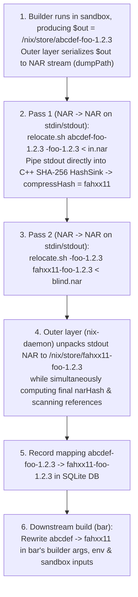

# CASPER: Content-Addressable Store via Partial-blinding and Embedded Relocation

## 1. Overview & Motivation

### 1.1 The Blocker to Output-Addressed Derivations: The Self-Reference Hash Loop
In traditional Nix, derivation outputs are **input-addressed**: a derivation with masked input hash `abcdef...` builds its output directly into `/nix/store/abcdef...-foo-1.2.3`, and that path is registered in the store regardless of the actual bytes produced. Two derivations with different inputs that compile to the exact same output cannot share a store path or short-circuit downstream rebuilds.

Nix has long sought to move to **output-addressed (content-addressed) derivations**, where every built object in `/nix/store` is named by the cryptographic hash of its output contents (`/nix/store/<output-hash>-<name>`). However, **self-referencing outputs** are the natural blocker:
- Over **54.9%** of packages (and **72.2%** by store size; see [empirical-analysis.md](empirical-analysis.md)) embed their own `$out` store path inside their build outputs—in ELF `DT_RUNPATH`s, shebangs, wrapper scripts, `pkg-config` `.pc` files, Python `.pyc` bytecode, and even inside compressed files such as `.gz` manpages.
- During the build, `$out` must already be known so compilers and build scripts can embed `/nix/store/<hash>-<name>` into binaries and data files.
- Yet if `<hash>` is the cryptographic hash of the output, then the output's contents must contain `<hash>` before `<hash>` can be computed—an **unsolvable cryptographic hash loop**:
  $$H = \text{Hash}\big(\text{output containing } \texttt{/nix/store/} \parallel H \parallel \texttt{-foo}\big)$$

### 1.2 Why Store Symlinks Are Not Enough
One way to sidestep the self-reference loop without rewriting package contents is to build in the original input-addressed path `/nix/store/<input-hash>-<name>`, move the result to `/nix/store/<output-hash>-<name>`, and replace the original input-addressed path `/nix/store/<input-hash>-<name>` with a **symlink** to `/nix/store/<output-hash>-<name>`.
- **Why this is undesirable**:
  1. **Double Filesystem Lookups on Every Access**: Every `execve`, shared library load (`openat` via `DT_RUNPATH`), header include, or file read through `/nix/store/<input-hash>-<name>` requires **two filesystem lookups** (first resolving the input-hash symlink, then traversing the target output-addressed directory). On cold storage, spinning disks, overlayfs, or network/remote stores, doubling every filesystem lookup slows down execution and builds considerably.
  2. **Leaky Input-Hash Pollution**: Binaries still embed `<input-hash>` rather than `<output-hash>`, so two builds producing identical functional content still differ at the byte level in their embedded paths, and `/nix/store` accumulates permanent symlink stubs for every historical input hash.

### 1.3 The CASPER Approach: Partial Blinding & Embedded Relocation

**CASPER (Content-Addressable Store via Partial-blinding and Embedded Relocation)** resolves the self-reference hash loop directly through two core ideas:

1. **Breaking the Hash Loop via Partial Blinding**:
   - Whenever a payload must embed a cryptographic hash or signature of itself, standard cryptographic protocols break the circularity by computing the digest over a **blinded** representation of the payload in which the hash/signature slot is either stripped or overwritten with a fixed placeholder (such as all zeros or `xxxx...`):
     - In **cryptocurrency transactions** (e.g., Bitcoin's `SIGHASH` and Ethereum transaction signing), the `scriptSig` or signature fields are zeroed/blanked before hashing the transaction payload to be signed, and the resulting signature is then placed into those fields.
     - In **signed API requests, JWTs, and XML-DSig / SAML enveloped signatures**, as well as **PE Authenticode binaries**, **RPM/FIT images**, and **IPv4/TCP/ICMP packets**, the embedded signature or checksum field is zeroed out before the hash is computed over the payload.
   - We call this **partial blinding**: only the self-reference slots inside the derivation output are overwritten with a fixed placeholder (while all external dependency references `/nix/store/<dep-hash>-<dep>` remain unblinded).
   - In CASPER, an output's content address `<output-hash>` is defined not as the raw SHA-256 hash of the final output, but as the SHA-256 hash of the **partially blinded** output. Because the placeholder is independent of both `<input-hash>` and `<output-hash>`, the hash loop disappears, and two derivations with different input hashes that produce identical blinded content converge to the exact same `<output-hash>`.

2. **Delegating Partial Blinding & Relocation to the Derivation Itself (Embedded Relocation)**:
   - Why can't Nix simply perform partial blinding in C++ using a naive byte-string search-and-replace? Because in real software packages, self-references are not always stored in uncompressed plaintext. Consider a `.gz`-compressed manpage or archive inside `$out` that embeds `/nix/store/<input-hash>-<name>`: a naive byte-string blinder scanning raw file bytes will never see the reference inside the compressed Deflate bitstream and therefore cannot blind or relocate it.
   - While we could special-case `.gz` files in Nix itself, this is undesirable as so many versions of hidden references could exist. It is up to the software packager to fix those up.
   - CASPER's second invention is to **delegate the task of blinding and relocating self-references to the derivation output itself**, by embedding a relocator (`$out/nix-support/relocate.sh`) inside the output.
   - Crucially, embedding the blinder/relocator inside the output **does not re-introduce the hash loop**: the task of blinding and relocating can be defined **abstractly** (`relocate.sh <old-self> <new-self>`, taking the source and target store-path strings as parameters) without making any concrete reference to `<input-hash>` or `<output-hash>` inside the script itself. Because the relocator's own bytes remain completely invariant across blinding and relocation, it can live inside `$out` and be hashed alongside the rest of the partially blinded output without causing a hash cycle.

---

## 2. Detailed Architecture

### 2.1 End-to-End Operational Pipeline

1. **Evaluation & Build in Input-Hash Path (`<input-hash>-<name>`)**:
   - At evaluation time (`builtins.derivation`), a derivation `foo-1.2.3` still computes its standard 32-character input-addressed path `/nix/store/abcdef...-foo-1.2.3`.
   - No `.` prefix or store symlinks are needed: all store paths remain standard 32-character Nix32 hashes of identical byte length (`32` chars).
   - During the build of `foo`, `$out` is `/nix/store/abcdef...-foo-1.2.3`.
2. **Primary Design: Pure `NAR` $\to$ `NAR` Stream Relocation (`stdin` $\to$ `stdout`) & Outer-Layer Unpacking**:
   - Rather than mutating a live directory tree on the host filesystem, `relocate` (`$out/nix-support/relocate.sh`) is a **`NAR` $\to$ `NAR` stream transformer**: it reads a Nix Archive (NAR) from `stdin`, replaces `<old-self>` with `<new-self>`, and writes the resulting NAR to `stdout`:
     ```sh
     relocate.sh <old-self> <new-self> < input.nar > output.nar
     ```
   - The relocator process needs **zero host filesystem access**; if the outer layer (`nix-daemon`) wants to write the relocated output to `/nix/store/<output-hash>-<name>`, **the outer layer unpacks the NAR from `stdout` itself** (`restorePath`).
   - Blinding is **strictly scoped to self-references** (`<input-hash>-<name>` $\to$ `<blind-hash>-<name>`). Dependency references (`/nix/store/<dep-out-hash>-<dep-name>`) already have their final content-addressed hashes and are never blinded.
   - **Step 2a + 2b (In-Stream Blinding & Content Hashing—Zero Disk Writes)**:
     - The outer layer serializes `$out` into a NAR stream (`dumpPath($out)`), pipes it into `relocate.sh "<input-hash>-<name>" "<blind-hash>-<name>"`, and pipes `stdout` **directly into Nix's C++ SHA-256 `HashSink`** (compressing the digest to 20 bytes / 32 Nix32 chars to obtain `<output-hash>`, e.g. `fahxx11...`).
     - Because self-references were blinded in the NAR stream first (even inside `.gz` entries), two builds with different input hashes that produce the same content yield the **exact same `<output-hash>`** without writing a blinded copy to disk.
   - **Step 2c (In-Stream Relocation + Trusted Outer-Layer NAR Unpacking & Reference Scan)**:
     - The outer layer pipes the NAR through `relocate.sh "<blind-hash>-<name>" "<output-hash>-<name>"` and feeds `stdout` directly into Nix's C++ `TeeSink(RestoreSink("/nix/store/<output-hash>-<name>"), HashAndRefScanSink)`—simultaneously unpacking the final output to `/nix/store/fahxx11...-foo-1.2.3`, computing its final `narHash`/`narSize`, and scanning the final uncompressed NAR stream for store references.
3. **Downstream Dependency Rewriting in Builder Args & Env**:
   - When a downstream derivation `bar` (which depends on `foo`) was evaluated, its `.drv` recorded `foo`'s input-addressed path `/nix/store/abcdef...-foo-1.2.3`.
   - Before `bar` is built, Nix looks up the realised output path of `foo` (`/nix/store/fahxx11...-foo-1.2.3`) and rewrites `abcdef...` -> `fahxx11...` in `bar`'s builder arguments (`drv.args`), environment variables (`drv.env`), structured attrs / extra files, and sandbox `inputPaths`.
   - Thus `bar` builds directly against `/nix/store/fahxx11...-foo-1.2.3`—no symlinks in `/nix/store` are required.



### 2.2 `relocate.sh` as a `NAR` $\to$ `NAR` Stream Transformer (`stdin` $\to$ `stdout`)

#### Core Contract
Instead of mutating a directory tree in place on the host filesystem, `relocate` (`$out/nix-support/relocate.sh`) operates as a pure **`NAR` $\to$ `NAR` stream filter**:
```sh
/bin/sh "$out/nix-support/relocate.sh" <old-self> <new-self> < input.nar > output.nar
```
- `stdin`: A Nix Archive (NAR) byte stream representing the output (either a directory, regular file, or symlink).
- `stdout`: The relocated Nix Archive (NAR) byte stream with `<old-self>` rewritten to `<new-self>`.
- `$1` (`old-self`): `<old-hash>-<name>` (e.g. `abcdef...-foo-1.2.3` or `<blind-hash>-foo-1.2.3`).
- `$2` (`new-self`): `<new-hash>-<name>` (e.g. `<blind-hash>-foo-1.2.3` or `fahxx11...-foo-1.2.3`).
- **Outer-Layer Unpacking**: The `relocate` process never writes to `/nix/store`. Whenever the outer layer (`nix-daemon`) wants to materialize the relocated output to disk (`/nix/store/<output-hash>-<name>`), **the outer layer unpacks the NAR from `stdout` itself** using its trusted C++ `RestoreSink` (`restorePath`).

#### Why `NAR` $\to$ `NAR` Takes Precedence Over In-Place Directory Mutation
1. **Uncompressed NARs Can Be Relocated as a Raw Byte Stream ($O(1)$ Memory)**:
   - In the NAR wire format, every regular file body, symlink target, and filename is stored as a contiguous byte slice preceded by a 64-bit little-endian length prefix and padded to an 8-byte boundary.
   - Because `<oldHash>-<name>` and `<newHash>-<name>` have the **exact same byte length**, replacing `<oldHash>-<name>` $\to$ `<newHash>-<name>` inside any uncompressed file or symlink **never alters any 64-bit length prefix or 8-byte alignment padding**.
   - Only compressed entries (such as `.gz`, where re-running `gzip -n` after rewriting a hash can change the compressed byte size by a few bytes) require updating that entry's 64-bit NAR length field.
2. **Zero Disk Writes During Blinding & Content Hashing**:
   - **Pass 1 (In-Stream Blind + Hash)**: The outer layer serializes `$out` once (`dumpPath($out)`), pipes it into `relocate.sh "<inputHash>-<name>" "<blindHash>-<name>"`, and streams `stdout` **directly into Nix's C++ `HashSink(HashAlgorithm::SHA256)`** to compute `outHash = compressHash(narHash, 20)`—without ever unpacking the blinded tree to disk.
   - **Pass 2 (In-Stream Relocate + Trusted Unpack + Reference Scan)**: The outer layer pipes the NAR into `relocate.sh "<blindHash>-<name>" "<outHash>-<name>"` and streams `stdout` directly into `TeeSink(RestoreSink("/nix/store/<outHash>-<name>"), HashAndRefScanSink)`.
3. **Eliminates Whole Classes of Security Vulnerabilities by Construction (see [security.md](security.md))**:
   - **No Host Filesystem Access or TOCTOU Races**: `relocate.sh` runs in an isolated, unprivileged container with no write access to `/nix/store` or `actualPath`, communicating exclusively over `stdin` and `stdout`.
   - **Trusted C++ Unpacking**: Because `nix-daemon` unpacks the final NAR itself via `restorePath`, Nix enforces canonical permissions (`0444`/`0555`), `mtime = 1`, `root:root` ownership, `O_NOFOLLOW` file creation, and safe hardlink deduplication.
   - **Automatic Metadata Canonicalization**: Because the NAR format has no `mtime`, `ctime`, `uid`, `gid`, `inode` numbers, or unsorted directory entries, `stdin` $\to$ `stdout` NAR transformation automatically strips all filesystem metadata side channels between Pass 1 and Pass 2.
   - **Single-Pass Post-Relocation Reference Scanning**: As the outer layer unpacks `stdout` to disk, it simultaneously hashes and runs `scanForReferences` on the exact final NAR stream.

#### Supporting Both Streaming and Directory-Based Custom Hooks Under `NAR` $\to$ `NAR`
- **Default / Streaming Relocator (`nar-relocate`)**:
  - Reads NAR tokens from `stdin`, streaming non-`.gz` regular files and symlinks straight through with fixed-length `<old>` $\to$ `<new>` replacement in $O(1)$ memory, and buffering only individual `.gz` entries in memory to run `gzip -dc | sed "s|$old|$new|g" | gzip -n` and update the 64-bit NAR entry length prefix.
- **Directory-Tool Wrapper (`nix-store --restore $TMPDIR/work && ... && nix-store --dump $TMPDIR/work`)**:
  - If a specialized package hook (e.g., GHC's `ghc-pkg recache`) requires random-access directory operations, its `relocate.sh` still honors the `NAR (stdin) -> NAR (stdout)` interface by unpacking `stdin` into a private in-memory `tmpfs` inside the sandbox, running the tool, and dumping the directory back to `stdout` as a NAR.

---

### 2.3 Downstream Dependency Rewriting

Because we do not keep symlinks at `/nix/store/<inputHash>-<name>`, downstream derivations that were evaluated with `<inputHash>-<name>` are rewritten to `<outHash>-<name>` before they are built:

1. **SQLite Mapping (`DerivationOutputs` & `PathRewrites`)**:
   - When `foo.drv` finishes building and its output `/nix/store/<inputHash>-foo` is relocated to `/nix/store/<outHash>-foo`:
     - `DerivationOutputs` is updated to point `(drvId, "out")` to `/nix/store/<outHash>-foo`.
     - A `PathRewrites` table in SQLite records `inputPath = "/nix/store/<inputHash>-foo" -> outputPath = "/nix/store/<outHash>-foo"`.
2. **Resolving Inputs in `DerivationGoal` & `DerivationBuildingGoal`**:
   - Before building `bar.drv`:
     - All input derivation outputs (`SingleDerivedPath::Built`) and opaque inputs are checked against `DerivationOutputs` / `PathRewrites`.
     - For every dependency whose evaluation-time path `<depInputHash>-<depName>` was relocated to `<depOutHash>-<depName>`, we add `inputRewrites[<depInputHash>] = <depOutHash>`.
     - We apply `inputRewrites` to `resolvedDrv` (`builder`, `args`, `env`, `structuredAttrs`, `inputs`), so `bar`'s builder arguments, environment variables, and sandbox `inputPaths` all reference `/nix/store/<depOutHash>-<depName>` directly.
3. **Multiple Outputs Within the Same Derivation (`out`, `lib`, `dev`, `doc`)**:
   - In `DerivationBuilderImpl::registerOutputs`, outputs of a multi-output derivation are topologically sorted (`sortedOutputNames | std::views::reverse`, leaves first).
   - When leaf output `lib` is relocated from `libInputHash` to `libOutHash`, `outputRewrites[libInputHash] = libOutHash` is recorded.
   - Before hashing dependent output `out` or `dev`, `relocate.sh` is invoked for each `(oldHash, newHash)` in `outputRewrites` so cross-output references (`dev -> lib`, `out -> lib`) are updated to `libOutHash` before `out`/`dev` is hashed.

---

## 3. Implementation Overview (Modified C++ Files in `nix/`)

1. **[`src/libstore/schema.sql`](nix/src/libstore/schema.sql), [`src/libstore/local-store.cc`](nix/src/libstore/local-store.cc), [`src/libstore/include/nix/store/local-store.hh`](nix/src/libstore/include/nix/store/local-store.hh), [`src/libstore/outputs-query.cc`](nix/src/libstore/outputs-query.cc), [`src/libstore/store-dir-config.cc`](nix/src/libstore/store-dir-config.cc)**:
   - Added `PathRewrites (inputPath text primary key not null, outputPath text not null)` table and prepared statements (`AddPathRewrite`, `QueryPathRewrite`, `QueryAllPathRewrites`, `DeletePathRewritesForOutput`).
   - Added `StoreDirConfig::makeContentAddressedOutputPath(const Hash & narHash, std::string_view name)` returning `makeStorePath("casper:out", narHash, name)` so differently named outputs with identical content never collide on a 32-character `hashPart`.
   - Added `LocalStore::queryPathRewrite`, `LocalStore::addPathRewrite`, and multi-hop `LocalStore::resolveInputPath` (with automatic `PathRewrites` cleanup in `LocalStore::invalidatePath`), wiring `queryPartialDerivationOutputMap` through `resolveInputPath` so relocated outputs are seamlessly resolved.
2. **[`src/libstore/build/derivation-goal.cc`](nix/src/libstore/build/derivation-goal.cc), [`src/libstore/build/derivation-building-goal.cc`](nix/src/libstore/build/derivation-building-goal.cc), [`src/libstore/misc.cc`](nix/src/libstore/misc.cc), [`src/libexpr/primops.cc`](nix/src/libexpr/primops.cc)**:
   - Updated `checkPathValidity()` and `queryPartialDerivationOutputMap()` to resolve `<inputHash>-<name>` via `resolveInputPath` / `DerivationOutputs` so already-built derivations are recognized as `AlreadyValid` at their `<outHash>-<name>` path.
   - Restricted binary cache substitution in `DerivationGoal::haveDerivation` and `Store::queryMissing` to `type(*drv).isCA()` so `CAFixed` source tarballs/seeds can be fetched from `cache.nixos.org` while `InputAddressed` derivations are always built and relocated locally by CASPER.
   - When projecting `Full` derivation `drv` to `BasicDerivation resolvedDrv` in `DerivationGoal::haveDerivation` (and in `EvalState::realiseContext` for import-from-derivation), built the `depRewrites` map (`<depInputHash> -> <depOutHash>`) scoped to the transitive closure of `drv->inputs` and rewrote `builder`, `args`, `env`, `structuredAttrs`, and `inputPaths`.
3. **[`src/libstore/build/derivation-builder-impl.cc`](nix/src/libstore/build/derivation-builder-impl.cc), [`src/libstore/build/derivation-check.cc`](nix/src/libstore/build/derivation-check.cc), [`src/libstore/unix/build/unix-derivation-builder.cc`](nix/src/libstore/unix/build/unix-derivation-builder.cc), [`src/libstore/linux/build/linux-derivation-builder.cc`](nix/src/libstore/linux/build/linux-derivation-builder.cc), [`src/libutil/compression.cc`](nix/src/libutil/compression.cc)**:
   - Implemented streaming C++ `relocateNAR(Source & source, Sink & sink, const StringMap & rewrites, Sink * extraRefScanSink)` (`NAR` $\to$ `NAR`), rewriting regular files in $O(1)$ memory via `RewritingSink`, decompressing/rewriting/deterministically-recompressing `.gz` regular files (`gzip -n` via `libarchive` `"!timestamp"`) when matched, rewriting symlink targets, and maintaining sorted directory entries.
   - When a derivation provides a custom `$out/nix-support/relocate.sh`, `runRelocateScript` executes `relocate.sh <oldSelf> <newSelf>` inside the isolated sandbox namespaces (`CLONE_NEWUSER`, `CLONE_NEWNS`, `CLONE_NEWNET`, `CLONE_NEWIPC`, `CLONE_NEWUTS`, seccomp/Landlock, `closeExtraFDs`), piping the input NAR over `stdin` and reading the relocated NAR from `stdout`.
   - In `DerivationBuilderImpl::registerOutputs()`, performs Pass 1 (`$out` $\to$ blinded NAR $\to$ `HashSink(SHA256)` with zero disk writes) and Pass 2 (blinded NAR $\to$ final NAR $\to$ `TeeSink(restorePath, finalNarHashSink, PathRefScanSink)`), verifies `narHash` on pre-existing `caOutPath` hits, and records the `PathRewrites` mapping in `LocalStore`.
   - Updated `checkOutputs()` in `derivation-check.cc` to resolve `allowedReferences`, `allowedRequisites`, `disallowedReferences`, and `disallowedRequisites` through `store.resolveInputPath` and current derivation outputs.

---

## 4. Reflections, Packaging Trade-offs & Verification Tricks

*(For discarded design alternatives, see [ALTERNATIVES_CONSIDERED.md](ALTERNATIVES_CONSIDERED.md); for security considerations, threat models, prototype vulnerabilities, and relocator invariants, see [security.md](security.md)).*

### 4.1 The Packaging Drawback: Maintaining `relocate.sh` for Opaque Formats
- In CASPER, package maintainers have the added responsibility of thinking about `relocate.sh` during packaging.
- Plaintext and standard ELF binary self-references are easy to spot with `grep` and are handled automatically by `sed` in the default `relocate.sh`.
- However, self-references buried inside compressed or encoded formats—such as `.gz` files (handled by default), `.xz`/`.zst` archives, `.zip`/`.jar`/`.whl` archives, SQLite databases, or custom binary caches—are invisible to a naive `grep`. Spotting and rewriting these references normally requires package-specific domain knowledge so the packager can extend `relocate.sh` to unpack, rewrite, and repack those files.

### 4.2 Trick for Deterministic Packages: Dual-Location Rebuild to Detect Incomplete `relocate.sh`
- For **fully deterministic packages** (packages that always produce the exact same output byte stream given identical inputs and build environment), we can automatically detect hidden, unrelocated self-references *without* needing prior knowledge of the package's file formats:
  1. **Build 1**: Build the package in its normal scratch location `/nix/store/<input-hash>-foo`, run `relocate.sh` to blind `/nix/store/<input-hash>-foo` $\to$ `/nix/store/xxxxxxxxxxxxxxxxxxxxxxxxxxxxxxxx-foo`, and compute the blinded output hash $H_1$.
  2. **Build 2 (`-recheck`)**: Rebuild the exact same derivation into a different output location—for example, `/nix/store/<input-hash>-foo-recheck` (or an alternate scratch hash).
  3. Run `relocate.sh` on the second build to blind `/nix/store/<input-hash>-foo-recheck` $\to$ `/nix/store/xxxxxxxxxxxxxxxxxxxxxxxxxxxxxxxx-foo`, and compute the blinded output hash $H_2$.
  4. **Compare $H_1$ vs. $H_2$**:
     - If `relocate.sh` caught **every** self-reference, both blinded trees will be byte-for-byte identical and $H_1 = H_2$.
     - If the build embedded `$out` inside an unhandled format (e.g., an `.xz` archive or binary cache that `relocate.sh` did not unpack), the `-recheck` suffix remains inside that file after `relocate.sh` runs, causing $H_1 \neq H_2$.
     - Comparing the two blinded trees immediately alerts the packager to the incomplete `relocate.sh` and pinpoints the exact file containing the hidden self-reference.

---

## 4. Nixpkgs Bootstrapping & Lightweight Overlay Strategy

### 4.1 Zero-Touch Built-In `NAR` $\to$ `NAR` Relocation vs. Lightweight Overlay (`casper-overlay.nix`)
- **Zero-Touch Default (`stdenv.mkDerivation`, `runCommand`, `buildEnv`, etc.)**:
  - Because `DerivationBuilder` performs default `NAR` $\to$ `NAR` relocation directly in C++ via [`relocateNAR`](nix/src/libstore/build/derivation-builder-impl.cc#L108-L273) without injecting any extra files into `$out`, standard packages do not require any `stdenv.mkDerivation` changes or extra store references (`allowedReferences = []` works unmodified). Over 95% of `nixpkgs` packages (standard ELF binaries, shared libraries, shell/Python/Perl wrappers, pkg-config `.pc` files, CMake configs, and `.gz` man/info pages) work out of the box without any Nixpkgs diff.
- **Lightweight Overlay for Special-Case Packages**:
  - Rather than maintaining a massive `nixpkgs` fork, CASPER overrides live in a small, self-contained Nixpkgs overlay ([`casper-overlay.nix`](casper-overlay.nix)).
  - Whenever a package embeds self-references inside a specialized container format or requires custom relocation, the overlay wraps it with the `withCasper` helper using `overrideAttrs` (or `overrideDerivation` for non-`mkDerivation` builders) to emit a custom `NAR` $\to$ `NAR` (`stdin` $\to$ `stdout`) `$out/nix-support/relocate.sh`:

```nix
final: prev:
let
  # Helper to attach a custom NAR -> NAR ($out/nix-support/relocate.sh) hook to any derivation
  withCasper = { relocateExtra ? "", relocateStream ? "" }: pkg:
    pkg.overrideAttrs (old: {
      postFixup = (old.postFixup or "") + prev.lib.optionalString (relocateExtra != "") ''
        mkdir -p "$out/nix-support"
        cat << 'EOF' > "$out/nix-support/relocate.sh"
        #!/bin/sh
        set -e
        old="$1"
        new="$2"
        workdir=$(mktemp -d)
        trap 'chmod -R u+w "$workdir" 2>/dev/null || true; rm -rf "$workdir"' EXIT
        target="$workdir/root"
        nix-store --restore "$target"
        chmod -R u+w "$target" 2>/dev/null || true
        find "$target" -type f ! -name "*.gz" -exec sed -i "s|$old|$new|g" {} +
        ${relocateExtra}
        nix-store --dump "$target"
        EOF
        chmod +x "$out/nix-support/relocate.sh"
      '';
    });
in {
  # Example 1: Python packages with PEP 376 RECORD files storing SHA-256 hashes of scripts
  python3 = prev.python3.override {
    packageOverrides = pyFinal: pyPrev:
      prev.lib.mapAttrs (name: pkg:
        withCasper {
          relocateExtra = ''
            # Strip SHA-256 digests in *.dist-info/RECORD after shebang/path relocation
            find "$target" -path "*.dist-info/RECORD" -exec sed -i 's|,sha256=[^,]*,|,,|g' {} +
          '';
        } pkg
      ) pyPrev;
  };

  # Example 2: Packages with .zst or .xz compressed assets containing self-references
  someZstPackage = withCasper {
    relocateExtra = ''
      find "$target" -type f -name "*.zst" | while IFS= read -r zf; do
        zstd -dc "$zf" | sed "s|$old|$new|g" | zstd -q > "$zf.casper-tmp"
        mv "$zf.casper-tmp" "$zf"
      done
    '';
  } prev.someZstPackage;
}
```

> [!TIP]
> Notice `cat << 'EOF'` uses `#!/bin/sh` rather than `${prev.runtimeShell}` (`#!/nix/store/...-bash/bin/bash`). This ensures the custom script does not introduce an unwanted runtime store dependency on `bash` for data-only or minimal-closure outputs.

### 4.2 Bootstrapping Strategies: Incremental vs. Full `stdenv` Bootstrap

#### Mode A: Incremental Bootstrap on Top of an Existing `/nix/store` (Fastest)
- You do **not** have to rebuild `stdenv` from stage 0 just to start using CASPER with `nixpkgs`:
  - `localStore.resolveInputPath(inputPath)` in [`local-store.cc`](nix/src/libstore/local-store.cc#L1838-L1854) returns `inputPath` unchanged whenever a store path has no entry in the `PathRewrites` SQLite table.
  - Therefore, pre-existing store paths in `/nix/store` (or paths substituted from `cache.nixos.org`) act as fixed leaves, while every **newly built** derivation goes through CASPER's streaming `NAR` $\to$ `NAR` blinding, content-hashing, and relocation.

#### Mode B: Full End-to-End `stdenv` Bootstrap from `bootstrap-tools`
When bootstrapping `nixpkgs` from scratch (`stdenvStages` 0 through final `stdenv`):
1. **Stage 0 (`bootstrap-tools`)**:
   - Downloaded as a fixed-output derivation (`CAFixed`), unpacked by `busybox` (`unpack-bootstrap-tools.sh`), and relocated in-process by C++ [`relocateNAR`](nix/src/libstore/build/derivation-builder-impl.cc#L108-L273) without requiring any external tools in the sandbox.
2. **Static Libraries (`.a` Archives) Across Bootstrap Stages (`stage0` $\to$ `stage1` $\to$ `stage2` $\to$ `stage3` $\to$ `stdenv`)**:
   - Early GCC/glibc bootstrap stages build static `.a` archives (`libgcc.a`, `libc.a`).
   - Standard `ar` archives store each member's byte size as a fixed-width decimal ASCII header and do not store member checksums. Because `<inputHash>` (32 chars), `xxxxxxxxxxxxxxxxxxxxxxxxxxxxxxxx` (32 chars), and `<outHash>` (32 chars) have the exact same byte length, `RewritingSink` relocation inside `.a` archives preserves member sizes and symbol tables without needing `ranlib`.
3. **Ecosystem-Level Hooks for Full Nixpkgs Coverage**:
   - Rather than overriding individual packages one by one, most non-plaintext formats in `nixpkgs` belong to language/framework ecosystems where a single hook covers thousands of packages:
     - **Python (`buildPythonPackage`)**: `*.dist-info/RECORD` files list SHA-256 hashes of installed entry-point scripts; when `relocate.sh` rewrites `$out` inside an entry-point script, `RECORD` either needs its hash updated or stripped.
     - **Haskell (`ghc` / `cabal`)**: `package.conf.d/package.cache` is a binary cache of `.conf` files containing `$out` paths; `relocate.sh` for GHC package DBs can re-run `ghc-pkg recache` or rewrite the binary cache.
     - **Linux Kernel Modules (`linux`)**: `.ko.xz` or `.ko.zst` modules that embed `$out` firmware/module paths need `xz`/`zstd` decompression/recompression in `relocate.sh`.
     - **Java / JVM (`.jar` / `.zip`)**: Unpacking/repacking `.jar` files only when `grep` detects a self-reference inside the uncompressed stream.
     - **macOS (`darwin`)**: Mach-O binaries with ad-hoc code signatures invalidate their signature when rewriting the `LC_RPATH` load command, requiring `codesign -f -s -` in `relocate.sh` on Darwin.

### 4.3 Real-World Bootstrap Verification (`casper-store`)
Both Nixpkgs bootstrap chains were executed end-to-end into `casper-store` using `./nix/build/src/nix/nix-build` and [`casper-overlay.nix`](casper-overlay.nix), producing **313 relocated derivation outputs** (`PathRewrites` rows in `casper-store/nix/var/nix/db/db.sqlite`) that converged to **274 unique content-addressed outputs**:

1. **Source-Only `stage0-posix` Bootstrap (49 Derivations)**:
   - Built from `hex0-1.6.0` (`stage0-posix-1.6.0-source`) through `hex1`, `hex2`, `catm`, `M0`, `cc_arch`, `M2-0`, `M2`, `blood-elf-0`, `M1-0`, `hex2-1`, `M1`, `hex2`, `kaem-unwrapped`, `mescc-tools`, `mescc-tools-extra`, and `kaem-1.6.0` (`/nix/store/5ac8fyvhhjj13m4r54kc53b6bbhy7nfw-kaem-1.6.0`).
2. **Full Nixpkgs `stdenv` Bootstrap (`stage0` $\to$ `stage1` $\to$ `stage-xgcc` $\to$ `stage2` $\to$ `stage3` $\to$ `stage4` $\to$ `stdenv-linux` $\to$ `hello-2.12.2`)**:
   - **264 `stdenv` bootstrap outputs** built, blinded, content-hashed, and relocated across all bootstrap stages via the streaming `NAR` $\to$ `NAR` pipeline without a single Nixpkgs package modification.

#### Key Bootstrap Milestones (`inputPath` $\to$ Content-Addressed `outputPath`)

| Stage / Milestone | Evaluation Input Path (`<inputHash>-<name>`) | Relocated Content-Addressed Path (`<outHash>-<name>`) |
| :--- | :--- | :--- |
| **`stage0-posix` (`hex1-1.6.0`)** | `/nix/store/pvk596baqdg5hnmvnjsb1fbca6bz5j4v-hex1-1.6.0` | `/nix/store/3m87j2yh62phlzc3f5nhj4l0m75n55x1-hex1-1.6.0` |
| **`stage0-posix` (`M2-1.6.0`)** | `/nix/store/3vmryl2mpq9rib67bi6clfvb44nym9jr-M2-1.6.0` | `/nix/store/f2xdw0rhj6k5a3dsirczd0gnlf53f50x-M2-1.6.0` |
| **`stage0-posix` (`mescc-tools`)** | `/nix/store/k7847sdmcmfqvgpc7ycd5a4wpx49xan0-mescc-tools-1.6.0` | `/nix/store/97n0b1z6g61n330w9qn5r6b1mc4yawzl-mescc-tools-1.6.0` |
| **`stage0-posix` (`kaem-1.6.0`)** | `/nix/store/9a0qmi15cidrn9kca5j820dw0qan13c8-kaem-1.6.0` | `/nix/store/5ac8fyvhhjj13m4r54kc53b6bbhy7nfw-kaem-1.6.0` |
| **Stage 0 (`bootstrap-tools`)** | `/nix/store/razasrvdg7ckplfmvdxv4ia3wbayr94s-bootstrap-tools` | `/nix/store/30n2a6x7vsvxj1mzvrvhg8m89f41ci37-bootstrap-tools` |
| **Stage 0 (`stdenv-linux`)** | `/nix/store/ajrdf015k5ipn89gyh06isniabysrkcw-bootstrap-stage0-stdenv-linux` | `/nix/store/s5j2ficvrlkjb6dhw9ay9zgglh573w98-bootstrap-stage0-stdenv-linux` |
| **Stage 1 (`stdenv-linux`)** | `/nix/store/wkqjkkwnwhs270sav1mrdz089cmydmj8-bootstrap-stage1-stdenv-linux` | `/nix/store/dk3i95c49wjpsa5xc62cby077qk83y3a-bootstrap-stage1-stdenv-linux` |
| **Stage xgcc (`xgcc-14.3.0`)** | `/nix/store/nvv5arlnf72xkvpnmnw78ywgdnvx92q3-xgcc-14.3.0` | `/nix/store/g5inkmc4j8pdclpyi2z37vszcr252wib-xgcc-14.3.0` |
| **Stage xgcc (`stdenv-linux`)** | `/nix/store/azdg07c0qmzmj6cpnbpgmrh9gk1jl91d-bootstrap-stage-xgcc-stdenv-linux` | `/nix/store/75x0pfcacqpsf6h8ppd9fz983r08n69n-bootstrap-stage-xgcc-stdenv-linux` |
| **Stage 2 (`linux-headers-6.16.7`)** | `/nix/store/9a975kwlj5hyfq8y6hsapfaj5pj7g090-linux-headers-6.16.7` | `/nix/store/b7xga9z9x1rbkj6agr51pgg9v4yf4d5w-linux-headers-6.16.7` |
| **Stage 2 (`glibc-2.40-224`)** | `/nix/store/7nbi22pcc92y2fqbkyp7h3srvvklmckb-glibc-2.40-224` | `/nix/store/94f38yglcijsz5a8kv7hr3bz2w1is1r0-glibc-2.40-224` |
| **Stage 3 (`stdenv-linux`)** | `/nix/store/j7sbhs7c8wi0rxfh2f8wyngjdj5lb3z5-bootstrap-stage3-stdenv-linux` | `/nix/store/rpnwisgkssmkndx9yamgvhgmh376ipb7-bootstrap-stage3-stdenv-linux` |
| **Stage 4 (`gcc-14.3.0`)** | `/nix/store/ipr6y28viyqkhkg58rdvy27m01q5j5nh-gcc-14.3.0` | `/nix/store/ixh56dfh4lq5r87cfl8v3dv7q230hw0h-gcc-14.3.0` |
| **Stage 4 (`coreutils-9.8`)** | `/nix/store/hqkszxk2c0cxvd04xa4gsaqs182dw8l2-coreutils-9.8` | `/nix/store/nkydbxdsfg1jjyli6mzz5ahfj3m6mj0h-coreutils-9.8` |
| **Stage 4 (`bash-5.3p3`)** | `/nix/store/3hgg7pr65imdrifqqh3flg3arvkc2r22-bash-5.3p3` | `/nix/store/3894m0zrq35da26lpk0kk2lasdmc98vw-bash-5.3p3` |
| **Final `stdenv-linux`** | `/nix/store/0i25iw4373868kjqhafvmd6pn1wwzkh3-stdenv-linux` | `/nix/store/5cbirwzcqq4rdwib11lh1k5rbz3xma8l-stdenv-linux` |
| **Final `hello-2.12.2`** | `/nix/store/18bbdvag5v2f3d4y37pdbkzvh7s71cw4-hello-2.12.2` | `/nix/store/sn0pwh1agh2hnlbgm61ra3qr6yiz6ja8-hello-2.12.2` |

#### Cross-Stage Content-Addressed Deduplication (20 Output Groups Across Stages 0–4)
Querying `PathRewrites` in `casper-store/nix/var/nix/db/db.sqlite` showed **20 output groups** (39 duplicate outputs eliminated) where derivations built across different bootstrap stages (with distinct `.drv` hashes and toolchains) produced identical blinded content and automatically converged to the exact same content-addressed store path:

| Converged Content-Addressed `outputPath` | Stage Count | Distinct Input Hash Prefixes (`inputPath`) |
| :--- | :---: | :--- |
| `/nix/store/h2zm8gx40nhw8sj8757xh5pcpglw8gnb-gnu-config-2024-01-01` | **6** | `nkp2jjfx`, `wqzpxm4j`, `y6alivz8`, `xdj1hdnn`, `nynfiaxg`, `ay97s1f2` |
| `/nix/store/1sid5bc540bia6li9ggk7sc7di5nm89h-update-autotools-gnu-config-scripts-hook` | **6** | `ivs0xima`, `w3f3v1va`, `44bzap4q`, `zmbyl8wb`, `zxixwkhw`, `4s62rh5i` |
| `/nix/store/isksmxafyj4ldqkn6zwbrz4cq1rp7qxz-bash-5.3p3-info` | **5** | `pqqcpb5q`, `4pz2asx9`, `k52n6fp4`, `ycy1vg2n`, `f4q2risa` |
| `/nix/store/mflf4dq4x1wmsglpra9gsnq49z8an7mf-bash-5.3p3-man` | **5** | `vsrzjz05`, `83s5r9zn`, `irvzpqbc`, `3br10pn2`, `y3hrz22j` |
| `/nix/store/xdkj3ydj7q3px091xay4wx9hgwl8hidx-bash-5.3p3-doc` | **5** | `sidp11qn`, `5i8iqc88`, `sia47i7m`, `d5h5g51l`, `m569srhy` |
| `/nix/store/ii3700nq7nnfhp8zfssjczarw60izsdv-nuke-references` | **4** | `rxxjh38q`, `wwiqgin8`, `jrabk1pr`, `2kh0hlwq` |
| `/nix/store/0xz45i1lvf06pjxydpddid2nglir332r-expand-response-params` | **2** | `gk36k5fd`, `bzkq151p` *(compiled C binary deduplicated across stages)* |
| `/nix/store/kcrsbmlryh3rjgmx1ns9lrshsj3i6zxs-bash-5.3p3-debug` | **2** | `2hg82qsg`, `i7p4sb8d` |
| `/nix/store/78x0j5kl28kgf46699s3pisjafbax3j0-binutils-2.44-man` | **2** | `2b43ga3y`, `5951bdp9` |
| `/nix/store/k8yn35adnbq8vivkljg6bjb10lh5bwfx-binutils-2.44-info` | **2** | `b4b5lfds`, `ynws37nl` |
| `/nix/store/6i8rmmr9b3w6nfm1mbad4a8rj05ykjb8-binutils-wrapper-2.44-man` | **2** | `641ksb94`, `iwh74pj4` |
| `/nix/store/5ddi5vhhma11h30v7mqa5b9ipq63fqcj-binutils-wrapper-2.44-info` | **2** | `0s7vn1v9`, `fmf1v6h8` |
| `/nix/store/8w7bd80468acw2ki886x4mcz9jw52b13-python-setup-hook.sh` | **2** | `4441jg4a`, `1ay695zg` |
| `/nix/store/p8mqjin5gf9acxzdgk722ylh6d50vxis-gmp-6.3.0-info` | **2** | `3g3f04ja`, `a945qkvw` *(distinct from `2ypdc6zv6xxgg65aykz0177m9wgn4rga-gmp-with-cxx-6.3.0-info` via name-mixed `casper:out` derivation)* |
| `/nix/store/r2dg2j6svx26z7z9kkp6b5laskkxmr21-mpfr-4.2.2-doc` | **2** | `3m1319j9`, `fiqrdsdy` |
| `/nix/store/wc4dm2kbkipfx437qa39aq0kc39q1lxd-mpfr-4.2.2-info` | **2** | `s6w6ji55`, `5fmqqppa` |
| `/nix/store/3zpq1q2dnsklbf41wlvfkx8rwjf2s8d4-xz-5.8.3-doc` | **2** | `x4qgpmhz`, `h4ch4ldb` |
| `/nix/store/2kfnv0hyikydq1mmfpqh7ld64wq96fdl-xz-5.8.3-man` | **2** | `yzci0g7r`, `34qc1s1k` |
| `/nix/store/29a0hwkx4wfj3xbiz5233gqg9g1g6qwh-libxcrypt-4.5.2-man` | **2** | `cc7r666h`, `yhficm51` |
| `/nix/store/fzm5c1csn6slg3zsb850lznsy96mg52k-gettext-0.25.1-info` | **2** | `nky8g413`, `wripq293` |

#### Key Technical Findings from the Real Bootstrap
1. **Zero Injected Files & Pure `NAR` $\to$ `NAR` In-Process Stream Relocation**:
   - In `minimal-bootstrap` (`stage0-posix`), early derivations (`hex1`, `hex2`, `M0`, `M2`, `blood-elf-0`) execute in a bare sandbox with **no `/bin/sh`, `find`, or `sed`**, and many outputs are single regular executable files (`S_ISREG`) rather than directories (`S_ISDIR`).
   - Because [`relocateNAR`](nix/src/libstore/build/derivation-builder-impl.cc#L108-L273) operates directly on the NAR stream in C++ (including in-memory `.gz` decompression, rewriting, and deterministic `gzip -n` recompression) and only spawns `$out/nix-support/relocate.sh` when a package explicitly provides one, all 313 bootstrap outputs relocated in-process without injecting any extra files into `$out`.
2. **Selective Binary Cache Substitution (`type(*drv).isCA()`)**:
   - Standard binary caches (`cache.nixos.org`) index input-addressed derivations by `<inputHash>-<name>`, whereas `CAFixed` derivations (source tarballs, `bootstrap-tools.tar.xz`, `stage0-posix` seeds) are indexed by fixed content hash.
   - Restricting binary cache substitution to `type(*drv).isCA()` in [`DerivationGoal::haveDerivation`](nix/src/libstore/build/derivation-goal.cc#L93) and [`Store::queryMissing`](nix/src/libstore/misc.cc#L268) allows CASPER to fetch fixed-output source tarballs from `cache.nixos.org` while building and relocating all input-addressed derivations locally.
3. **Resolving `allowedReferences` & `disallowedRequisites` After Relocation**:
   - Foundational packages in `nixpkgs` (`glibc-2.40-224`, `gcc-14.3.0`, `bootstrap-stage*-stdenv-linux`) specify strict `allowedReferences`, `allowedRequisites`, `disallowedReferences`, and `disallowedRequisites` lists containing evaluation-time `<inputHash>-<name>` store paths.
   - Updating [`checkOutputs`](nix/src/libstore/build/derivation-check.cc#L23-L52) to resolve those paths through `store.resolveInputPath` (and the current derivation's `outputs` map) allowed every bootstrap stage's reference checks to pass without modifying `nixpkgs`.
4. **Empirical `.gz` Recompression in the Bootstrap**:
   - Multi-output packages (`outputs = [ "out" "man" ... ]`) whose `.gz` manpages embed sibling `$out` references were automatically detected during the pre-sort sibling scan, topologically ordered after `$out`, and rewritten in-stream by [`relocateNAR`](nix/src/libstore/build/derivation-builder-impl.cc#L172-L205):
     1. `rzkzgcpi35061aphd7nvw9q4567ws09d-file-5.45-man`: `share/man/man1/file.1.gz`, `share/man/man3/libmagic.3.gz`, and `share/man/man4/magic.4.gz` (rewrote `/nix/store/018l43lbsqbrsasrfdcxxb5s4s161fkr-file-5.45/share/misc/magic*` $\to$ `/nix/store/40xf2hs1hr0934ad6a5w1kb6krc16g7a-file-5.45/share/misc/magic*`).
     2. `vbrchwv2wc4s32cdnf6ns12b751b5v3f-gettext-0.25.1-man` (Stage 3): `share/man/man1/gettext.1.gz` and `share/man/man1/ngettext.1.gz` (rewrote `/nix/store/qawh4dvis37x3nvvsd1n53v13gy9yq9g-gettext-0.25.1/share/locale` $\to$ `/nix/store/mj7f7qmykivmz7cmwq62gn0zd5w173is-gettext-0.25.1/share/locale`).
     3. `8gjj4hnbj7fr4bfyd2yp5bfvbx5lh7d7-gettext-0.25.1-man` (Stage 4): `share/man/man1/gettext.1.gz` and `share/man/man1/ngettext.1.gz` (rewrote `/nix/store/yfnzmmv8r4wzgg2f0fci4xl874lm7w5x-gettext-0.25.1/share/locale` $\to$ `/nix/store/6jz09pa69k6nfijv6ij5laf6k4m8qh2z-gettext-0.25.1/share/locale`).


