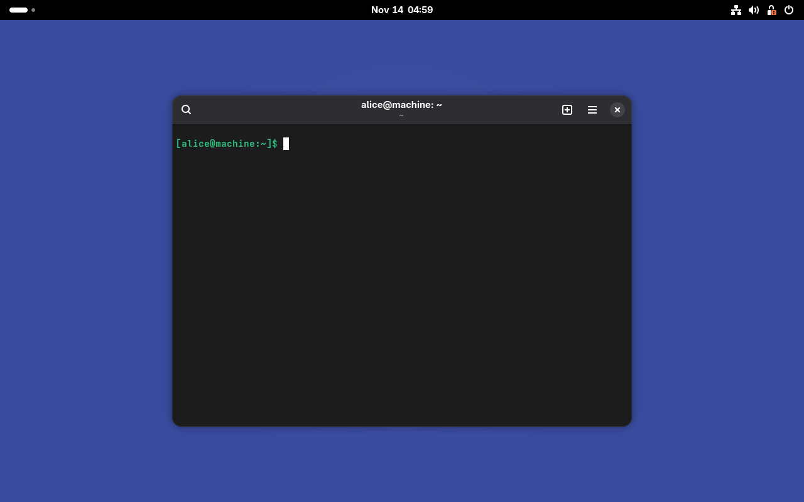

# CASPER: Content-Addressable Store via Partial-blinding and Embedded Relocation

In traditional Nix, build outputs are *input-addressed*: changing a build-only dependency, tweaking a build script, or compiling the same source via two different recipes produces a new store path and triggers cascading downstream rebuilds even when the resulting bytes are identical—while forcing users to trust binary-cache signatures rather than verifying artifacts by their contents. Moving `/nix/store` to *content-addressed* outputs unlocks early rebuild cutoff, cross-recipe deduplication, and trustless content verification, but stabilizing content-addressed Nix has remained elusive because most real-world packages embed their own `/nix/store/<hash>-<name>` path inside their outputs. Breaking that circular hash dependency requires rewriting self-references after the build, yet those references frequently appear inside compressed archives, checksummed manifests, or signed binaries where naive byte-replacement in the Nix daemon is unsound.

**CASPER** resolves this tension without `/nix/store` symlink stubs and without teaching Nix about individual file formats. It pairs cryptographic **partial blinding** with a sandboxed, package-provided `NAR` $\to$ `NAR` stream relocation contract (`$out/nix-support/relocate.sh`), delegating format-specific rewriting to the derivation while Nix enforces fixed-point soundness, offline content verifiability, and on-the-fly dependency replacement. Implemented as an operational prototype over Nix and a lightweight Nixpkgs overlay ([`casper-overlay.nix`](casper-overlay.nix)), CASPER bootstraps from source and boots a full NixOS GNOME desktop.

---

## 1. Core Innovations of CASPER

### 1.1 Breaking the Self-Reference Hash Loop via Partial Blinding
- Whenever a payload must embed a cryptographic hash or signature of itself, standard cryptographic protocols break the circularity by computing the digest over a **blinded** representation of the payload in which the hash/signature slot is either stripped or overwritten with a fixed placeholder (such as all zeros or `xxxx...`):
  - In **cryptocurrency transactions** (e.g., Bitcoin's `SIGHASH` and Ethereum transaction signing), the `scriptSig` or signature fields are zeroed/blanked before hashing the transaction payload to be signed, and the resulting signature is then placed into those fields.
  - In **signed API requests, JWTs, and XML-DSig / SAML enveloped signatures**, as well as **PE Authenticode binaries**, **RPM/FIT images**, and **IPv4/TCP/ICMP packets**, the embedded signature or checksum field is zeroed out before the hash is computed over the payload.
- We call this **partial blinding**: only the self-reference slots (`/nix/store/<input-hash>-<name>`) inside the derivation output are overwritten with a blinding placeholder (`/nix/store/<blind-hash>-<name>`), while all external dependency references (`/nix/store/<dep-hash>-<dep>`) remain unblinded.
- In CASPER, an output's content address `<output-hash>` is defined not as the raw SHA-256 hash of the final output, but as the SHA-256 hash of the **partially blinded** output. Because the placeholder is independent of both `<input-hash>` and `<output-hash>`, the hash loop disappears, and two derivations with different input hashes that produce identical blinded content converge to the exact same `<output-hash>`.

### 1.2 Delegating Partial Blinding & Relocation to the Derivation (`$out/nix-support/relocate.sh`)
- Why can't Nix simply perform partial blinding in C++ using a naive byte-string search-and-replace? Because in real software packages, self-references are not always stored in uncompressed plaintext. Consider a `.gz`-compressed manpage or archive inside `$out` that embeds `/nix/store/<input-hash>-<name>`: a naive byte-string blinder scanning raw file bytes will never see the reference inside the compressed Deflate bitstream and therefore cannot blind or relocate it.
- While we could special-case `.gz` files in Nix itself, this is undesirable as so many versions of hidden references could exist. It is up to the software packager to fix those up.
- CASPER's second invention is to **delegate the task of blinding and relocating self-references to the derivation output itself**, by embedding a relocator (`$out/nix-support/relocate.sh`) inside the output.
- Crucially, embedding the blinder/relocator inside the output **does not re-introduce the hash loop**: the task of blinding and relocating can be defined **abstractly** (`relocate.sh <old-self> <new-self>`, taking the source and target store-path strings as parameters) without making any concrete reference to `<input-hash>` or `<output-hash>` inside the script itself. Because the relocator's own bytes remain completely invariant across blinding and relocation, it can live inside `$out` and be hashed alongside the rest of the partially blinded output without causing a hash cycle.

### 1.3 Sandboxed `NAR` $\to$ `NAR` Stream Relocation (`stdin` $\to$ `stdout`)
- Instead of mutating a directory tree in place on the host filesystem, `relocate.sh <old-self> <new-self>` runs inside an isolated sandbox (`CLONE_NEWUSER`, `CLONE_NEWNS`, `CLONE_NEWNET`, seccomp/Landlock) as a pure **`NAR` (`stdin`) $\to$ `NAR` (`stdout`) stream transformer** with zero host filesystem access:
  - **Pass 1 (Blinding & Hashing)**: Nix serializes `$out` as a NAR stream, pipes it through `relocate.sh "<input-hash>-<name>" "<blind-hash>-<name>"`, and feeds `stdout` directly into Nix's C++ SHA-256 `HashSink` with **zero disk writes** to derive `<output-hash>`.
  - **Pass 2 (Relocation & Trusted Unpacking)**: Nix pipes the blinded NAR through `relocate.sh "<blind-hash>-<name>" "<output-hash>-<name>"` and unpacks `stdout` via its trusted C++ `RestoreSink` to `/nix/store/<output-hash>-<name>` while simultaneously computing the final `narHash` and scanning store references.
  - **Pass 3 (Fixed-Point Verification)**: Immediately after unpacking, Nix re-blinds `/nix/store/<output-hash>-<name>` back to `<blind-hash>-<name>` and verifies that the SHA-256 hash matches Pass 1—proving at build time that `<output-hash>` is a true fixed point.

### 1.4 Unsolvable Hash Loop for the Relocator via Dynamic Blinding Constant
- Whenever `$out/nix-support/relocate.sh` is present, it is required to be a **symlink pointing to a standalone relocator derivation** (`/nix/store/<relocator-hash>-<relocator-name>/...`).
- Nix extracts `<relocator-hash>` directly from the `relocate.sh` symlink target and uses `<relocator-hash>-<name>` as the blinding constant (`blindSelf`).
- This forces an **unsolvable cryptographic hash loop** into the relocator itself: for a relocator to anticipate or hardcode its blinding constant (for example, to branch differently between Pass 1 and Pass 2), it would have to embed its own SHA-256 store hash inside its own binary or script before being hashed.

### 1.5 Downstream Dependency Rewriting (Zero Store Symlinks)
- When a dependency `foo` is relocated from `/nix/store/<input-hash>-foo` to `/nix/store/<output-hash>-foo`, Nix records the mapping in SQLite (`PathRewrites` and `DerivationOutputs`).
- Before building any downstream derivation `bar`, Nix rewrites `<input-hash>-foo` $\to$ `<output-hash>-foo` across `bar`'s builder arguments, environment variables, structured attributes, and sandbox inputs so `bar` builds directly against `/nix/store/<output-hash>-foo`.

### 1.6 Replacing Dependencies on the Fly (CPU Optimization & Rapid Security Patching)
- Because `relocate.sh` is a general `<old-hash>-<name>` $\to$ `<new-hash>-<name>` `NAR` $\to$ `NAR` stream transformer, it can rewrite **dependency hashes** in addition to self-references (similar in spirit to Nixpkgs' `replaceDependencies`, but format-aware and content-addressed).
- This enables both **rapid security updates deep in the stack** (swapping a CVE-patched `openssl`, `glibc`, or `zlib` across a built system in seconds without recompiling reverse dependencies) and **targeted CPU optimization** (swapping in a `-march=native` `glibc` or `openblas`), producing new content-addressed store paths that pass `nix-hash --casper` (see [docs/DEP_REPLACE.md](docs/DEP_REPLACE.md)).

---

## 2. Quickstart & How to Use CASPER

### 2.1 Building CASPER Nix

Compile the modified Nix implementation in the [`nix/`](nix) submodule:

```bash
meson compile -C nix/build
```

The resulting binaries (`nix`, `nix-build`, `nix-store`, `nix-hash`, etc.) are placed in `nix/build/src/nix/`.

---

### 2.2 Building Nixpkgs Packages with `casper-overlay.nix`

[`casper-overlay.nix`](casper-overlay.nix) provides a lightweight Nixpkgs overlay that builds [`casper-relocate`](casper-relocate.c) (a statically-linked C `NAR` $\to$ `NAR` stream relocator handling uncompressed files, symlinks, directory entries, and `.gz` files) and symlinks `$out/nix-support/relocate.sh -> ${casper-relocate}/bin/casper-relocate` whenever an output contains `.gz` files. Outputs without `.gz` files use Nix's built-in format-agnostic C++ `relocateNAR` with zero extra files.

#### Build a Single Package or Closure

```bash
./nix/build/src/nix/nix-build \
  --store "$PWD/casper-store" \
  -E 'import <nixpkgs> { overlays = [ (import ./casper-overlay.nix) ]; }' \
  -A hello
```

> [!TIP]
> **Incremental vs. Full Bootstrap**: You do not need to rebuild `stdenv` from scratch to use CASPER. Pre-existing store paths without a `PathRewrites` entry act as fixed leaves (`resolveInputPath` returns them unchanged), while newly built derivations are blinded, content-addressed, and relocated by CASPER.

#### Run the Full From-Scratch Source Bootstrap (`stage0-posix` $\to$ `stdenv`)

```bash
NIXPKGS=/path/to/nixpkgs ./bootstrap.sh
```

Running [`bootstrap.sh`](bootstrap.sh) against `nixpkgs-unstable` ([`2074cc672349`](https://github.com/NixOS/nixpkgs/commit/2074cc672349f14240fb7ea90d509e0b643e9dd4), `2026-11-12`) builds the entire `x86_64-linux` bootstrap chain **100% from source**—with zero prebuilt `bootstrap-tools` binary tarball—from `hex0-1.9.1` through `mes-0.27.1`, `tinycc`, `musl-1.2.6`, `gcc-4.6.4`, `gcc-10.4.0`, `glibc-2.44`, `gcc-16.2.0`, `stdenv-linux`, and `hello-2.12.3` (**480 relocated derivations** / **591 relocated outputs**), automatically deduplicating **29 cross-stage output groups** (**54 duplicate outputs eliminated**, including compiled C static libraries `crt`, `libgetopt.a`, `libc.a`, `libtcc1.a`, and `zlib-1.3.2-static`) into **537 unique content-addressed store paths** (see [docs/BOOTSTRAPPING_AND_PACKAGING.md](docs/BOOTSTRAPPING_AND_PACKAGING.md#4-real-world-bootstrap-verification-casper-store)).

#### Run a Full NixOS Unstable GNOME 51.0 Wayland Desktop (`pkgs.nixosTests.gnome`)

Beyond bootstrapping `stdenv`, CASPER builds and runs a complete **NixOS Unstable GNOME 51.0 Wayland desktop** (`pkgs.nixosTests.gnome` at `nixpkgs-unstable` [`2074cc672349`](https://github.com/NixOS/nixpkgs/commit/2074cc672349f14240fb7ea90d509e0b643e9dd4), `2026-11-12T14:50:34Z`) in `./casper-store`:

- **3,395 relocated derivations** (**5,712 relocated outputs**, deduplicated into **5,551 unique content-addressed store paths**—eliminating **161 duplicate outputs** with zero `/nix/store` symlink stubs), spanning `linux-6.18.63`, `systemd`, `llvm-22.1.8`, `rustc-1.99.1`, `python3-3.14.10`, `mesa-26.3.0`, `wayland`, `gtk4-4.24.0`, `webkitgtk-2.54.2+abi=6.0`, `mutter-51.0`, `gnome-shell-51.0`, `gdm-51.0`, `virtiofsd-1.14.0`, and `qemu-11.1.2` (as well as NixOS 25.11 GNOME 49.4 at **2,717 derivations** / **5,213 relocated outputs** $\to$ **5,077 unique content-addressed store paths**).
- Every package output passed Pass 1 partial blinding, `casper:out` SHA-256 content addressing, Pass 2 `NAR` $\to$ `NAR` stream relocation, and Pass 3 fixed-point idempotency verification, and the resulting NixOS VM booted into GDM, auto-logged into the GNOME 51.0 Wayland session, and launched `org.gnome.Console`:



---

### 2.3 Verifying Store Paths Offline (`nix-hash --casper` / `nix hash casper`)

Because `<relocator-hash>` is preserved on the `$out/nix-support/relocate.sh` symlink inside the final store object, you can independently recompute and verify the content address of any `/nix/store/<output-hash>-<name>` path without needing the `.drv` or SQLite database:

```bash
# Legacy CLI:
./nix/build/src/nix/nix-hash --casper \
  --store "$PWD/casper-store" \
  /nix/store/5q3rabjwwd2lanj8can9i0l2kk3yl5rp-hello-2.12.3

# Modern CLI:
./nix/build/src/nix/nix --extra-experimental-features nix-command \
  hash casper --store "$PWD/casper-store" \
  /nix/store/5q3rabjwwd2lanj8can9i0l2kk3yl5rp-hello-2.12.3
```

`nix-hash --casper` locates `$out/nix-support/relocate.sh`, extracts `<relocator-hash>` from the symlink target, blinds `<output-hash>-<name>` $\to$ `<relocator-hash>-<name>`, hashes the resulting NAR stream with SHA-256, and verifies that the recomputed `casper:out` store path matches `/nix/store/<output-hash>-<name>`.

---

### 2.4 Custom Relocators for Opaque Formats (`withCasper`)

When a package embeds self-references inside an opaque format beyond `.gz` (such as `.zst`/`.xz` archives or Python `RECORD` manifests), wrap the package with `withCasper` from [`casper-overlay.nix`](casper-overlay.nix). `withCasper` builds a standalone relocator derivation (`casper-relocate-<name>`) and symlinks it at `$out/nix-support/relocate.sh`:

```nix
final: prev:
let
  casperOverlay = import ./casper-overlay.nix final prev;
  inherit (casperOverlay) withCasper;
in casperOverlay // {
  # Example 1: Directory-based custom hook (unpacks NAR in sandbox tmpfs, runs hook, dumps NAR)
  someZstPackage = withCasper {
    relocateExtra = ''
      find "$target" -type f -name "*.zst" | while IFS= read -r zf; do
        zstd -dc "$zf" | sed "s|$old|$new|g" | zstd -q > "$zf.casper-tmp"
        mv "$zf.casper-tmp" "$zf"
      done
    '';
  } prev.someZstPackage;

  # Example 2: Pure NAR -> NAR stream filter hook (stdin -> stdout)
  someStreamPackage = withCasper {
    relocateStream = ''
      exec ${final.casper-relocate}/bin/casper-relocate "$old" "$new"
    '';
  } prev.someStreamPackage;
}
```

---

## 3. Background: Why Self-References Block Content-Addressed Nix

### 3.1 The Self-Reference Hash Loop
In traditional Nix, derivation outputs are **input-addressed**: a derivation with masked input hash `abcdef...` builds its output directly into `/nix/store/abcdef...-foo-1.2.3`, and that path is registered in the store regardless of the actual bytes produced. Two derivations with different inputs that compile to the exact same output cannot share a store path or short-circuit downstream rebuilds.

Moving to **output-addressed (content-addressed) derivations**, where every built object in `/nix/store` is named by the cryptographic hash of its output contents (`/nix/store/<output-hash>-<name>`), runs directly into **self-referencing outputs**:
- Over **54.9%** of packages (and **72.2%** by store size; see [docs/EMPIRICAL_ANALYSIS.md](docs/EMPIRICAL_ANALYSIS.md)) embed their own `$out` store path inside their build outputs—in ELF `DT_RUNPATH`s, shebangs, wrapper scripts, `pkg-config` `.pc` files, Python `.pyc` bytecode, and compressed files such as `.gz` manpages.
- During the build, `$out` must already be known so compilers and build scripts can embed `/nix/store/<hash>-<name>` into binaries and data files.
- Yet if `<hash>` is the cryptographic hash of the output, then the output's contents must contain `<hash>` before `<hash>` can be computed—an **unsolvable cryptographic hash loop**:
  $$H = \text{Hash}\big(\text{output containing } \texttt{/nix/store/} \parallel H \parallel \texttt{-foo}\big)$$

### 3.2 Why Store Symlink Stubs Are Not Enough
One way to sidestep the self-reference loop without rewriting package contents is to build in `/nix/store/<input-hash>-<name>`, move the result to `/nix/store/<output-hash>-<name>`, and leave a **symlink** at `/nix/store/<input-hash>-<name> -> /nix/store/<output-hash>-<name>`. This is undesirable for two reasons:
1. **Double Filesystem Lookups on Every Access**: Every `execve`, shared library load (`openat` via `DT_RUNPATH`), header include, or file read through `/nix/store/<input-hash>-<name>` requires **two filesystem lookups** (first resolving the input-hash symlink, then traversing the target output-addressed directory). On cold storage, spinning disks, overlayfs, or network/remote stores, doubling every filesystem lookup slows down execution and builds considerably.
2. **Leaky Input-Hash Pollution**: Binaries still embed `<input-hash>` rather than `<output-hash>`, so two builds producing identical functional content still differ at the byte level in their embedded paths, and `/nix/store` accumulates permanent symlink stubs for every historical input hash.

---

## 4. Documentation

- **[Comparison with Other Systems (`docs/COMPARISON.md`)](docs/COMPARISON.md)**: Architectural comparison with upstream Nix (`ca-derivations` / RFC 0062, Nix 2.35 `build-trace-v2`, and `builder-rpc-v0`), Lix, Snix (`snix-castore`), Casita, GNU Guix grafts, and Spack splicing, plus open verification trade-offs.
- **[Detailed Architecture (`docs/DETAILS.md`)](docs/DETAILS.md)**: End-to-end operational pipeline, Mermaid flowchart, `NAR` $\to$ `NAR` stream protocol, and multi-output/downstream dependency rewriting.
- **[On-the-Fly Dependency Replacement (`docs/DEP_REPLACE.md`)](docs/DEP_REPLACE.md)**: Using `relocate.sh` to swap ABI-compatible dependencies (such as a CPU-optimized `glibc`) across built packages without recompiling.
- **[Binary Caching & Build Non-Determinism (`docs/NON_DETERMINISM.md`)](docs/NON_DETERMINISM.md)**: `input -> output` realisation index for binary caches, build non-determinism trade-offs, and symlink strategies (`input_hash -> output_hash` vs. `competing_output_hash -> master_output_hash`) to prevent diamond dependency duplication.
- **[Nixpkgs Bootstrapping & Packaging Guide (`docs/BOOTSTRAPPING_AND_PACKAGING.md`)](docs/BOOTSTRAPPING_AND_PACKAGING.md)**: Packaging trade-offs for opaque formats, the dual-location rebuild trick, [`casper-overlay.nix`](casper-overlay.nix) internals, and full `stage0-posix` / `stdenv` bootstrap tables.
- **[Nix C++ Implementation Overview (`docs/NIX_IMPLEMENTATION.md`)](docs/NIX_IMPLEMENTATION.md)**: Summary of modified C++ files in the [`nix/`](nix) submodule.
- **[Security Considerations & Threat Model (`docs/SECURITY.md`)](docs/SECURITY.md)**: Sandbox threat model, prototype vulnerabilities, dynamic `<relocator-hash>` blinding construction, and Pass 3 fixed-point verification.
- **[Alternatives Considered (`docs/ALTERNATIVES_CONSIDERED.md`)](docs/ALTERNATIVES_CONSIDERED.md)**: Discarded design alternatives (in-place directory mutation, separate `hash.sh`, `/nix/build`, and `.`-prefixed store paths).
- **[Empirical Self-Reference Analysis (`docs/EMPIRICAL_ANALYSIS.md`)](docs/EMPIRICAL_ANALYSIS.md)**: Measurements of self-referencing store paths across Nixpkgs by output category and size.
