# Comparison with Other Content-Addressed & Relocatable Build Systems

This document compares **CASPER (Content-Addressable Store via Partial-blinding and Embedded Relocation)** against upstream Nix's content-addressed derivations ([RFC 0062](https://github.com/NixOS/rfcs/blob/master/rfcs/0062-content-addressed-paths.md), Nix 2.35 `build-trace-v2`, and `builder-rpc-v0`), **Lix**, **Snix (`snix-castore`)**, **Casita**, **GNU Guix grafts**, and **Spack binary relocation & splicing** (see [README.md](../README.md), [DETAILS.md](DETAILS.md), [DEP_REPLACE.md](DEP_REPLACE.md), [NON_DETERMINISM.md](NON_DETERMINISM.md), and [SECURITY.md](SECURITY.md)).

---

## 1. High-Level Architectural Matrix

No existing system combines all six of CASPER's mechanisms—partial blinding with a dynamic `<relocator-hash>` sentinel, package-embedded `NAR` $\to$ `NAR` stream relocators (`$out/nix-support/relocate.sh`), sandboxed stream execution, three-pass fixed-point verification, symlink-free downstream input rewriting, and post-build dependency replacement—into a single model. However, several systems solve important pieces of the same puzzle:

| System | Content-Addressed Build Outputs | Self-Reference Handling | Opaque / Compressed Format Relocation (`.gz`, `.zst`, Checksums, Signatures) | Post-Build Dependency Swapping (No Rebuild) | Storage Model |
| :--- | :---: | :--- | :--- | :--- | :--- |
| **CASPER** | Yes (`casper:out` SHA-256 of blinded NAR) | Dynamic `<relocator-hash>` partial blinding + 3-pass fixed-point check | **Yes** — delegated to sandboxed `NAR` $\to$ `NAR` `$out/nix-support/relocate.sh` (or fast C++ `relocateNAR` when absent) | **Yes** — format-aware `relocate.sh` produces new verifiable CA paths ([`DEP_REPLACE.md`](DEP_REPLACE.md)) | Standard `/nix/store` directories (compatible with chunked backends) |
| **Upstream Nix `ca-derivations`** ([RFC 0062](https://github.com/NixOS/rfcs/blob/master/rfcs/0062-content-addressed-paths.md) / Nix 2.35) | Opt-in (`__contentAddressed = true`) | NUL-byte sentinel masking (`MaskedHashSink` + `RewritingSink`) | **No** — hardcoded raw byte replacement in C++; misses compressed/encoded refs | No (requires `replaceDependencies` rebuild derivations) | Standard `/nix/store` + `build-trace-v2` |
| **Upstream Nix `builder-rpc-v0`** ([`building.md`](../nix/doc/manual/source/store/building.md#L227-L270)) | Yes (IPC `nix store submit-output`) | **Unsupported** (cannot resolve hash loop for self-references) | **Sibling outputs only** — builder submits `out` first, rewrites/compresses `man` second | No | Standard `/nix/store` |
| **Lix** (2.94+) | Removed `ca-derivations` in 2026 | Input-addressed only | N/A | Via Nixpkgs `replaceDependencies` | Standard `/nix/store` |
| **Snix (`snix-castore`)** & **Casita** | Storage-layer CA (orthogonal to self-ref blinding) | Inherits builder/Nix output semantics | Orthogonal — operates on post-build trees/blobs | Orthogonal | **Merkle-DAG trees + chunked blob store** |
| **GNU Guix Grafts** | No (input-addressed `/gnu/store`) | Input-addressed | Limited — fixed-length byte scan over uncompressed files/symlinks | **Yes** — first-class `graft` mechanism for rapid security updates | Standard `/gnu/store` |
| **Spack Relocation & Splicing** ([`arXiv:2509.07728`](https://arxiv.org/abs/2509.07728)) | Prefix-relocated binary cache | Relocates install prefixes (`RPATH`, Mach-O, text) | Format-specific logic hardcoded in Spack (`ELF`, `Mach-O`, text, scripts) | **Yes** — ABI-aware `splice` rewires DAGs + tracks provenance | Prefix-per-hash directory layout |

---

## 2. Upstream Nix: `ca-derivations`, `build-trace-v2`, and `builder-rpc-v0`

Upstream Nix's content-addressed derivations effort—originated in [RFC 0062](https://github.com/NixOS/rfcs/blob/master/rfcs/0062-content-addressed-paths.md) (2019–2020) and led primarily by Théophane Hufschmitt, Eelco Dolstra, and John Ericson, with store/trust contributions from Guillaume Maudoux, Robert Hensing, and others—is the closest architectural relative to CASPER.

### 2.1 Where CASPER Overlaps with RFC 0062 & Nix 2.35
1. **Sentinel-Based Partial Blinding**:
   - Partial blinding itself is not new to CASPER: RFC 0062 already breaks the self-reference hash cycle by hashing the output through `MaskedHashSink` (which masks occurrences of `oldHashPart` to NUL bytes) and then rewriting `oldHashPart` $\to$ `newHashPart` via `RewritingSink`.
   - CASPER refines *how* that blinding is parameterized, executed, and verified: instead of a fixed NUL mask applied to raw NAR bytes in C++, CASPER allows each output to supply a sandboxed `NAR` $\to$ `NAR` stream transformer (`$out/nix-support/relocate.sh`), uses the relocator derivation's own store hash (`<relocator-hash>-<name>`) as the blinding target (`blindSelf`), and enforces a Pass 3 re-blinding check (`Pass 3 == Pass 1`).
2. **Build Traces (`build-trace-v2`) vs. `PathRewrites`**:
   - Because a floating content-addressed output path is unknown until its build finishes, Nix must record a mapping from `(drvPath, outputName)` to the realized `/nix/store/<output-hash>-<name>`.
   - Nix 2.35 (July 2026) overhauled realisations into **`build-trace-v2`**, removing complex "deep realisations" and keying traces directly by `(drvPath, outputName) -> outputPath`. CASPER's SQLite `PathRewrites` and `DerivationOutputs` tables serve the exact same role locally, and Nix 2.35's signed `build-trace-v2` model aligns directly with how CASPER binary caches publish `input -> output` mappings (see [NON_DETERMINISM.md](NON_DETERMINISM.md)).
3. **Shared Fundamental Trade-Offs**:
   - **Mixed Input/CA Closures**: As tracked in upstream Nix ([#11919](https://github.com/NixOS/nix/issues/11919)), a single input-addressed leaf in an incremental closure breaks end-to-end Merkle trust unless either rebuilt from source (CASPER's Mode B: `hex0` $\to$ GNOME 51.0) or trusted via cache signatures (CASPER's Mode A incremental mode).
   - **Cutoff Requires Building the Changed Node First**: Content addressing cuts off rebuilds *downstream* of a derivation whose blinded output converges, but Nix still must build a derivation when its *own* recipe or `postFixup` hook changes before knowing that its output bytes match.

### 2.2 The Key Contrast: `ca-derivations` vs. `builder-rpc-v0` vs. CASPER
The sharpest architectural comparison in upstream Nix is with **`builder-rpc-v0`**, documented in [`nix/doc/manual/source/store/building.md`](../nix/doc/manual/source/store/building.md#L227-L270).

Upstream Nix recognized that C++ `RewritingSink` over raw NAR bytes is fragile whenever store paths are compressed, checksummed, or signed (`.gz` manpages, Mach-O code signatures, Python `RECORD` digests). To avoid black-box rewriting by the daemon, `builder-rpc-v0` lets a derivation communicate with the daemon over IPC (`nix store add` / `nix store submit-output`) and submit outputs one by one in topological order (`out` first, `man` second after learning `out`'s content address).

However, as the upstream Nix manual explicitly notes ([`building.md`](../nix/doc/manual/source/store/building.md#L265-L270)):
> *"The major disadvantage of this approach is that **it doesn't yet support self-references**. Unlike acyclic output-to-output references, self-references fundamentally do require rewriting... Neither batched (traditional) nor serial (IPC) submission of outputs can avoid this fundamental property of secure hash functions. We could add support for such rewriting just for self-references, as is done for the traditional post-build processing, but we haven't yet done so as **the very point of the IPC approach is to free Nix from any obligation to rewrite black-box data in unsound ways**."*

```mermaid
flowchart TD
    subgraph RFC0062["Upstream Nix ca-derivations (RFC 0062)"]
        A1["Builder writes $out"] --> A2["Nix C++ MaskedHashSink + RewritingSink"]
        A2 --> A3["Supports self-refs, but blind to .gz / checksums / signatures"]
    end

    subgraph RPC["Upstream Nix builder-rpc-v0 (IPC)"]
        B1["Builder submits 'out' via IPC, gets CA path"] --> B2["Builder formats/compresses 'man' with CA path"]
        B2 --> B3["Format-aware for sibling outputs, but CANNOT handle self-references"]
    end

    subgraph CASPER["CASPER Embedded NAR-Stream Relocation"]
        C1["Builder writes $out + optional nix-support/relocate.sh symlink"] --> C2["Pass 1/2/3: Sandboxed NAR -> NAR relocate(old, new)"]
        C2 --> C3["Supports BOTH self-references AND format-aware compressed/signed data"]
    end
```

CASPER resolves the exact dilemma between `ca-derivations` and `builder-rpc-v0`:
- **Nix remains completely format-agnostic** (never learning about `.gz`, `.zst`, `RECORD`, or `codesign`), freeing the daemon from unsound black-box byte-rewriting on opaque formats.
- **Self-references work natively** because post-build blinding and relocation are retained, but delegated to the derivation's own pure `NAR` $\to$ `NAR` stream operator (`$out/nix-support/relocate.sh`).
- **Zero Nixpkgs rewrite required**: whereas `builder-rpc-v0` requires rewriting package builders around interactive IPC calls (and `__contentAddressed = true` in `ca-derivations` still struggles with compressed references and full NixOS closures), CASPER builds an unmodified `nixpkgs-unstable` source bootstrap (`hex0` $\to$ `stdenv`) and a full NixOS GNOME 51.0 Wayland desktop (`5,712` relocated outputs $\to$ `5,551` unique CA paths) with a ~290-line overlay ([`casper-overlay.nix`](../casper-overlay.nix)).

---

## 3. Lix: Why `ca-derivations` Was Removed and How CASPER Differs

In early 2026 (Lix 2.94 / 2.95), the **[Lix](https://lix.systems)** fork removed experimental `ca-derivations` and dynamic derivations altogether, arguing that bolting optional CA derivations onto input-addressed Nix introduced pervasive complexity and correctness hazards across evaluation, scheduling, daemon wire protocols, and NAR rewriting.

CASPER addresses two of the core pain points behind that critique:
1. **Content Addressing as the Uniform Store Invariant, Without Evaluation Bifurcation**: Instead of splitting the Nix language and scheduler into incompatible input-addressed vs. floating-CA derivation worlds, CASPER keeps standard `.drv` evaluation intact and applies uniform `NAR` $\to$ `NAR` blinding/relocation + `PathRewrites` resolution at build boundaries.
2. **Explicit Fixed-Point Soundness Instead of "Cross Fingers" Byte Rewriting**: Upstream Nix's `rewriteOutput` literally logs `"rewriting hashes in %1%; cross fingers"` ([`derivation-builder-impl.cc`](../nix/src/libstore/build/derivation-builder-impl.cc#L492)). CASPER replaces blind mutation with a deterministic `NAR` $\to$ `NAR` functional contract verified at build time by Pass 3 (`relocate(newSelf -> blindSelf) == Pass 1`) and verifiable offline at any time via `nix-hash --casper`.

---

## 4. Next-Generation CA Storage Engines: Snix (`snix-castore`) & Casita

Two prominent Rust projects in the Nix ecosystem redesign the **physical store layer**:
- **[Snix](https://snix.dev) (`snix-castore`)**: Replaces monolithic NAR blobs and `/nix/store` directories with content-addressed Merkle directory DAGs and chunked blob storage (BLAKE3), exposing lazy FUSE/virtiofs views while interoperating with legacy NARs.
- **[Casita](https://casita.rs)** (announced by Domen Kožar in September 2026): A generic Rust content-addressed object store supporting chunk-level deduplication, verified incremental synchronization, garbage collection, and unified import of Nix archives, Git trees, and OCI container layers.

**Complementary, Not Competing Layers**:
- `snix-castore` and Casita solve **physical storage and transport**: sub-file chunk deduplication across distinct packages, lazy mounting, and verified streaming—things store-object-level CA (both RFC 0062 and CASPER) does not provide on its own.
- Conversely, a Merkle-DAG blob store **does not by itself solve the self-reference hash loop**: if `glibc` or `gnome-shell` is built at scratch prefix `/nix/store/<input-hash>-...` and imported straight into `snix-castore` or Casita without blinding and format-aware relocation, its ELF `DT_RUNPATH`s and `.gz` manpages still embed `<input-hash>`.
- Combining **CASPER's build-time `NAR` $\to$ `NAR` blinding/relocation protocol** (to normalize self-references and derive `/nix/store/<output-hash>-<name>`) with **`snix-castore` / Casita's Merkle-chunked storage backend** (to deduplicate shared file chunks across versions and stream closures lazily) gives both logical content-addressing and physical sub-file deduplication.

---

## 5. Post-Build Dependency Replacement: GNU Guix Grafts & Spack Splicing

CASPER's embedded relocators also enable **post-build dependency replacement**—swapping an ABI-compatible library (such as a CVE-patched `openssl` or `-march=native` `glibc`) across an already-built closure without recompiling reverse dependencies (see [DEP_REPLACE.md](DEP_REPLACE.md)). Two systems outside Nix pioneer closely related mechanisms:

### 5.1 GNU Guix Grafts
- **[GNU Guix](https://guix.gnu.org)** uses **grafts** to deploy urgent security updates across deep dependency trees in seconds by rewriting `/gnu/store/<old-hash>-lib` $\to$ `/gnu/store/<new-hash>-lib` in dependent outputs rather than rebuilding the world.
- **Comparison**: Guix grafts operate on an input-addressed store using generic fixed-length string replacement (which cannot see inside compressed `.gz` files or update embedded checksum manifests like Python `RECORD`). Because CASPER packages carry `$out/nix-support/relocate.sh`, CASPER's dependency replacement reuses the exact same package-specific `NAR` $\to$ `NAR` relocator used at build time and produces a genuinely content-addressed `casper:out` store path verifiable via `nix-hash --casper`.

### 5.2 Spack Binary Relocation & Splicing (`arXiv:2509.07728`)
- **[Spack](https://spack.io)** has long performed format-aware binary relocation (rewriting ELF `RPATH`s, Mach-O load commands, shebangs, and text prefixes) to install binary-cache tarballs into arbitrary host prefixes, and in Spack 0.23+ introduced **[splicing](https://arxiv.org/abs/2509.07728)**—rewiring a built package DAG against an ABI-compatible replacement (for instance, building against generic MPICH and splicing in a vendor-tuned cluster MPI at deployment time).
- **Key Architectural Lesson for CASPER (Structural Integrity vs. ABI Compatibility)**:
  - Unlike Spack's prefix relocation (which relocates into non-self-content-addressed install paths using format logic centralized inside Spack), CASPER decentralizes format knowledge into per-package `relocate.sh` symlinks and closes the self-reference hash loop.
  - Conversely, Spack splicing explicitly models **ABI compatibility predicates** and records **build provenance vs. spliced deployment configuration**. A valid `relocate.sh` pass and a passing `nix-hash --casper` check prove *structural relocation integrity*, **not** that `libfoo-1.2.4` is actually ABI-compatible with `libfoo-1.2.3`. Pairing CASPER's `relocate.sh` splicing with Spack-style ABI compatibility metadata and provenance records is a natural extension for production security grafting and microarchitectural optimization.

---

## 6. Scrutinizing CASPER's Boundaries & Path to Upstream Adoption

Comparing CASPER across these systems highlights two fundamental properties that must be kept clear in any rigorous evaluation, along with a pragmatic path for upstreaming:

### 6.1 Pass 3 Proves Round-Trip Consistency, Not Relocation Completeness
- Pass 3 (`relocate(newSelf -> blindSelf) == Pass 1`) guarantees at build time that `relocate.sh` is a deterministic fixed-point bijection on every reference it touches—catching truncation, non-deterministic recompression, and cheating relocators.
- However, Pass 3 **cannot by itself prove completeness**: if a package embeds `/nix/store/<input-hash>-foo` inside an unrecognized format (e.g., an `.xz` blob when only `.gz` is handled), Pass 1, Pass 2, and Pass 3 will all leave that compressed blob untouched. Pass 3 will succeed even though `<input-hash>` remains dormant inside the `.xz` stream.
- Detecting *incomplete* relocators requires **differential dual-location builds** (`-recheck` under two distinct scratch paths `<inputHash1>` vs. `<inputHash2>` and verifying $H_{\text{blind}}^{(1)} = H_{\text{blind}}^{(2)}$; see [BOOTSTRAPPING_AND_PACKAGING.md §1.2](BOOTSTRAPPING_AND_PACKAGING.md#12-trick-for-deterministic-packages-dual-location-rebuild-to-detect-incomplete-relocatesh)).

### 6.2 Offline Content Verification Includes the Sandboxed Relocator in the TCB
- For the **91.1%** of store outputs in the NixOS Unstable GNOME closure (`5,058` of `5,551` unique CA paths) that contain no `.gz` or custom opaque self-references, `$out/nix-support/relocate.sh` is absent and `nix-hash --casper` verifies the store path purely inside Nix C++ (`relocateNAR`) with zero external code execution.
- For the remaining **8.9%** (`493` outputs with `$out/nix-support/relocate.sh -> .../casper-relocate`), independent verification of `<output-hash>` must execute the referenced relocator inside a hermetic `NAR` $\to$ `NAR` sandbox (while raw transport integrity continues to be covered immediately by `ValidPaths.narHash`).
- Consequently, the relocator sandbox (`CLONE_NEWUSER | CLONE_NEWNS | CLONE_NEWNET`, seccomp/Landlock, zero host/store mounts) and the cryptographic binding of `<relocator-hash>` as `blindSelf` are security-critical parts of the verification model (see [SECURITY.md](SECURITY.md)).

### 6.3 Pragmatic Scope for Upstream Nix Integration
Rather than viewing CASPER as a competing rewrite of Nix's storage layer or build-trace protocol, CASPER's most distinct upstream contribution is a **first-class, sandboxed `NAR` $\to$ `NAR` relocation protocol for store objects**:
- It plugs directly into Nix 2.35's `build-trace-v2` `(drvPath, outputName) -> outputPath` architecture and future `snix-castore` / Casita Merkle backends.
- Most importantly, it closes the exact self-reference gap documented between RFC 0062's format-blind `MaskedHashSink` and `builder-rpc-v0`'s self-reference-incapable IPC submission.
