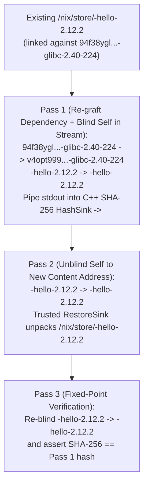

# On-the-Fly Dependency Replacement in CASPER

This document explains how **CASPER (Content-Addressable Store via Partial-blinding and Embedded Relocation)** enables replacing runtime dependencies on the fly (such as swapping a generic `glibc` for a CPU-optimized `-march=native` `glibc`) without recompiling downstream packages (see [README.md](../README.md), [DETAILS.md](DETAILS.md), and [NON_DETERMINISM.md](NON_DETERMINISM.md)).

---

## 1. Motivation: CPU-Optimized Base Libraries & Rapid Deep-Stack Security Patching

### 1.1 Optimizing Base Libraries Instead of Leaf Applications

Recompiling an entire operating system or desktop closure with `-march=native` (`x86-64-v3`, `x86-64-v4`, `znver4`, etc.) is expensive and rarely necessary for leaf utilities like `hello` or `coreutils`. In practice, the vast majority of CPU-sensitive inner loops live in a small set of foundational shared libraries:
- **`glibc` / `libm`** (`memcpy`, `memmove`, `strcmp`, `strlen`, vectorized math functions `expf`/`sinf`/`cosf`)
- **Cryptography & Compression** (`openssl`, `zlib`, `zstd`, `libblake3`)
- **Linear Algebra, Media & Graphics** (`openblas`/`lapack`, `ffmpeg`, `libjpeg-turbo`, `mesa`, `pixman`)

### 1.2 Rapid Security Updates Deep in the Dependency Stack

When a critical CVE is discovered in a foundational library deep in the dependency graph (`openssl`, `glibc`, `zlib`, `xz`, `expat`, `curl`, `libxml2`), rebuilding every transitive reverse dependency in Nixpkgs (browsers, desktop environments, databases, language runtimes) takes hours or days on a build farm.

In traditional Nixpkgs, `pkgs.replaceDependencies` (in `pkgs/build-support/replace-dependency.nix`) attempts to work around this by performing a byte-for-byte string replacement of `/nix/store/<old-hash>-<name>` $\to$ `/nix/store/<new-hash>-<name>` across a closure.

In CASPER, because every package with non-plaintext references already carries a format-aware `NAR` $\to$ `NAR` relocator (`$out/nix-support/relocate.sh`), any ABI-compatible dependency—whether a **security-patched library** or a **CPU-optimized base library**—can be replaced across an already-built package or closure **on the fly** in a streaming pass, producing a new, first-class content-addressed store path in seconds without recompiling downstream packages.

---

## 2. Why `relocate.sh` Naturally Supports Dependency Replacement

1. **Format-Agnostic `old` $\to$ `new` Interface**:
   - `relocate.sh` does not assume that the store path being rewritten is `$out` (`self`). It simply rewrites `<old-hash>-<name>` $\to$ `<new-hash>-<name>` across the NAR stream (including ELF `PT_INTERP`, `DT_RUNPATH`, wrapper scripts, symlinks, and compressed `.gz` files).
   - CASPER already uses this mechanism during **multi-output builds** in [`DerivationBuilderImpl::registerOutputs`](../nix/src/libstore/build/derivation-builder-impl.cc#L688-L716): when leaf output `$out` is relocated to `<new-out-hash>-<name>`, dependent outputs (`$man`, `$dev`) invoke their `relocate.sh` to rewrite `<old-out-hash>-<name>` $\to$ `<new-out-hash>-<name>` before computing their own content address.
2. **Multi-Pair Streaming Relocation**:
   - By accepting multiple rewrite pairs in a single invocation (e.g., `casper-relocate <old1>:<new1> <old2>:<new2> ...`), `casper-relocate` can rewrite both external dependencies (`<generic-glibc> -> <optimized-glibc>`) and `self` (`<old-self> -> <blind-self>`) in a **single streaming pass** over the NAR.

---

## 3. End-to-End Pipeline: Swapping `glibc` for a CPU-Optimized `glibc`

Suppose `hello-2.12.2` (or an entire GNOME closure) was built against generic `x86-64` `glibc`:
- **Generic `glibc`**: `/nix/store/94f38yglcijsz5a8kv7hr3bz2w1is1r0-glibc-2.40-224`
- **CPU-Optimized `glibc` (`-march=native`)**: `/nix/store/v4opt999cijsz5a8kv7hr3bz2w1is1r0-glibc-2.40-224`

Because both `glibc` derivations share the store-path name `glibc-2.40-224`, their store paths have the **exact same byte length** (`32`-char hash + `-glibc-2.40-224`). Retargeting `/nix/store/<old-hello>-hello-2.12.2` to the optimized `glibc` proceeds in three streaming passes:

1. **Pass 1 (In-Stream Dependency Rewrite + Self-Blinding + SHA-256 Hash)**:
   - Stream the NAR of `/nix/store/<old-hello>-hello-2.12.2` through `relocate.sh`, rewriting:
     - `94f38yglcijsz5a8kv7hr3bz2w1is1r0-glibc-2.40-224` $\to$ `v4opt999cijsz5a8kv7hr3bz2w1is1r0-glibc-2.40-224`
     - `<old-hello>-hello-2.12.2` $\to$ `<blind-hello>-hello-2.12.2`
   - Pipe `stdout` directly into Nix's C++ SHA-256 `HashSink` with zero disk writes to derive the new content address `<new-hello>-hello-2.12.2`.
2. **Pass 2 (Unblind Self & Materialize to `/nix/store/<new-hello>-hello-2.12.2`)**:
   - Pipe the blinded NAR through `relocate.sh` (`<blind-hello>-hello-2.12.2` $\to$ `<new-hello>-hello-2.12.2`) and unpack via `RestoreSink` into `/nix/store/<new-hello>-hello-2.12.2` while scanning references.
3. **Pass 3 (Self-Verification)**:
   - The resulting `/nix/store/<new-hello>-hello-2.12.2` is a **genuine, first-class CASPER content-addressed path**: running `nix-hash --casper /nix/store/<new-hello>-hello-2.12.2` verifies its content address identically to a package compiled from scratch against the optimized `glibc`.

---

## 4. Advantages Over Traditional `pkgs.replaceDependencies`

1. **Works Inside Compressed & Checksummed Files**:
   - Traditional Nixpkgs `replaceDependencies` performs raw byte replacement on unpacked files and breaks whenever a dependency path is stored inside a `.gz` manpage, a `.zst` archive, a Python `.dist-info/RECORD` manifest with SHA-256 digests, or a GHC `package.cache`.
   - In CASPER, each package's `$out/nix-support/relocate.sh` already handles its own compressed or checksummed formats.
2. **In-Flight Relocation During Binary Cache Downloads**:
   - A client downloading generic packages from a shared binary cache can apply dependency replacement **in flight** on the incoming NAR stream—linking downloaded packages against a locally built `-march=native` `glibc`, `openssl`, `mesa`, or `openblas` as they are unpacked into `/nix/store`.

---

## 5. Scope & Limitations

- **Supported**: Any **ABI-compatible shared library or runtime interpreter** (`glibc`, `libstdc++`, `openssl`, `zlib`, `zstd`, `libjpeg-turbo`, `openblas`, `mesa`, `ffmpeg`) whose replacement store path preserves the same `<name>` suffix.
- **Not Replaced**: Code that was **inlined from C/C++ headers** (such as `<bits/string_fortified.h>` or template headers) or statically linked from `.a` archives at compile time, or libraries whose public ABI/symbol versions changed incompatibly.
