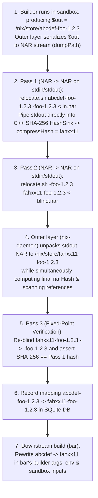

# CASPER Detailed Architecture

This document describes the detailed end-to-end operational pipeline, the `NAR` $\to$ `NAR` stream relocation contract, and downstream dependency rewriting for **CASPER (Content-Addressable Store via Partial-blinding and Embedded Relocation)** (see [README.md](../README.md), [NON_DETERMINISM.md](NON_DETERMINISM.md), [BOOTSTRAPPING_AND_PACKAGING.md](BOOTSTRAPPING_AND_PACKAGING.md), [NIX_IMPLEMENTATION.md](NIX_IMPLEMENTATION.md), [SECURITY.md](SECURITY.md), and [ALTERNATIVES_CONSIDERED.md](ALTERNATIVES_CONSIDERED.md)).

---

## 1. End-to-End Operational Pipeline

1. **Evaluation & Build in Input-Hash Path (`<input-hash>-<name>`)**:
   - At evaluation time (`builtins.derivation`), a derivation `foo-1.2.3` still computes its standard 32-character input-addressed path `/nix/store/abcdef...-foo-1.2.3`.
   - No `.` prefix or store symlinks are needed: all store paths remain standard 32-character Nix32 hashes of identical byte length (`32` chars).
   - During the build of `foo`, `$out` is `/nix/store/abcdef...-foo-1.2.3`.
2. **Primary Design: Pure `NAR` $\to$ `NAR` Stream Relocation (`stdin` $\to$ `stdout`) & Outer-Layer Unpacking**:
   - Rather than mutating a live directory tree on the host filesystem, `relocate` (`$out/nix-support/relocate.sh`) is a **`NAR` $\to$ `NAR` stream transformer**: it reads a Nix Archive (NAR) from `stdin`, replaces `<old-self>` with `<new-self>`, and writes the resulting NAR to `stdout`:
     ```sh
     relocate.sh <old-self> <new-self> < input.nar > output.nar
     ```
   - The relocator process needs **zero host filesystem access**; if the outer layer (`nix-daemon`) wants to write the relocated output to `/nix/store/<output-hash>-<name>`, **the outer layer unpacks the NAR from `stdout` itself** (`restorePath`).
   - When `$out/nix-support/relocate.sh` is present, it must be a symlink to a standalone relocator derivation `/nix/store/<relocator-hash>-<relocator-name>/...`, and Nix sets `<blind-hash> = <relocator-hash>` (when `relocate.sh` is absent, Nix uses its built-in format-agnostic C++ `relocateNAR` with `<blind-hash> = xxxxxxxxxxxxxxxxxxxxxxxxxxxxxxxx`; see [SECURITY.md Section 5](SECURITY.md#5-dynamic-blinding-target-via-symlinked-relocator-store-hash--round-trip-self-verification)).
   - Blinding is **strictly scoped to self-references** (`<input-hash>-<name>` $\to$ `<blind-hash>-<name>`). Dependency references (`/nix/store/<dep-out-hash>-<dep-name>`) already have their final content-addressed hashes and are never blinded.
   - **Step 2a + 2b (In-Stream Blinding & Content Hashing—Zero Disk Writes)**:
     - The outer layer serializes `$out` into a NAR stream (`dumpPath($out)`), pipes it into `relocate.sh "<input-hash>-<name>" "<blind-hash>-<name>"`, and pipes `stdout` **directly into Nix's C++ SHA-256 `HashSink`** (deriving the 32-character Nix32 `casper:out` hash `<output-hash>`, e.g. `fahxx11...`).
     - Because self-references were blinded in the NAR stream first (even inside `.gz` entries), two builds with different input hashes that produce the same content yield the **exact same `<output-hash>`** without writing a blinded copy to disk.
   - **Step 2c (In-Stream Relocation + Trusted Outer-Layer NAR Unpacking & Reference Scan)**:
     - The outer layer pipes the NAR through `relocate.sh "<blind-hash>-<name>" "<output-hash>-<name>"` and feeds `stdout` directly into Nix's C++ `TeeSink(RestoreSink("/nix/store/<output-hash>-<name>"), HashAndRefScanSink)`—simultaneously unpacking the final output to `/nix/store/fahxx11...-foo-1.2.3`, computing its final `narHash`/`narSize`, and scanning the final uncompressed NAR stream for store references.
   - **Step 2d / Pass 3 (Fixed-Point Verification)**:
     - Immediately after unpacking the relocated output, Nix re-blinds the unpacked output (`relocate.sh "<output-hash>-<name>" "<blind-hash>-<name>"`) into a SHA-256 `HashSink` and asserts that the re-blinded digest equals Step 2b's `normalizedNar.hash`—proving at build time that `<output-hash>` is a true fixed point and that Pass 2 was a lossless inverse of Pass 1.
3. **Downstream Dependency Rewriting in Builder Args & Env**:
   - When a downstream derivation `bar` (which depends on `foo`) was evaluated, its `.drv` recorded `foo`'s input-addressed path `/nix/store/abcdef...-foo-1.2.3`.
   - Before `bar` is built, Nix looks up the realised output path of `foo` (`/nix/store/fahxx11...-foo-1.2.3`) and rewrites `abcdef...` -> `fahxx11...` in `bar`'s builder arguments (`drv.args`), environment variables (`drv.env`), structured attrs / extra files, and sandbox `inputPaths`.
   - Thus `bar` builds directly against `/nix/store/fahxx11...-foo-1.2.3`—no symlinks in `/nix/store` are required.



---

## 2. `relocate.sh` as a `NAR` $\to$ `NAR` Stream Transformer (`stdin` $\to$ `stdout`)

### Core Contract
Instead of mutating a directory tree in place on the host filesystem, `relocate` (`$out/nix-support/relocate.sh`) operates as a pure **`NAR` $\to$ `NAR` stream filter**:
```sh
"$out/nix-support/relocate.sh" <old-self> <new-self> < input.nar > output.nar
```
- `stdin`: A Nix Archive (NAR) byte stream representing the output (either a directory, regular file, or symlink).
- `stdout`: The relocated Nix Archive (NAR) byte stream with `<old-self>` rewritten to `<new-self>`.
- `$1` (`old-self`): `<old-hash>-<name>` (e.g. `abcdef...-foo-1.2.3` or `<blind-hash>-foo-1.2.3`).
- `$2` (`new-self`): `<new-hash>-<name>` (e.g. `<blind-hash>-foo-1.2.3` or `fahxx11...-foo-1.2.3`).
- **Outer-Layer Unpacking**: The `relocate` process never writes to `/nix/store`. Whenever the outer layer (`nix-daemon`) wants to materialize the relocated output to disk (`/nix/store/<output-hash>-<name>`), **the outer layer unpacks the NAR from `stdout` itself** using its trusted C++ `RestoreSink` (`restorePath`).

### Why `NAR` $\to$ `NAR` Takes Precedence Over In-Place Directory Mutation
1. **Uncompressed NARs Can Be Relocated as a Raw Byte Stream ($O(1)$ Memory)**:
   - In the NAR wire format, every regular file body, symlink target, and filename is stored as a contiguous byte slice preceded by a 64-bit little-endian length prefix and padded to an 8-byte boundary.
   - Because `<oldHash>-<name>` and `<newHash>-<name>` have the **exact same byte length**, replacing `<oldHash>-<name>` $\to$ `<newHash>-<name>` inside any uncompressed file or symlink **never alters any 64-bit length prefix or 8-byte alignment padding**.
   - Only compressed entries (such as `.gz`, where re-running `gzip -n` after rewriting a hash can change the compressed byte size by a few bytes) require updating that entry's 64-bit NAR length field.
2. **Zero Disk Writes During Blinding & Content Hashing**:
   - **Pass 1 (In-Stream Blind + Hash)**: The outer layer serializes `$out` once (`dumpPath($out)`), pipes it into `relocate.sh "<inputHash>-<name>" "<blindHash>-<name>"`, and streams `stdout` **directly into Nix's C++ `HashSink(HashAlgorithm::SHA256)`** to compute `outHash`—without ever unpacking the blinded tree to disk.
   - **Pass 2 (In-Stream Relocate + Trusted Unpack + Reference Scan)**: The outer layer pipes the NAR into `relocate.sh "<blindHash>-<name>" "<outHash>-<name>"` and streams `stdout` directly into `TeeSink(RestoreSink("/nix/store/<outHash>-<name>"), HashAndRefScanSink)`.
3. **Eliminates Whole Classes of Security Vulnerabilities by Construction (see [SECURITY.md](SECURITY.md))**:
   - **No Host Filesystem Access or TOCTOU Races**: `relocate.sh` runs in an isolated, unprivileged container with no write access to `/nix/store` or `actualPath`, communicating exclusively over `stdin` and `stdout`.
   - **Trusted C++ Unpacking**: Because `nix-daemon` unpacks the final NAR itself via `restorePath`, Nix enforces canonical permissions (`0444`/`0555`), `mtime = 1`, `root:root` ownership, `O_NOFOLLOW` file creation, and safe hardlink deduplication.
   - **Automatic Metadata Canonicalization**: Because the NAR format has no `mtime`, `ctime`, `uid`, `gid`, `inode` numbers, or unsorted directory entries, `stdin` $\to$ `stdout` NAR transformation automatically strips all filesystem metadata side channels between Pass 1 and Pass 2.
   - **Single-Pass Post-Relocation Reference Scanning**: As the outer layer unpacks `stdout` to disk, it simultaneously hashes and runs `scanForReferences` on the exact final NAR stream.

### Supporting Both Streaming and Directory-Based Custom Hooks Under `NAR` $\to$ `NAR`
- **Default / Streaming Relocator ([`casper-relocate.c`](../casper-relocate.c))**:
  - Reads NAR tokens from `stdin`, streaming non-`.gz` regular files and symlinks straight through with fixed-length `<old>` $\to$ `<new>` replacement in $O(1)$ memory, and buffering only individual `.gz` entries in memory to decompress, rewrite `<old>` $\to$ `<new>`, recompress deterministically (`mtime = 0`), and update the 64-bit NAR entry length prefix.
- **Directory-Tool Wrapper (`nix-store --restore $TMPDIR/work && ... && nix-store --dump $TMPDIR/work`)**:
  - If a specialized package hook (e.g., GHC's `ghc-pkg recache`) requires random-access directory operations, its `relocate.sh` still honors the `NAR (stdin) -> NAR (stdout)` interface by unpacking `stdin` into a private in-memory `tmpfs` inside the sandbox, running the tool, and dumping the directory back to `stdout` as a NAR.

---

## 3. Downstream Dependency Rewriting

Because we do not keep symlinks at `/nix/store/<inputHash>-<name>`, downstream derivations that were evaluated with `<inputHash>-<name>` are rewritten to `<outHash>-<name>` before they are built:

1. **SQLite Mapping (`DerivationOutputs` & `PathRewrites`)**:
   - When `foo.drv` finishes building and its output `/nix/store/<inputHash>-foo` is relocated to `/nix/store/<outHash>-foo`:
     - `DerivationOutputs` is updated to point `(drvId, "out")` to `/nix/store/<outHash>-foo`.
     - A `PathRewrites` table in SQLite records `inputPath = "/nix/store/<inputHash>-foo" -> outputPath = "/nix/store/<outHash>-foo"`.
2. **Resolving Inputs in `DerivationGoal` & `DerivationBuildingGoal`**:
   - Before building `bar.drv`:
     - All input derivation outputs (`SingleDerivedPath::Built`) and opaque inputs are checked against `DerivationOutputs` / `PathRewrites`.
     - For every dependency whose evaluation-time path `<depInputHash>-<depName>` was relocated to `<depOutHash>-<depName>`, we add `inputRewrites[<depInputHash>] = <depOutHash>`.
     - We apply `inputRewrites` to `resolvedDrv` (`builder`, `args`, `env`, `structuredAttrs`, `inputs`), so `bar`'s builder arguments, environment variables, and sandbox `inputPaths` all reference `/nix/store/<depOutHash>-<depName>` directly.
3. **Multiple Outputs Within the Same Derivation (`out`, `lib`, `dev`, `doc`)**:
   - In `DerivationBuilderImpl::registerOutputs`, outputs of a multi-output derivation are topologically sorted (`sortedOutputNames | std::views::reverse`, leaves first).
   - When leaf output `lib` is relocated from `libInputHash` to `libOutHash`, `outputRewrites[libInputHash] = libOutHash` is recorded.
   - Before hashing dependent output `out` or `dev`, `relocate.sh` is invoked for each `(oldHash, newHash)` in `outputRewrites` so cross-output references (`dev -> lib`, `out -> lib`) are updated to `libOutHash` before `out`/`dev` is hashed.
