# CASPER Binary Caching & Handling Build Non-Determinism

This document examines how NAR fetching and binary caches operate in **CASPER (Content-Addressable Store via Partial-blinding and Embedded Relocation)**, how build non-determinism interacts with content-addressed paths, and how CASPER resolves the diamond dependency problem for non-deterministic packages (see [README.md](../README.md), [DETAILS.md](DETAILS.md), and [SECURITY.md](SECURITY.md)).

---

## 1. Binary Cache & NAR Fetching Architecture in CASPER

```mermaid
sequenceDiagram
    participant Client as CASPER Client
    participant Index as Cache Realisation Index (input -> output)
    participant Store as Cache NAR Store (keyed by output-hash)

    Client->>Index: 1. Query rewrite for <input-hash> (or <resolved-drv-hash>)
    Index-->>Client: 2. Signed mapping: <input-hash>-foo -> <output-hash>-foo
    Client->>Store: 3. GET /<output-hash>.narinfo & /nar/<nar-hash>.nar.zst
    Store-->>Client: 4. Stream NAR of /nix/store/<output-hash>-foo
    Note over Client: 5. Unpack & run Pass 3 (nix-hash --casper)<br/>Verify re-blinded NAR SHA-256 == <output-hash>
```

In traditional input-addressed Nix, a client computes `/nix/store/<input-hash>-<name>` at evaluation time and directly requests `GET /<input-hash>.narinfo` from the binary cache, because every store and cache keys objects by `<input-hash>`.

In CASPER, built store objects live at `/nix/store/<output-hash>-<name>`, while evaluation initially knows only `<input-hash>-<name>`. Serving pre-built packages therefore separates **input-to-output resolution** from **content-addressed NAR fetching**:

### 1.1 Layer 1: The `input -> output` Realisation Index
A CASPER binary cache exposes a signed index (analogous to the local SQLite `PathRewrites` table) keyed in two ways:
1. **By Evaluation Input Hash (`<eval-input-hash> -> <output-hash>`)**:
   - Allows a client evaluating a top-level package (such as `pkgs.gnome-shell`) to resolve the `<output-hash>`es of its runtime closure immediately without downloading or resolving intermediate build-only `.drv` files.
2. **By Resolved Derivation Hash (`<resolved-drv-hash>!<outputName> -> <output-hash>`)**:
   - Here `<resolved-drv-hash>` is the hash of the derivation *after* its input dependencies have been rewritten from `<dep-input-hash>` to `<dep-output-hash>`.
   - **Early Cutoff**: If an upstream dependency (`openssl.drv`) changes in a way that does not alter its built output (`<eval-input-hash>` changes, but `<openssl-output-hash>` remains identical), then a downstream derivation (`curl.drv`) has a new `<eval-input-hash>` but the **exact same `<resolved-drv-hash>`** once `openssl` is rewritten to `<openssl-output-hash>`. Querying by `<resolved-drv-hash>` yields an immediate cache hit for `curl` without rebuilding it.

### 1.2 Layer 2: Serving the NAR (Direct Streaming vs. On-the-Fly Repacking)
Once the client resolves `<input-hash> -> <output-hash>`:
- **CASPER Cache $\to$ CASPER Client (Zero Repacking Needed)**:
  - Because the binary cache was populated by a CASPER builder, `/nix/store/<output-hash>-<name>` already embeds `<output-hash>-<name>` in its files (including inside `.gz` files) and already references `<dep-output-hash>-<dep>` for its dependencies.
  - The cache serves `/nar/<nar-hash>.nar.zst` as a static file.
  - **Trustless Content Verification on the Client**: Upon receiving the NAR, the client runs **Pass 3 (`nix-hash --casper`)**: it extracts `<relocator-hash>` from `$out/nix-support/relocate.sh`, stream-blinds `<output-hash>-<name> -> <relocator-hash>-<name>`, and verifies that the SHA-256 digest derives `/nix/store/<output-hash>-<name>`. The client only trusts the cache's signature for the *realisation mapping* (`<input-hash>` produced `<output-hash>`), not for the content integrity of `/nix/store/<output-hash>-<name>`.
- **On-the-Fly Repacking (Legacy Interop)**:
  - If a CASPER store needs to serve a NAR to a legacy input-addressed Nix client expecting `/nix/store/<input-hash>-<name>`, the store can repack the NAR on the fly in a streaming pipeline by rewriting dependency hashes `<dep-output-hash> -> <dep-input-hash>` via `relocateNAR` and piping through `relocate.sh "<output-hash>-<name>" "<input-hash>-<name>"`.

---

## 2. How Build Non-Determinism Helps or Hurts

Build non-determinism interacts with CASPER differently depending on where it occurs:

### 2.1 Where CASPER Helps Despite Non-Determinism
1. **Self-Verification (`nix-hash --casper`) Remains 100% Deterministic**:
   - Even if a compiler (`buildPhase`) is non-deterministic (e.g., PGO noise or random seeds in codegen), once `buildPhase` finishes, `$out` is a fixed byte tree.
   - Because `relocate.sh` is deterministic, `<output-hash>` is still a strict cryptographic fixed point of that output tree, and `nix-hash --casper /nix/store/<output-hash>-foo` deterministically verifies it on any machine without re-running the compiler.
2. **Downstream Absorption of Build-Tool Non-Determinism**:
   - If a build-time tool (`bison`, `cmake`, or a bootstrap compiler stage) has minor non-determinism in its own binary (`<out-hash-1>-bison` vs. `<out-hash-2>-bison`) but emits identical generated code when executed, a downstream package `jq` that does not retain a runtime reference to `bison` produces the **exact same `<out-hash>-jq`** under both builds—stopping the non-determinism from propagating further downstream.
3. **Immediate Detection of Non-Deterministic Relocators**:
   - If `relocate.sh` itself is non-deterministic (e.g., recompressing `.gz` files without `gzip -n`), CASPER's build-time **Pass 3 fixed-point check** (`pass3Nar.hash == normalizedNar.hash`) immediately rejects the build (`OutputRejected`) before it can enter the store or cache.

### 2.2 Where Build Non-Determinism Hurts: The Diamond Dependency Problem
- In traditional input-addressed Nix, build non-determinism is masked behind a single store path: if `libfoo` is built twice with slight non-determinism (such as an embedded build timestamp), both builds still occupy `/nix/store/<input-hash>-libfoo`. If `libbar` was built against build 1 and `libbaz` was built against build 2, both still embed `DT_RUNPATH = /nix/store/<input-hash>-libfoo/lib`.
- In CASPER, two non-deterministic builds of `libfoo` produce **two distinct content-addressed store paths**:
  - `/nix/store/<out-hash-1>-libfoo` (used when building `libbar`)
  - `/nix/store/<out-hash-2>-libfoo` (used when building `libbaz`)
- When a downstream application `app` links against both `libbar` and `libbaz`, `app`'s closure now requires **two separate materializations of `libfoo`** (`/nix/store/<out-hash-1>-libfoo` and `/nix/store/<out-hash-2>-libfoo`) and loads two copies of `libfoo.so` into the same process address space—duplicating disk/memory usage and potentially breaking libraries with process-global state (such as C++ ODR or `glib`/GObject type registries).

---

## 3. Resolving the Diamond Dependency Problem for Non-Deterministic Outputs

To prevent a non-deterministic package from forcing two materializations in a diamond dependency graph, CASPER can handle known non-deterministic outputs using either of two symlink fallback strategies:

```mermaid
flowchart TD
    subgraph S1["Strategy A: Mark Output Non-Deterministic (Input-Hash Symlink)"]
        A1["libbar (keeps reference to <input-hash>-libfoo)"] --> L1["/nix/store/<input-hash>-libfoo (symlink)"]
        A2["libbaz (keeps reference to <input-hash>-libfoo)"] --> L1
        L1 --> M1["/nix/store/<output-hash>-libfoo (actual directory)"]
    end

    subgraph S2["Strategy B: Symlink Competing Output Hashes to a Master Output Hash"]
        B1["libbar (references <out-hash-1>-libfoo)"] --> L2["/nix/store/<out-hash-1>-libfoo (symlink)"]
        B2["libbaz (references <master-out-hash>-libfoo)"] --> M2["/nix/store/<master-out-hash>-libfoo (actual directory)"]
        L2 --> M2
    end
```

### 3.1 Strategy A: Marking an Output as Non-Deterministic (`input_hash -> output_hash` Symlink & Disabling Downstream Rewriting)

When a derivation (or specific output) is marked as non-deterministic:
1. **Revive the `/nix/store/<input-hash>-<name> -> /nix/store/<output-hash>-<name>` Symlink in `/nix/store`**:
   - The package is still built and materialized at `/nix/store/<output-hash>-<name>`, and Nix creates a store symlink `/nix/store/<input-hash>-<name> -> /nix/store/<output-hash>-<name>` so the package remains reachable via its evaluation-time `<input-hash>`.
2. **Disable Downstream Dependency Rewriting for That Output**:
   - When building downstream derivations (`libbar`, `libbaz`), Nix does **not** rewrite `<input-hash>-libfoo` to `<output-hash>-libfoo` in builder arguments, environment variables, or sandbox inputs.
   - Instead, downstream packages continue to reference `/nix/store/<input-hash>-libfoo` directly.

- **Result**:
  - Both `libbar` and `libbaz` reference `/nix/store/<input-hash>-libfoo`, which resolves through the symlink to the single materialization `/nix/store/<output-hash>-libfoo`.
  - Only the explicitly marked non-deterministic package incurs the extra symlink traversal on disk access, while all deterministic packages in `/nix/store` remain symlink-free and content-addressed.

### 3.2 Strategy B: Symlinking Competing `output_hash`es to a `master_output_hash`

Alternatively, if downstream packages have already been built with rewritten output hashes (`libbar` references `/nix/store/<out-hash-1>-libfoo` and `libbaz` references `/nix/store/<out-hash-2>-libfoo`):
1. **Elect a Single `master_output_hash`**:
   - One build output (`/nix/store/<master-output-hash>-libfoo`, e.g., `<out-hash-2>-libfoo`) holds the actual materialized directory tree in `/nix/store`.
2. **Symlink Competing `output_hash`es to `master_output_hash`**:
   - Every competing non-deterministic output path (`/nix/store/<out-hash-1>-libfoo`, etc.) is replaced in `/nix/store` with a symlink pointing to `/nix/store/<master-output-hash>-libfoo`:
     $$\texttt{/nix/store/}\langle\text{out-hash-1}\rangle\texttt{-libfoo} \longrightarrow \texttt{/nix/store/}\langle\text{master-output-hash}\rangle\texttt{-libfoo}$$

- **Result**:
  - Downstream packages remain unmodified regardless of which competing `<out-hash-i>` they were built against, and only one physical copy of `libfoo` is materialized on disk.
  - Because `ld.so` deduplicates loaded shared libraries by `(st_dev, st_ino)` after resolving symlinks, `dlopen`/`DT_RUNPATH` loads via `/nix/store/<out-hash-1>-libfoo/lib/libfoo.so` and `/nix/store/<master-output-hash>-libfoo/lib/libfoo.so` resolve to the exact same inode in memory.
