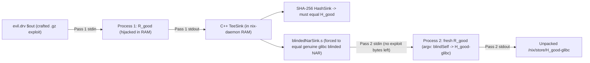

# CASPER Security Considerations & Threat Model

This document collects the security considerations, threat models, prototype vulnerabilities, and desired relocator invariants for **CASPER (Content-Addressable Store via Partial-blinding and Embedded Relocation)** (see [README.md](../README.md) and [DETAILS.md](DETAILS.md)).

---

## 1. Security Threat Model: Sandbox Bait-and-Switch in `relocate.sh` and Closure-Bound External Relocators

Even after discarding `hash.sh` ([ALTERNATIVES_CONSIDERED.md](ALTERNATIVES_CONSIDERED.md)) so that Nix always computes the SHA-256 NAR hash directly in C++ over the blinded output at Step 2b, what if a malicious derivation tries to pull a bait-and-switch between **Pass 1** (blinding before hashing) and **Pass 2** (relocating after hashing)?

- **Why the bait-and-switch cannot remain inside `$out` at Step 2b (and the Self-Erasing `relocate.sh` Bypass)**:
  - Because `$out/nix-support/relocate.sh` is inside `$out`, it is included in the C++ NAR SHA-256 hash at Step 2b. If `$out/nix-support/relocate.sh` still differs by even a single byte at Step 2b (or if a second copy of `libc.so.6` is still stashed inside `$out`), the NAR hash at Step 2b changes and **will not match** legitimate `glibc`'s hash. At Step 2b, the entire `$out` directory must be byte-for-byte identical to legitimate blinded `glibc`.
  - **However**, in the directory-mutating prototype ([`DerivationBuilderImpl::registerOutputs`](../nix/src/libstore/build/derivation-builder-impl.cc#L621-L670)), `hasCustomRelocate` is latched *before* Pass 1 (line 622) and `needRelocateScript` is cached at line 635. A malicious custom `$out/nix-support/relocate.sh` can therefore execute during **Pass 1**, spawn a background process or stage a trigger in `/build`, and **overwrite `$out/nix-support/relocate.sh` with `defaultRelocateScript`** before exiting Pass 1—so `$out` is 100% identical to legitimate blinded `glibc` during Step 2b, yet `needRelocateScript` remains `true` for Pass 2.
- **Where the post-Step-2b trigger lives if run inside the build sandbox: `/build` (`$NIX_BUILD_TOP`) + `$PATH`**:
  - Although `$out` must be identical to legitimate blinded `glibc` at Step 2b, the build sandbox outside `$out` is not covered by `$out`'s NAR hash:
    1. **The payload stash in `/build`**: The attacker's derivation declares legitimate `glibc` as an input dependency, copies legitimate `glibc` into `$out`, and stashes a malicious `libc.so.6` in `/build/evil-libc.so.6`.
    2. **The trigger in `$PATH`**: Legitimate `glibc`'s `$out/nix-support/relocate.sh` uses `#!/bin/sh` and invokes `find`, `grep`, and `sed` via `$PATH`. The attacker leaves `$out/nix-support/relocate.sh` untouched, but sets `PATH=/build/evil-bin:...` in the derivation environment.
    3. During **Pass 1** (`relocate.sh <inputHash> xxxx...`), `/build/evil-bin/sed` performs normal blinding so Step 2b hashes pure blinded `glibc` $\to$ `19zs62pdr843wg6gdlrv42pi9xsk7gin`.
    4. During **Pass 2** (`relocate.sh xxxx... 19zs62pdr843wg6gdlrv42pi9xsk7gin`), `/build/evil-bin/sed` detects that `$1` is `xxxx...` (the post-hash pass) and injects `/build/evil-libc.so.6` into `$out/lib/libc.so.6` *after* the store path hash `19zs62pdr843wg6gdlrv42pi9xsk7gin` has already been chosen.
- **Defense (Closure-Bound External Relocators + Isolated `NAR` $\to$ `NAR` Sandbox)**:
  - If `$out/nix-support/relocate.sh` is absent, Nix uses its built-in relocator and never executes untrusted code.
  - If `$out/nix-support/relocate.sh` is present, it must be verified as a **symlink pointing to an external store dependency** $P_{\text{reloc}}$, executed in a fresh `NAR` $\to$ `NAR` (`stdin` $\to$ `stdout`) sandbox with `/build` unmounted and `$PATH` restricted to $P_{\text{reloc}}$'s store closure, and the cryptographic hash of $P_{\text{reloc}}$'s Nix closure ($H_{\text{closure}} = \text{SHA256}(\text{closure}(P_{\text{reloc}}))$) is combined with the blinded NAR hash:
    $$H_{\text{out}} = \text{compressHash}\big(\text{SHA256}(\text{"casper:ext-reloc:"} \parallel H_{\text{closure}} \parallel \text{":"} \parallel H_{\text{blinded-nar}}), 20\big)$$
  - Because an untrusted relocator closure $C_{\text{evil}}$ differs from legitimate `glibc`'s relocator ($C_{\text{good}}$), $H_{\text{closure}}(C_{\text{evil}}) \neq H_{\text{closure}}(C_{\text{good}})$, making it computationally infeasible ($2^{160}$ brute-force work) for a hostile relocator to hit legitimate `glibc`'s store hash.

---

## 2. Hostile / Weak Hasher Threat (`hash.sh` Attack Surface)

In the discarded design where a derivation could bundle a custom `$out/nix-support/hash.sh` ([ALTERNATIVES_CONSIDERED.md](ALTERNATIVES_CONSIDERED.md)):
- If Nix trusted the stdout of `$out/nix-support/hash.sh` as `<output-hash>`, a broken or hostile derivation (`evil-glibc`) could decouple **the digest Nix uses for the store path** from **the actual bytes in `$out`**.
- Specifically, `evil-glibc` could predict legitimate `glibc-2.40-224`'s hash (`19zs62pdr843wg6gdlrv42pi9xsk7gin`), write `echo "19zs62pdr843wg6gdlrv42pi9xsk7gin"` in `hash.sh`, and install a malicious `libc.so.6` directly into `/nix/store/19zs62pdr843wg6gdlrv42pi9xsk7gin-glibc-2.40-224`.
- Even if defended by requiring custom `hash.sh` to be a symlink to an external store dependency whose closure hash $H_{\text{closure}}$ is cryptographically combined with $H_{\text{content}}$ ($\text{SHA256}(H_{\text{closure}} \parallel H_{\text{content}})$), discarding `hash.sh` altogether and always computing the SHA-256 NAR digest inside Nix's C++ `HashSink` removes this attack surface completely.

---

## 3. Security & Correctness Vulnerabilities in the In-Place Prototype

1. **Pre-Blinded Placeholder Collision & Unblinding Mutation (`xxxxxxxxxxxxxxxxxxxxxxxxxxxxxxxx-<name>`)**:
   - In Step 1, CASPER blinds `<inputHash>-<name>` to `xxxxxxxxxxxxxxxxxxxxxxxxxxxxxxxx-<name>` (32 `'x'` characters), hashes the directory in Step 2, and replaces **every** occurrence of `xxxxxxxxxxxxxxxxxxxxxxxxxxxxxxxx-<name>` with `<outHash>-<name>` in Step 3.
   - Because `'x'` is a valid Nix-base32 character (`0123456789abcdfghijklmnpqrsvwxyz`), `xxxxxxxxxxxxxxxxxxxxxxxxxxxxxxxx-<name>` is an **in-band** string that can appear literally in a build output *before* Step 1.
   - **Collision Attack**: Package $A$ (containing a real self-reference `/nix/store/<inputHashA>-foo`) and Package $B$ (containing the literal string `/nix/store/xxxxxxxxxxxxxxxxxxxxxxxxxxxxxxxx-foo` and no self-reference) produce **byte-for-byte identical blinded trees** in Step 2 and collide on `<outHash>-foo`.
   - **Post-Hash Byte Mutation**: In Step 3, `relocate.sh` / `rewritePathInPlace` cannot distinguish occurrences of `xxxxxxxxxxxxxxxxxxxxxxxxxxxxxxxx-<name>` that were originally `<inputHash>-<name>` from literal strings already present in the build output—overwriting both with `<outHash>-<name>`.
   - **Mitigation**: Mirroring upstream Nix's [`MaskedHashSink::finish()`](../nix/src/libstore/references.cc#L120-L125), record the exact file paths and byte offsets where `<inputHash>-<name>` was blinded in Step 1, include those offsets in the Step 2 content hash, and only unblind those recorded offsets in Step 3.

2. **Identical 32-Char `hashPart` Across Different Package Names (`SIGABRT` DoS in `PathRefScanSink`)**:
   - In [`StoreDirConfig::makeContentAddressedOutputPath`](../nix/src/libstore/store-dir-config.cc), `<outHash>` is currently computed purely from `compressHash(narHash, 20)` **without mixing in `name`**.
   - As observed in the bootstrap ([BOOTSTRAPPING_AND_PACKAGING.md Section 4](BOOTSTRAPPING_AND_PACKAGING.md#4-real-world-bootstrap-verification-casper-store)), `/nix/store/j1zgcfidm58ay0zxcc724ciwxv6mwn91-gmp-6.3.0-info` and `/nix/store/j1zgcfidm58ay0zxcc724ciwxv6mwn91-gmp-with-cxx-6.3.0-info` have different names (`gmp-6.3.0-info` vs. `gmp-with-cxx-6.3.0-info`) but the **exact same 32-character `hashPart`** (`j1zgcfidm58ay0zxcc724ciwxv6mwn91`). The same occurs whenever two packages produce identical or empty `-doc` directories.
   - However, Nix's reference scanner in [`PathRefScanSink::fromPaths`](../nix/src/libstore/path-references.cc#L20-L33) assumes every `StorePath` has a globally unique 32-character `hashPart`:
     ```cpp
     for (auto & i : refs) {
         std::string hashPart(i.hashPart());
         auto inserted = backMap.emplace(hashPart, i).second;
         assert(inserted);
         hashes.insert(hashPart);
     }
     ```
   - **Daemon Crash (DoS) & Reference Confusion**: If any downstream derivation includes two store paths with the same 32-character `hashPart` in `referenceablePaths`, **`assert(inserted)` aborts the `nix-daemon` process (`SIGABRT`)**. Even without the assertion, `RefScanSink` only scans for 32-char hashes and cannot distinguish a reference to `<hash>-foo` from `<hash>-bar`.
   - **Mitigation**: Mix `name` (and `references`) into the hash before compressing to 20 bytes (matching `StoreDirConfig::makeStorePath`: `SHA256("casper:out:sha256:" + narHash + ":" + storeDir + ":" + name)`).

3. **Reference Scanner Desynchronization (`scanForReferences` Runs *Before* `relocate.sh`, Never After)**:
   - In [`DerivationBuilderImpl::registerOutputs`](../nix/src/libstore/build/derivation-builder-impl.cc#L363), `scanForReferences` runs once at line 363 **before** `relocate.sh` runs at lines 652 and 668, and only scans uncompressed plaintext bytes.
   - **`allowedReferences` / `disallowedReferences` Bypass**: A custom `relocate.sh` (or an archive unpacked during `relocate.sh`) can introduce references to `/nix/store/<disallowed-dep>` into `$out` during Step 3 (line 668), *after* `scanForReferences` has already completed—bypassing `checkOutputs` (`allowedReferences` / `disallowedReferences`).
   - **Use-After-GC via Compressed Dependency References**: Conversely, if a package only references a runtime dependency `/nix/store/<depOutHash>-foo` inside a `.gz` file, `scanForReferences` never sees it in the uncompressed stream, allowing `nix-collect-garbage` to delete `<depOutHash>-foo` while the dependent package is still installed.
   - **Mitigation**: Always re-run `scanForReferences` on the final relocated output at Step 4 (after `relocate.sh` finishes), or simultaneously while unpacking the final NAR stream from `relocate.sh`'s `stdout` in the `NAR` $\to$ `NAR` architecture.

4. **Host-`root` vs. Sandbox-User TOCTOU Races, Disabled `uidRange` Checks, and Shared Hardlink Corruption**:
   - **TOCTOU Symlink Race**: In [`derivation-builder-impl.cc`](../nix/src/libstore/build/derivation-builder-impl.cc#L171-L243), [`preparePathForRelocation`](../nix/src/libstore/build/derivation-builder-impl.cc#L171-L189) and [`rewritePathInPlace`](../nix/src/libstore/build/derivation-builder-impl.cc#L204-L243) run in the **host Nix daemon process as `root`**. A background process forked by `relocate.sh` as `buildUser` can race with the host daemon, swapping a regular file inside `$out` with a symlink between `lstat(path)` and `chmod(path)` / `writeFile(path)` (which defaults to `FinalSymlink::Follow` and truncates target files without `O_NOFOLLOW`).
   - **Post-Relocation `uidRange` Check Disabled**: Pre-relocation [`canonicalisePathMetaData`](../nix/src/libstore/build/derivation-builder-impl.cc#L341-L348) enforces `.uidRange = buildUser->getUIDRange()` to reject hardlinks to foreign files (e.g., `/etc/shadow` in non-chroot builds). However, [`preparePathForRelocation`](../nix/src/libstore/build/derivation-builder-impl.cc#L171-L189) unconditionally `lchown`s and `chmod(..., S_IWUSR)`s every file in `actualPath` to `buildUser` as host `root` without checking `st_uid` or `st_nlink`, and Step 4's [`canonicalisePathMetaData`](../nix/src/libstore/build/derivation-builder-impl.cc#L673-L681) passes `.uidRange = std::nullopt`. Any foreign hardlink created by `relocate.sh` during Pass 1 is chowned to `buildUser` and made writable before Pass 2, or chowned to `root:root` (`0444`) in Step 4.
   - **In-Place Mutation of Shared Hardlinks Across Multi-Output Builds**: Both [`rewritePathInPlace`](../nix/src/libstore/build/derivation-builder-impl.cc#L225) (`writeFile` with `O_TRUNC`) and [`defaultRelocateScript`](../nix/src/libstore/build/derivation-builder-impl.cc#L120-L133) (`cat "$f.tmp" > "$f"`) overwrite files in-place without unlinking when `st_nlink > 1`. If `$dev/file` is hardlinked to `$out/file`, leaf output `$out` is registered, canonicalized to `0444`, and hardlinked into `/nix/store/.links` first; relocating `$dev` then mutates the shared inode in-place, corrupting the already-registered `$out/file` and `/nix/store/.links` entry.
   - **Host `/nix/store` Permission Mutation on Symlink Outputs**: When [`rewritePathInPlace`](../nix/src/libstore/build/derivation-builder-impl.cc#L209-L218) rewrites a symlink, it runs `chmod(parent, (pst.st_mode & ~S_IFMT) | S_IWUSR)` and never restores `parent`'s mode; if the top-level output `$out` is itself a symlink, `parent` is `/nix/store` (or `chrootRootDir/nix/store`).
   - **Mitigation**: Using the `NAR` $\to$ `NAR` (`stdin` $\to$ `stdout`) stream transformer architecture ([DETAILS.md Section 2](DETAILS.md#2-relocatesh-as-a-nar-to-nar-stream-transformer-stdin-to-stdout)) eliminates host filesystem access during relocation altogether; for in-place directories, kill all sandbox processes after every `runRelocateScript` call, traverse output trees using `openat(..., O_NOFOLLOW)` descriptors, enforce `.uidRange` on every `preparePathForRelocation` and `canonicalisePathMetaData` pass, and unlink files before writing (`O_CREAT | O_EXCL` + atomic `renameat`) whenever `st_nlink > 1`.

5. **Binary Corruption, Regex Wildcard Mismatches & Shell Injection in `defaultRelocateScript` / `defaultHashScript`**:
   - **POSIX / BusyBox `sed` on Binaries**: In `defaultRelocateScript`, `sed "s|$old|$new|g" "$f" > "$f.tmp"` runs on arbitrary ELF executables and shared libraries if they match `grep -l "$old"`. Many `sed` implementations append a missing trailing newline `\n` to files that do not end in `\n` or corrupt lines containing NUL bytes, silently corrupting ELF binaries or appended ZIP/initramfs payloads.
   - **Embedded Checksums & Code Signatures**: Blindly replacing `<oldHash>` with `<newHash>` inside files that wrap paths in an internal integrity check (such as Mach-O `LC_CODE_SIGNATURE`, PE Authenticode checksums, `.whl`/`RECORD` SHA-256 manifests, or SQLite pages) breaks the file or creates exploitable state mismatches.
   - **Unescaped `.` Regex Wildcard in `grep` / `sed` vs. Literal C++ `rewritePathInPlace`**: `old` and `new` are `<hash>-<name>`, where `<name>` commonly contains `.` (e.g., `foo-1.2.3`). `defaultRelocateScript` passes `$old` directly to `grep -l "$old"` and `sed "s|$old|$new|g"`, where `.` is an unescaped BRE wildcard matching any character, whereas C++ [`rewritePathInPlace`](../nix/src/libstore/build/derivation-builder-impl.cc#L222) performs literal substring replacement. A byte sequence matching `xxxxxxxxxxxxxxxxxxxxxxxxxxxxxxxx-foo-1X2Y3` is untouched in Step 1, hashed as-is in Step 2, and then mutated by `sed` in Step 3 into `<outHash>-foo-1.2.3`.
   - **Newline-in-Filename & `.tmp` Symlink Clobbering**: `find "$target" ... | while IFS= read -r f` in `defaultRelocateScript` splits on newlines, and `sed "s|$old|$new|g" "$f" > "$f.tmp"` follows symlinks if `$f.tmp` was pre-created as a symlink by the builder.
   - **Host Code Execution When Running `$out/nix-support/hash.sh`**: Running `$out/nix-support/hash.sh` on an installed store path for post-build verification executes `"$target/nix-support/relocate.sh"` directly on the host outside any sandbox, granting arbitrary code execution as the verifying user if the package output is untrusted.

6. **Global `PathRewrites` Poisoning, Unscoped `queryAllPathRewrites()`, and Stale Rewrites Across GC**:
   - **Non-Deterministic Rebuild Poisoning (`INSERT OR REPLACE`)**: In [`local-store.cc`](../nix/src/libstore/local-store.cc#L761-L786), `addPathRewrite` executes `insert or replace into PathRewrites (inputPath, outputPath) values (?, ?)`. If a derivation `foo.drv` is slightly non-deterministic, building it a second time overwrites `PathRewrites[<inputHash>-foo]` with `<outHash2>-foo`, leaving existing packages linked against `<outHash1>-foo` while newly built packages get rewritten to `<outHash2>-foo` (introducing silent **diamond dependency ABI splits**).
   - **Unscoped Global Rewriting (`queryAllPathRewrites()`)**: In [`DerivationGoal::haveDerivation`](../nix/src/libstore/build/derivation-goal.cc#L242-L295), `depRewrites` is initialized with `worker.store.queryAllPathRewrites()`—loading **every rewrite ever recorded in the store** rather than scoping rewrites to `drv->inputs`—and applied via `resolvedDrvMut.applyRewrites(depRewrites)`. On a multi-user `nix-daemon`, any unprivileged user's build injects global hash rewrite rules into every subsequent build's environment and arguments.
   - **Stale Rewrites Survive Garbage Collection & Multi-Hop / RemoteStore Desynchronization**: [`PathRewrites`](../nix/src/libstore/schema.sql#L43-L47) has no foreign-key cascade to `ValidPaths`, and [`LocalStore::invalidatePath`](../nix/src/libstore/local-store.cc#L1154-L1165) never deletes rows from `PathRewrites` when `outputPath` is garbage-collected, leaving `resolveInputPath` pointing to deleted store paths. Moreover, [`EvalState::realiseContext`](../nix/src/libexpr/primops.cc#L96) resolves 2 hops (`buildStore->resolveInputPath(store->resolveInputPath(o.path))`) whereas `LocalStore::resolveInputPath` resolves 1 hop, and [`Store::resolveInputPath`](../nix/src/libstore/include/nix/store/store-api.hh#L767-L770) is a no-op on `RemoteStore` / `UDSRemoteStore`.
   - **Mitigation**: Scope `depRewrites` strictly to the transitive closure of `drv->inputs`, delete `PathRewrites` rows in `LocalStore::invalidatePath` when `outputPath` is invalidated, and expose `resolveInputPath` over the daemon worker protocol.

7. **Incomplete Sandbox Isolation in [`ChrootLinuxDerivationBuilder::runRelocateScript`](../nix/src/libstore/linux/build/linux-derivation-builder.cc#L1015-L1081) & [`UnixDerivationBuilderImpl::runRelocateScript`](../nix/src/libstore/unix/build/unix-derivation-builder.cc#L988-L1045)**:
   - Unlike the main builder process in [`ChrootLinuxDerivationBuilder::prepareSandbox`](../nix/src/libstore/linux/build/linux-derivation-builder.cc#L452-L460) and [`UnixDerivationBuilderImpl::runChild`](../nix/src/libstore/unix/build/unix-derivation-builder.cc#L868-L935), `runRelocateScript` only calls `setns()` on `sandboxUserNamespace` and `sandboxMountNamespace`:
     - **Host Network Access (`CLONE_NEWNET` Bypass)**: `runRelocateScript` never enters the sandbox network namespace and instead inherits the host `nix-daemon` network namespace, allowing any sandboxed derivation with a `relocate.sh` script (or `.gz` file) to access the network during `registerOutputs`.
     - **Seccomp Bypass (`setupSeccomp()` Omitted)**: `runRelocateScript` does not install the seccomp filter from [`setupSeccomp()`](../nix/src/libstore/linux/build/linux-derivation-builder.cc#L186-L275), re-enabling blocked syscalls such as `fchmodat2(..., AT_SYMLINK_NOFOLLOW)` setuid/setgid creation (CVE-2024-45593).
     - **Host PID/IPC Namespaces & Surviving Background Processes**: [`killSandbox`](../nix/src/libstore/linux/build/linux-derivation-builder.cc#L969-L983) runs in `unprepareBuild()` *before* `registerOutputs()` and is never called after `runRelocateScript()`. Because `runRelocateScript` runs in the host PID/IPC namespaces and outside the build cgroup, background processes forked by `relocate.sh` survive after the build completes.
     - **Leaked File Descriptors & Supplementary Groups**: Neither `runRelocateScript` implementation calls `unix::closeExtraFDs()`, and `ChrootLinuxDerivationBuilder::runRelocateScript` does not call `setgroups(0, 0)` before `setns(..., CLONE_NEWUSER)`.
     - **Ignored Exit Status & Unbounded Execution**: Both implementations ignore the exit status of `child.wait()` (silently registering half-relocated outputs on script failure) and block synchronously outside `DerivationBuildingGoal`'s `timeout` / `maxSilentTime` loop.

8. **Store Metadata Desynchronization & Clobbering on `caOutPath` Collisions**:
   - In [`DerivationBuilderImpl::registerOutputs`](../nix/src/libstore/build/derivation-builder-impl.cc#L784-L790), when `localStore.isValidPath(newInfo.path)` is already true, Nix deletes `actualPath` (`deletePath(actualPath)`) and keeps the existing files on disk **without verifying that `newInfo.narHash` matches the existing store path's `narHash`**.
   - Immediately afterward, [`LocalStore::registerValidPaths`](../nix/src/libstore/local-store.cc#L1106-L1118) calls [`updatePathInfo(*state, i)`](../nix/src/libstore/local-store.cc#L943-L953), which overwrites `ValidPaths.hash`, `ValidPaths.narSize`, and `ValidPaths.sigs` in SQLite with the new build's `newInfo` (and unions `i.references` into `Refs`) while the old build's files remain on disk:
     - If a build mutates files in Step 3 (`relocate.sh` pass 2) after colliding on Step 2's `caOutPath`, SQLite's `ValidPaths.hash`, `narSize`, and local binary cache signature are overwritten with the new build's metadata while the old files stay on disk (or vice versa if a poisoned build ran first and a legitimate build runs second).
   - **Mitigation**: When `localStore.isValidPath(newInfo.path)` is true in `registerOutputs`, verify `newInfo.narHash == oldInfo.narHash` (rejecting mismatches with `BuildResult::Failure::OutputRejected`) before discarding `actualPath` or updating `ValidPaths`.

---

## 4. Desired Invariants for `relocate.sh` & Practical Design Trade-offs

Ideally, `relocate.sh` ($R(T, \text{old}, \text{new})$) would behave as a pure, invertible groupoid action on directory trees (or NAR streams). In practice, evaluating which invariants to enforce reveals important design trade-offs:

1. **Why Strict Purity & Algebraic Groupoid Laws (Invariants 1 & 2) Are Hard to Enforce Directly**:
   - Requiring $R(T, a, b)$ to be strictly deterministic (unable to read clocks, PIDs, or metadata side channels) and mathematically invertible ($R(R(T, a, b), b, a) = T$ and $R(R(T, a, b), b, c) = R(T, a, c)$) is difficult to guarantee when `relocate.sh` is an arbitrary `#!/bin/sh` script—enforcing purity statically would require forcing a pure/restricted language (such as Haskell or a declarative DSL) onto every relocator.
2. **Defeating the `"xxxx..."` Singularity Attack via an Unpredictable Blinding String (Invariant 3)—Without Touching Files in C++**:
   - Even a 100% deterministic `relocate.sh` can fool naive round-trip checks if it branches on the publicly known blinding constant `x = "xxxxxxxxxxxxxxxxxxxxxxxxxxxxxxxx-<name>"` (e.g., outputting a benign tree when `$2 == "xxxx..."` during Step 2b hashing, and unpacking a different payload for every other target hash `$2 != "xxxx..."`).
   - Calling `relocate.sh` with a **string that `relocate.sh` cannot predict or hardcode** prevents `relocate.sh` from special-casing the blinding pass:
     - For example, blinding with a deterministic token derived from the cryptographic hash of `relocate.sh` itself ($B = \text{compressHash}(\text{SHA256}(\text{"casper-blind:"} \parallel \text{SHA256}(\text{relocate.sh})), 20)$, which `relocate.sh` cannot hardcode without finding a SHA-256 fixed point), or verifying commutativity via a fresh random canary $r \stackrel{\$}{\leftarrow} \Sigma^{32}$ ($R(R(T_0, \text{inHash}, r), r, \text{outHash}) = T_{\text{final}}$).
   - **Crucial Constraint—Keep C++ Format-Agnostic**: Nix must **not** need to load, parse, or rewrite files in C++ after calling `relocate.sh`. The entire reason `relocate.sh` exists is so that format-specific logic (`.gz`, `.xz`, `.zst`, Python `RECORD`, etc.) stays inside `relocate.sh` and out of Nix's C++ codebase; C++ should only invoke `relocate.sh` and compute standard tree `NARHash`es.
3. **Post-Relocation Reference Conservation (Invariant 5)**:
   - Re-running `scanForReferences` on the final output tree *after* `relocate.sh` finishes (or simultaneously while unpacking the output NAR from `relocate.sh`'s `stdout`) and verifying that the reference set matches the pre-relocation reference set (modulo `<inputHash>` $\to$ `<outHash>`) is completely format-agnostic in C++ and prevents `relocate.sh` from smuggling undeclared or disallowed `/nix/store/...` references after hashing.

---

## 5. Dynamic Blinding Target via Symlinked Relocator Store Hash & Round-Trip Self-Verification

To enforce **Invariant 3** in practice without adding format-specific logic to Nix C++, CASPER uses the **store-path hash of the symlinked relocator derivation itself** as the blinding target (`blindSelf`):

1. **Mandatory Symlink to a Standalone Relocator Derivation**:
   - Derivations are prohibited from embedding an inline script at `$out/nix-support/relocate.sh`.
   - Whenever `$out/nix-support/relocate.sh` is present, [`DerivationBuilderImpl::registerOutputs`](../nix/src/libstore/build/derivation-builder-impl.cc#L636-L675) verifies via `lstat` and `store->toStorePath(readLink(...))` that `$out/nix-support/relocate.sh` is a **symbolic link pointing to a valid store path**:
     $$\texttt{\$out/nix-support/relocate.sh} \longrightarrow \texttt{/nix/store/}\langle\text{relocator-hash}\rangle\texttt{-}\langle\text{relocator-name}\rangle\texttt{/bin/casper-relocate}$$
   - Any custom relocator must therefore be built as its own derivation first and referenced via a symlink.

2. **Unsolvable Cryptographic Hash Loop for a Dishonest Relocator**:
   - Instead of blinding `<input-hash>-<out-name>` to a fixed constant (`xxxxxxxxxxxxxxxxxxxxxxxxxxxxxxxx-<out-name>`), Nix extracts the 32-character Nix32 `<relocator-hash>` from the `relocate.sh` symlink target and sets:
     $$\texttt{blindSelf} = \langle\text{relocator-hash}\rangle\texttt{-}\langle\text{out-name}\rangle$$
   - **Why the relocator cannot *statically* hardcode `blindSelf` (and why runtime self-discovery requires Section 6)**:
     - `<relocator-hash>` is derived from the cryptographic SHA-256 hash of the relocator derivation's own output (`makeContentAddressedOutputPath(narHash, relocatorName)`).
     - For the relocator executable or script to hardcode `<relocator-hash>` statically as a literal constant inside its own code (for example, `if ($2 == "8cgwszca...-...")`), the relocator would have to embed its own SHA-256 output hash inside itself before being hashed—an unsolvable cryptographic preimage / fixed-point loop.
     - *Important caveat*: Although a relocator cannot hardcode `<relocator-hash>` statically, a dishonest relocator **can** discover `<relocator-hash>` dynamically at runtime (e.g., via `readlink("/proc/self/exe")`, `argv[0]`, the `nix-support/relocate.sh` symlink inside `stdin`'s NAR stream, or hashing its own mapped ELF pages). See **Section 6** below for how CASPER defeats runtime self-hash discovery and environment hijacking.
   - **Why `blindSelf` never collides with the `relocate.sh` symlink target**:
     - The `relocate.sh` symlink target is `/nix/store/<relocator-hash>-<relocator-name>/...`, whereas `blindSelf` is `<relocator-hash>-<out-name>`.
     - Nix enforces `!hasPrefix(<relocator-name>, <out-name>)` (and `casper-overlay.nix` prefixes relocator derivations with `casper-relocate-...`), so `<relocator-hash>-<out-name>` is never equal to or a prefix of `<relocator-hash>-<relocator-name>`, ensuring Pass 2 (`<relocator-hash>-<out-name>` $\to$ `<out-hash>-<out-name>`) never rewrites the `relocate.sh` symlink target itself.

3. **Zero-Knowledge Post-Build & Binary-Cache Self-Verification (`nix hash casper` / `nix-hash --casper`)**:
   - Because `<relocator-hash>` is preserved directly in the symlink target of `$out/nix-support/relocate.sh` inside the final store object `/nix/store/<out-hash>-<out-name>`, any party can independently recompute and verify `<out-hash>` from `/nix/store/<out-hash>-<out-name>` alone—without needing the `.drv`, the original evaluation `<input-hash>`, or the SQLite `PathRewrites` table:
     1. Inspect `/nix/store/<out-hash>-<out-name>/nix-support/relocate.sh`:
        - If present, verify it is a symlink, parse its target store path `/nix/store/<relocator-hash>-<relocator-name>/...`, set `blindSelf = "<relocator-hash>-<out-name>"`, and pipe the NAR of `/nix/store/<out-hash>-<out-name>` through `relocate.sh "<out-hash>-<out-name>" "<relocator-hash>-<out-name>"`.
        - If absent, stream the NAR through the built-in format-agnostic C++ `relocateNAR` with `blindSelf = "xxxxxxxxxxxxxxxxxxxxxxxxxxxxxxxx-<out-name>"`.
     2. Compute the SHA-256 digest $H_{\text{blind}}$ of the resulting blinded NAR stream.
     3. Compute `recomputedPath = makeContentAddressedOutputPath(H_blind, outName)` and assert `recomputedPath == "/nix/store/<out-hash>-<out-name>"`.
   - **Build-Time Pass 3 Fixed-Point Check & Offline Verification**:
     - During build, [`DerivationBuilderImpl::registerOutputs`](../nix/src/libstore/build/derivation-builder-impl.cc#L770-L796) immediately executes **Pass 3** on the unpacked output (`<out-hash>-<out-name>` $\to$ `blindSelf`) and asserts `pass3Nar.hash == normalizedNar.hash`, rejecting the build (`OutputRejected`) if Pass 2 was not a lossless inverse of Pass 1 or if the output hash is not a true fixed point.
     - Offline or after substitution from a binary cache, `nix hash casper` / `nix-hash --casper` repeats this exact Pass 3 check on `/nix/store/<out-hash>-<out-name>` directly.

---

## 6. Runtime Self-Hash Discovery, the Groupoid Isomorphism Theorem, and Enforced Countermeasures

While Section 5 prevents a relocator from *statically* hardcoding `<relocator-hash>`, a malicious custom relocator $R_{\text{evil}}$ (`/nix/store/<H_evil_reloc>-evil-reloc/bin/...`) can always discover `<H_evil_reloc>` **at runtime**—via `readlink("/proc/self/exe")`, `argv[0]`, `/proc/self/maps`, the `nix-support/relocate.sh` symlink entry inside `stdin`'s NAR stream, or even by computing the CASPER hash of its own ELF image in memory.

### 1. The Collision Attack & Why Black-Box Multi-Pass / Canary Checks Cannot Detect It

Suppose an attacker wants a malicious derivation `evil.drv` (with output name `<name>`, matching a legitimate target package $G$ at `/nix/store/<H_good>-<name>`) to collide onto `<H_good>-<name>` while installing trojaned files $T_{\text{trojan}}(y)$ into the store:

1. Let $N_{\text{good}}^{\text{blind}}$ be the exact blinded NAR byte stream of legitimate package $G$ (which is public and whose SHA-256 determines `<H_good>`).
2. At runtime, $R_{\text{evil}}$ learns `<H_evil_reloc>`, computes $\texttt{blindSelf} = \langle H_{\text{evil\_reloc}}\rangle\texttt{-}\langle\text{name}\rangle$, and implements the piecewise deterministic function:
   $$R_{\text{evil}}(T, a, b) = \begin{cases} N_{\text{good}}^{\text{blind}} & \text{if } b = \texttt{blindSelf} \\ T_{\text{trojan}}(b) & \text{if } b \neq \texttt{blindSelf} \end{cases}$$
3. **Groupoid Isomorphism Theorem**: Define the state family $\{S_y\}$ by $S_{\texttt{blindSelf}} = N_{\text{good}}^{\text{blind}}$ and $S_y = T_{\text{trojan}}(y)$ for every $y \neq \texttt{blindSelf}$. On this family, $R_{\text{evil}}(S_a, a, b) = S_b$ for **all** $a, b$:
   - **Pass 1** (`oldSelf` $\to$ `blindSelf`): $b = \texttt{blindSelf}$, so $R_{\text{evil}}$ emits $N_{\text{good}}^{\text{blind}}$, yielding $\text{outHash} = H_{\text{good}}$.
   - **Pass 2** (`blindSelf` $\to$ `H_good-<name>`): $b \neq \texttt{blindSelf}$, so $R_{\text{evil}}$ materializes the trojaned tree $T_{\text{trojan}}(H_{\text{good}}\texttt{-}\langle\text{name}\rangle)$.
   - **Pass 3 & `nix-hash --casper`** (`H_good-<name>` $\to$ `blindSelf`): $b = \texttt{blindSelf}$, so $R_{\text{evil}}$ again emits $N_{\text{good}}^{\text{blind}}$, passing fixed-point verification!
   - **Random Canary Commutativity**: Even for a random canary $r \neq \texttt{blindSelf}$, $R_{\text{evil}}(R_{\text{evil}}(T_0, \text{oldSelf}, r), r, \text{newSelf}) = R_{\text{evil}}(T_{\text{trojan}}(r), r, \text{newSelf}) = T_{\text{trojan}}(\text{newSelf})$, so no black-box multi-pass or random-canary check can distinguish $R_{\text{evil}}$ from an honest groupoid action.

Crucially, however, $R_{\text{evil}}$ can **only** emit $N_{\text{good}}^{\text{blind}}$ in Pass 1 by **stripping or forging its own `nix-support/relocate.sh -> /nix/store/<H_evil_reloc>-...` symlink** inside Pass 1's output NAR (replacing it with no `relocate.sh` if $G$ uses the built-in C++ relocator, or with `/nix/store/<H_good_reloc>-...` if $G$ uses an honest custom relocator).

### 2. Protection 1: `nix-support/relocate.sh` Symlink Preservation Invariant

Both [`DerivationBuilderImpl::registerOutputs`](../nix/src/libstore/build/derivation-builder-impl.cc) and [`verifyCasperPath`](../nix/src/nix/hash.cc) (`nix hash casper` / `nix-hash --casper`) enforce strict structural and NAR-level preservation of the relocator symlink:

1. **Pre-Pass Structural Validation (`inspectOutputRelocator`)**:
   - Inspects `nix-support` and `nix-support/relocate.sh` via `maybeLstat` (never `pathExists`, so dangling symlinks cannot silently bypass custom relocation).
   - Rejects outputs where `nix-support` is a symlink through which `relocate.sh` is reachable (`'nix-support' must be a real directory`), where `relocate.sh` is not a symlink, where `linkTarget` is non-canonical (e.g. containing `/../` or redundant slashes that could cause `StoreDirConfig::toStorePath` and kernel path resolution to disagree), or where `relocatorStorePath` is not a declared valid input store path.
2. **Streaming NAR AST Verification (`RelocatorLinkCheckSink`)**:
   - After sibling relocation and **Pass 1 blinding** (and during `nix-hash --casper`), Nix parses the blinded NAR stream in $O(1)$ memory via `RelocatorLinkCheckSink` (a `NullFileSystemObjectSink` subclass with `skipContents = true`) and asserts that the root node is a directory, `nix-support` is a real directory, and `nix-support/relocate.sh` is a symlink with the **exact same `linkTarget`** (`/nix/store/<H_reloc>-...`).
   - After **Pass 2 unpacking**, `verifyUnpackedRelocatorLink` asserts that the materialized store tree likewise retains the real directory `nix-support` and symlink `nix-support/relocate.sh -> linkTarget` (and Pass 3's SHA-256 equality with Pass 1's verified NAR guarantees the same for Pass 3).
3. **Cryptographic Domain Separation with Zero Store Invalidation**:
   - Because SHA-256 covers the entire canonical NAR stream, forcing Pass 1's blinded NAR to contain `nix-support/relocate.sh -> /nix/store/<H_reloc>-...` commits `<H_reloc>` directly inside the SHA-256 preimage of `<out-hash>`:
     - No custom relocator ($H_{\text{evil\_reloc}}$) can collide with a standard package (which has no `nix-support/relocate.sh` in its blinded NAR) without finding a full SHA-256 collision ($2^{128}$ work) or 160-bit `casper:out` second preimage ($2^{160}$ work).
     - No custom relocator ($H_{\text{evil\_reloc}}$) can collide with a package using a different honest relocator ($H_{\text{good\_reloc}} \neq H_{\text{evil\_reloc}}$).
     - Every honest relocator (`casper-relocate`, `withCasper`) already preserves `nix-support/relocate.sh`, so **zero existing store paths are invalidated**.

### 3. Protection 2: Closure-Bound Environment & Isolated Mount Namespace in `runRelocateScript`

Protection 1 prevents a *dishonest* relocator derivation ($H_{\text{evil\_reloc}}$) from colliding with a package built using an *honest* relocator ($H_{\text{good\_reloc}}$). However, without environment isolation, a malicious derivation `evil.drv` could point `$out/nix-support/relocate.sh` to the **exact same honest relocator** $R_{\text{good}}$ (`/nix/store/<H_good_reloc>-...`, satisfying Protection 1!) and hijack $R_{\text{good}}$ externally if $R_{\text{good}}$ is a `withCasper` shell script or dynamic binary—via `drv.env` (`PATH=/build/evil-bin`, `LD_PRELOAD=/build/evil.so`, `BASH_ENV`, `XZ_OPT`), trojaned tools in `drv.inputPaths`, `drv.builder`, or files staged in `/build`, `/tmp`, or `/dev/shm`.

To close this vector completely, [`ChrootLinuxDerivationBuilder::runRelocateScript`](../nix/src/libstore/linux/build/linux-derivation-builder.cc) and [`UnixDerivationBuilderImpl::runRelocateScript`](../nix/src/libstore/unix/build/unix-derivation-builder.cc) isolate relocator execution from all untrusted builder state:

1. **Closure-Bound `/nix/store` Mount (`relocClosure` Only)**:
   - `registerOutputs` computes `relocClosure` via `localStore.computeFSClosure(relocatorStorePath, relocClosure)`.
   - On Linux, `ChrootLinuxDerivationBuilder::runRelocateScript` unconditionally unshares a private mount namespace (`CLONE_NEWNS` + `MS_PRIVATE | MS_REC`), mounts a fresh read-only `tmpfs` over `/nix/store`, and bind-mounts **only** `relocClosure` (plus system-level `defaultPathsInChroot`)—completely hiding `$out`, sibling scratch outputs, and all unrelated `drv.inputPaths` from the relocator.
2. **Ephemeral `/tmp` & `/dev/shm` and Hidden `/build`**:
   - Mounts fresh private `tmpfs` instances over `/tmp` and `/dev/shm`, and mounts an empty read-only `tmpfs` (`mode=0555,size=4k`) over `sandboxBuildDir` (`/build`), ensuring zero files staged during `buildPhase` survive into `runRelocateScript`.
3. **Sanitized Closure-Only Environment & Direct Canonical Execution**:
   - Never inherits `drv.env`, `drv.inputPaths`, or `drv.builder`. Instead, `envStrs` contains only sanitized defaults (`LC_ALL=C`, `HOME=/homeless-shelter`, `TMPDIR=/tmp`, and `PATH` constructed strictly from `relocClosure`), and `execve` invokes the canonical target path `/nix/store/<H_reloc>-...` directly.
   - Correspondingly, [`withCasper`](../casper-overlay.nix) accepts `relocateInputs ? [ ]` and bakes `#!${prev.runtimeShell}`, `export PATH="..."`, and a standalone C NAR helper ([`casper-nar.c`](../casper-nar.c)) directly into `customRelocator` so custom relocator closures are completely self-contained.

### 4. Output-Trampling Analysis & the Pass 1 $\to$ `TeeSink` $\to$ Pass 2 Dataflow Bottleneck

Unlike normal software where untrusted build artifacts only pose a risk if *executed*, a content-addressed build system faces a **build-time squatting ("trampling") risk**: if an untrusted derivation `evil.drv` is built *before* a legitimate derivation `glibc.drv` and manages to register trojaned content at `/nix/store/<H_good>-glibc`, it squats on `glibc`'s content-addressed path (either poisoning consumers of `<H_good>` or causing `glibc.drv`'s subsequent build to fail with a `narHash` mismatch).

Evaluating whether Linux sandbox or syscall holes could still allow output trampling splits cleanly into two cases:

1. **Case A — `evil.drv` Supplies Its Own Dishonest Relocator $R_{\text{evil}}$ (`/nix/store/<H_evil_reloc>-...`)**:
   - **Independent of the Linux sandbox**: Protection 1 runs in **trusted C++ inside `nix-daemon`** ([`RelocatorLinkCheckSink`](../nix/src/libstore/build/derivation-builder-impl.cc)) over the NAR pipe bytes *before* unpacking.
   - Even if the OS sandbox were completely disabled and $R_{\text{evil}}$ invoked arbitrary syscalls, Pass 1's `blindedNar` is rejected unless it contains `nix-support/relocate.sh -> /nix/store/<H_evil_reloc>-...`. Because `<H_evil_reloc>` is committed inside `SHA256(blindedNar)`, `evil.drv` cannot land on `<H_good>` without finding a 160-bit SHA-256 second preimage.

2. **Case B — `evil.drv` Points `nix-support/relocate.sh` to `glibc`'s *Honest* Relocator $R_{\text{good}}$ (`/nix/store/<H_good_reloc>-...`) and Exploits a Bug in $R_{\text{good}}$**:
   - Here `<H_reloc>` matches `<H_good_reloc>`. Suppose $R_{\text{good}}$ is linked against a C library with a memory-corruption vulnerability (e.g., in `zlib` or `liblzma`), and `evil.drv` places a crafted `.gz`/`.xz` payload inside `$out` to hijack $R_{\text{good}}$ during Pass 1.
   - **Why RCE in Pass 1 *Alone* Still Cannot Poison Pass 2 (The `TeeSink` Bottleneck)**:
     In [`DerivationBuilderImpl::registerOutputs`](../nix/src/libstore/build/derivation-builder-impl.cc), **Pass 2 never reads `evil.drv`'s `$out`**—Pass 2's `stdin` is **`blindedNarSink.s`** (Pass 1's `stdout`, buffered in `nix-daemon` C++ RAM simultaneously with hashing):



   - Trace what happens to the attacker:
     1. In **Pass 1**, Process 1 parses `evil.drv`'s crafted `.gz`, triggers the `zlib` overflow, and runs shellcode in Process 1's memory.
     2. However, for `<out-hash>` to equal `<H_good>`, Process 1's `stdout` (`blindedNarSink.s`) **must hash to `<H_good>`**. By SHA-256 second-preimage resistance, Process 1 is **forced to emit legitimate `glibc`'s exact, clean, un-exploited blinded NAR**—it cannot leave its crafted `.gz` exploit payload inside `blindedNarSink.s` without changing `<out-hash>` to some unrelated `<H_other> != <H_good>`.
     3. Process 1 exits and its corrupted RAM is destroyed. `nix-daemon` spawns a **fresh OS process (Process 2)** from unmodified $R_{\text{good}}$ on disk, passing `<blindSelf>` and `<H_good>-glibc` in `argv` and **`blindedNarSink.s`** on `stdin`.
     4. Because Process 2's executable, `argv`, and `stdin` are **100% identical to legitimate `glibc`'s own Pass 2** (with zero exploit bytes remaining in `stdin` to re-trigger the `zlib` bug), honest $R_{\text{good}}$ deterministically unblinds genuine `glibc`—so all `evil.drv` accomplished was materializing an authentic, un-trojaned copy of `glibc`!
   - **Why Cross-Pass Persistence Is the Only Remaining Bridge**:
     For Process 2 to output a trojan when its `(executable, argv, stdin)` are identical to an honest `glibc` build, **mutable external state must survive into Process 2**—either from `buildPhase` (blocked by Protection 2) or planted by hijacked Process 1 across a kernel/IPC/mount sandbox hole (or full kernel container escape).

---

## 7. Design Space for Zero-Syscall & Provably Safe Relocator Substrates

To eliminate **even the residual OS-sandbox / cross-pass persistence surface** in Section 6.4 (Case B) without privileging or enumerating specific compression algorithms (`gzip`, `xz`, `zstd`, ...) inside `nix-daemon`:

| Substrate | TCB Size | Privileged Codecs Needed? | Guarantees & Limits |
| :--- | :--- | :--- | :--- |
| **1. Bidirectional Lens / Codec DSL** (*Boomerang / Nail-style*) | ~1k LoC (C/Rust) | **Yes** (`gzip`, `xz`, `zstd`, `CRC32`, `SHA-256` built into engine) | User never sees `<old>` or `<new>`; invertible by construction, zero compiler TCB, covers >99% of `nixpkgs`, but cannot express new compression schemes without extending the engine. |
| **2. Safe Haskell (`-XSafe -fpackage-trust`) + `Free RelocF` / `forall h.`** | ~300k LoC (GHC) unless serialized to `reloc.plan` | **Yes** for bit-level compression (unless arbitrary `ByteString` code is allowed) | `SafeGate.hs` shim (`{-# LANGUAGE Safe #-}`) + pragma scrubbing (`Haskell2010` + `RankNTypes` only) + rank-2 `Sym h` enforces parametricity via free theorems on uncompressed structures; serializing `Free RelocF ()` to static bytecode removes GHC from the runtime TCB. |
| **3. Dhall (`System Fω`) / Verified eBPF (`ubpf`)** | ~2–10k LoC | **Yes** (compression via host helpers) | Strong normalization (Dhall) or static loop/bounds verification (eBPF); sound parametricity in `System Fω` without GHC extension complexity. |
| **4. Zero-Import Core WebAssembly (`no-WASI`)** | **~3–8k LoC** (`wasm3` / `wain` + `fuel`) | **No** (any C/Rust codec like `zlib`/`liblzma`/`zstd` compiles directly to `.wasm`) | **Eliminates OS sandbox reliance 100%**: zero syscalls, fresh linear memory instantiated per pass and discarded afterward. Even a `zlib` buffer overflow in Pass 1 stays trapped in Pass 1's linear buffer and vanishes before Pass 2 starts. |
| **5. Proof-Carrying Codecs (`nanoda` Lean Kernel / CakeML)** | **~2.5k LoC** checker (+ verified CakeML/Wasm runner) | **No** (each codec library proves $\forall v,\; \text{decode}(\text{encode}(v)) = \text{Some}(v)$ once in `nixpkgs`) | Adds static universal lossless round-trip & termination proofs for honest codecs on top of zero-syscall isolation. (Executing raw proof-kernel reduction on 50 MB streams is too slow, so verified codecs target CakeML or zero-import Core Wasm.) |

### Fundamental Theorem Limit: Why Protection 1 Remains Necessary Even Under Proof-Carrying Codecs

Even in **Option 5** (where a package supplies `(decode, encode)` together with a machine-checked theorem $\forall v,\; \text{decode}(\text{encode}(v)) = \text{Some}(v)$), real bit-level compression (`xz`, `gzip`, `zstd`) **cannot** be typed polymorphically over an abstract `Hash : Type` because LZMA/Huffman/CRC64 *must* inspect the concrete `Word8` bits of embedded hashes.

Once `encode : Bytes -> Bytes` inspects concrete bits, a maliciously constructed codec can **still satisfy $\forall v,\; \text{decode}(\text{encode}(v)) = \text{Some}(v)$** via a piecewise mathematical injection:
$$\text{encode}_{\text{evil}}(v) = \begin{cases} \text{good\_bytes} & \text{if } v = v^* \\ \text{trojan\_elf\_embedding}(v) & \text{if } v \neq v^* \end{cases} \qquad \text{decode}_{\text{evil}}(b) = \begin{cases} \text{Some}(v^*) & \text{if } b = \text{good\_bytes} \\ \text{Some}(v) & \text{if } b = \text{trojan\_elf\_embedding}(v) \end{cases}$$
Because the OS kernel (`execve`) and downstream tools consume the outer bytes $\text{encode}_{\text{evil}}(v)$ directly rather than calling $\text{decode}_{\text{evil}}$, no mathematical round-trip proof over concrete `Bytes -> Bytes` alone can rule out piecewise injections. Consequently:
1. **Protection 1** (committing `<H_reloc>` inside `SHA256(blindedNar)` via `nix-support/relocate.sh`) is **always** the necessary cryptographic domain separator that prevents a malicious relocator from trampling another package's output path.
2. **Zero-Import Core WebAssembly (Option 4)** (optionally paired with **Option 5** verified codecs) is the ideal generalized execution substrate: it privileges **zero** compression algorithms, runs near native speed in a ~4k-LoC interpreter, and reduces cross-pass persistence in Section 6.4 (Case B) to **zero** without trusting the Linux syscall/namespace sandbox.
